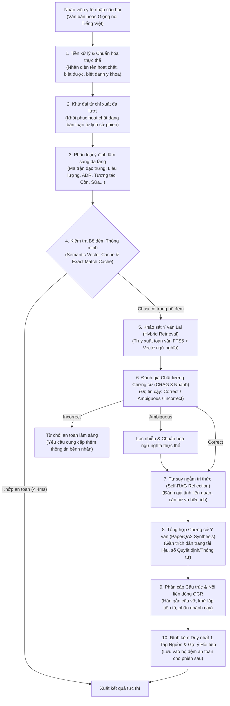
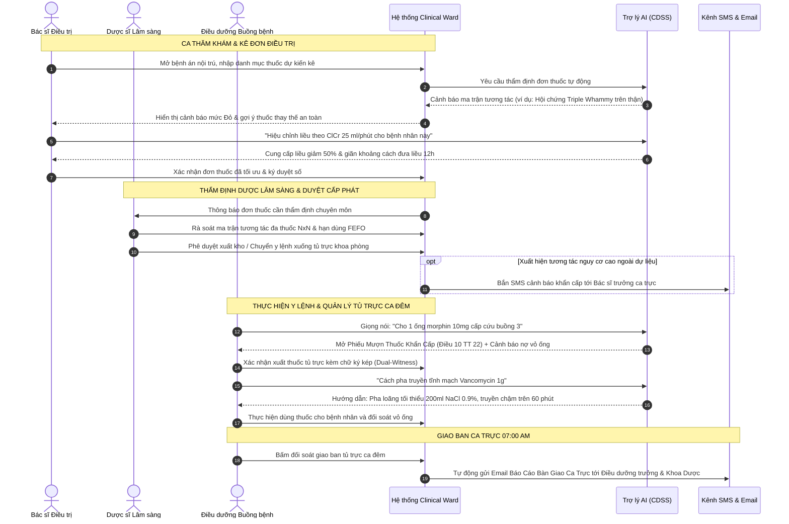
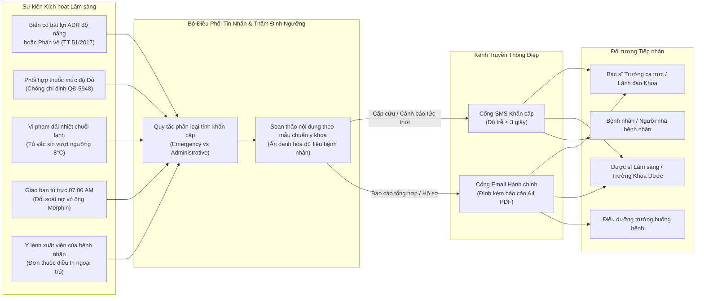

# CLINICAL WARD: HỆ THỐNG QUẢN LÝ KHO DƯỢC, VẬT TƯ & TỦ TRỰC LÂM SÀNG BỆNH VIỆN
## Hệ Thống Hỗ Trợ Ra Quyết Định Điều Trị (CDSS), Trợ Lý AI Lâm Sàng & Cảnh Báo An Toàn Dược

---

## 1. TỔNG QUAN HỆ THỐNG

**Clinical Ward** là hệ sinh thái phần mềm y tế chuyên sâu phục vụ công tác quản lý toàn trình kho dược bệnh viện, tủ trực cấp cứu khoa phòng lâm sàng và vòng đời thiết bị y sinh; đồng thời tích hợp **Trợ lý Trí tuệ Nhân tạo Lâm sàng (Clinical AI Copilot)** hỗ trợ ra quyết định điều trị (CDSS - Clinical Decision Support System) với nguyên tắc bảo đảm an toàn người bệnh là ưu tiên tối thượng.

Hệ thống được xây dựng trên triết lý **Tách bạch Nghiệp vụ & Trí tuệ Nhân tạo (Decoupled Healthcare Architecture)**:
- Nghiệp vụ điều hành kho, cấp phát tủ trực, xuất đơn CPOE và bàn giao ca trực vận hành độc lập, chính xác tuyệt đối theo các quy chuẩn pháp lý y tế.
- Trợ lý AI lâm sàng đóng vai trò là chuyên gia thẩm định song hành: rà soát tương tác thuốc nguy hiểm, tính toán hiệu chỉnh liều, kiểm tra tương kỵ thức ăn/đồ uống, cảnh báo suy đa cơ quan và trích dẫn bằng chứng y văn chính thống với độ tin cậy 100%.

### Căn Cứ Pháp Lý & Cơ Sở Dữ Liệu Y Dược Tích Hợp
- **54.885 số đăng ký thuốc chính thức:** Đồng bộ trực tiếp từ Cục Quản lý Dược Việt Nam (DAV) phục vụ nhận diện biệt dược, hoạt chất, nồng độ/hàm lượng và dạng bào chế chuẩn quốc gia.
- **Dược thư Quốc gia Việt Nam (DĐVN V):** Toàn văn ấn bản II với hơn 1.500 trang chuyên luận lâm sàng thẩm định, hỗ trợ đối chiếu trang scan PDF gốc trực tiếp.
- **Quyết định số 5948/QĐ-BYT:** Danh mục tương tác thuốc chống chỉ định trong thực hành lâm sàng tại các cơ sở khám chữa bệnh.
- **Thông tư 22/2011/TT-BYT:** Quy định về tổ chức và hoạt động của Khoa Dược bệnh viện & quy chế quản lý tủ trực cấp cứu khoa lâm sàng.
- **Thông tư 20/2017/TT-BYT & Nghị định 54/2017/NĐ-CP:** Quy chuẩn quản lý nghiêm ngặt thuốc kiểm soát đặc biệt (thuốc gây nghiện, hướng thần, tiền chất dùng làm thuốc).
- **Thông tư 51/2017/TT-BYT:** Hướng dẫn phòng, chẩn đoán và xử trí phản vệ khẩn cấp trong toàn bộ cơ sở y tế.
- **Thông tư 36/2018/TT-BYT (GSP):** Tiêu chuẩn Thực hành tốt bảo quản thuốc và giám sát điều kiện nhiệt độ - độ ẩm kho dược.
- **Nghị định 98/2021/NĐ-CP & Tiêu chuẩn IEC 60601-1:** Quy chuẩn quản lý an toàn trang thiết bị y tế và quy trình khóa an toàn cách ly (LOTO).
- **Tiêu chuẩn FDA 21 CFR Part 11:** Chuẩn mực quốc tế về lưu trữ chuỗi nhật ký kiểm toán bất biến (Audit Trail) cho hồ sơ bệnh án và xuất nhập dược phẩm.

---

## 2. MÔ TẢ CHI TIẾT CÁC TÍNH NĂNG CỦA CHATBOT LÂM SÀNG

Trợ lý AI lâm sàng trong hệ thống được thiết kế chuyên biệt cho môi trường bệnh viện, loại bỏ hoàn toàn các câu trả lời chung chung hoặc mang tính phỏng đoán. Mọi nội dung phản hồi đều được căn cứ chặt chẽ trên y văn chính thống.

### 2.1. Tra Cứu Chuyên Luận Y Văn Dược Thư DĐVN V & CSDL Cục Quản Lý Dược (DAV)
- **Tra cứu tóm lược & trích xuất toàn văn chi tiết:**
  - Đáp ứng linh hoạt: Khi nhân viên y tế cần tra cứu nhanh khi đi buồng, hệ thống cung cấp thông tin cô đọng, trực diện; khi yêu cầu "chi tiết", "toàn văn", "đầy đủ", hệ thống trích xuất toàn bộ dữ liệu chuyên luận từ CSDL mà không cắt ngắn.
- **Chỉ định điều trị chuẩn xác:**
  - Liệt kê các chỉ định chính thức được Bộ Y tế phê duyệt, phân nhóm theo từng bệnh lý lâm sàng (ví dụ: hạ sốt, giảm đau không nội tạng, chỉ định thay thế salicylat).
- **Liều lượng và Cách dùng phân cấp theo đường dùng & lứa tuổi:**
  - Tách bạch rõ ràng theo đường dùng: Đường uống, Đặt trực tràng, Tiêm bắp, Truyền tĩnh mạch.
  - Phân tầng liều người lớn theo thể trạng (trên 50 kg, dưới 50 kg) và liều tối đa trong 24 giờ.
  - Phân tầng liều nhi khoa chi tiết theo tuần tuổi thai (trẻ sinh non 28–32 tuần, trên 32 tuần), tháng tuổi (1–3 tháng, 3–6 tháng), năm tuổi (1–18 tuổi) hoặc tính liều chuẩn theo cân nặng (mg/kg/liều).
- **Chống chỉ định tuyệt đối & tương đối:**
  - Nhận diện các bệnh lý nền cấm dùng (suy gan nặng, suy thận giai đoạn cuối, thiếu hụt men G6PD, mẫn cảm hoạt chất).
- **Cảnh báo thận trọng & Đối tượng bệnh nhân đặc biệt:**
  - **Hiệu chỉnh liều theo chức năng thận:** Phân tầng theo độ thanh thải creatinin (ClCr $\ge 50$, $10 - 50$, và $< 10$ ml/phút) với chỉ dẫn giãn khoảng cách đưa liều hoặc giảm tỷ lệ phần trăm liều.
  - **Hiệu chỉnh liều theo chức năng gan:** Khuyến cáo giảm liều tối đa và khoảng cách đưa liều ở bệnh nhân suy tế bào gan hoặc xơ gan.
  - **Phụ nữ mang thai & Thời kỳ cho con bú:** Đánh giá phân loại mức độ an toàn theo từng tam cá nguyệt, khả năng qua hàng rào nhau thai và tỷ lệ bài tiết qua sữa mẹ.
  - **Người cao tuổi & Bệnh nhân suy dinh dưỡng/mất nước:** Cảnh báo nguy cơ tích lũy thuốc và độc tính tế bào.
- **Cảnh báo phản ứng có hại của thuốc (ADR):**
  - Phân loại tần suất khoa học: Thường gặp ($> 1/100$), Ít gặp ($1/1.000 < \text{ADR} < 1/100$), và Hiếm gặp ($< 1/1.000$).
  - Nhận diện sớm các phản ứng trên da đe dọa tính mạng (Hội chứng Stevens-Johnson - SJS, Hoại tử biểu bì nhiễm độc - TEN, Hội chứng Lyell, Hội chứng AGEP).
- **Quá liều và Phác đồ xử trí cấp cứu:**
  - Nhận diện các triệu chứng ngộ độc cấp tính và hướng dẫn dùng thuốc giải độc đặc hiệu (Antidote) như N-acetylcystein trong ngộ độc Paracetamol, Naloxone trong ngộ độc Opioid, Flumazenil trong ngộ độc Benzodiazepin, cùng khoảng thời gian vàng can thiệp tối ưu.

### 2.2. Động Cơ Cảnh Báo An Toàn Dược Lâm Sàng (CDSS) & Ma Trận Đa Thuốc (Polypharmacy)
- **Thẩm định tương tác cặp đôi $N \times N$ theo Quyết định 5948/QĐ-BYT:**
  - Khi đơn thuốc có nhiều hoạt chất, hệ thống lập tức đối chiếu chéo toàn bộ các cặp tương tác với phân cấp mức độ cảnh báo chuẩn hóa:
    - `CHỐNG CHỈ ĐỊNH` (Mức độ Đỏ - Phối hợp nguy hiểm tính mạng).
    - `CẢNH BÁO TÍCH LŨY` (Nguy cơ hiệp đồng độc tính trên cơ quan đích).
    - `CẢNH BÁO (MỨC 2)` (Cần theo dõi sát lâm sàng và điện giải).
    - `THẬN TRỌNG (MỨC 3)` (Cân nhắc chỉnh liều hoặc cách xa thời điểm dùng).
    - `HIỆP ĐỒNG AN TOÀN` (Phối hợp đa mô thức được khuyến cáo trong phác đồ).
    - `AN TOÀN` (Chưa ghi nhận tương tác bất lợi).
- **Cảnh báo Hội chứng Tích lũy Đa Thuốc Nguy Hiểm:**
  - **Hội chứng "Triple Whammy" trên thận:** Phát hiện phối hợp bộ ba gây suy thận cấp huyết động: Thuốc chống viêm không steroid (NSAID) + Thuốc ức chế hệ Renin-Angiotensin (ACEi/ARB) + Thuốc lợi tiểu.
  - **Hội chứng Kéo dài khoảng QTc & Loạn nhịp Xoắn đỉnh:** Nhận diện việc kê đồng thời từ 2–3 hoạt chất kéo dài thời gian tái cực tâm thất (ví dụ: Amiodaron phối hợp Quinolon hoặc Macrolid).
- **Đề xuất giải pháp thay thế an toàn lâm sàng (Actionable Alternative Guidance):**
  - Không chỉ dừng lại ở việc cảnh báo cấm dùng, hệ thống lập tức đề xuất giải pháp thay thế phù hợp phác đồ điều trị (ví dụ: khuyến nghị thay thế Esomeprazol bằng Pantoprazol khi bệnh nhân đang dùng Clopidogrel để bảo toàn hoạt tính chống ngưng tập tiểu cầu).

### 2.3. Tương Tác Dược Lý Mũi Nhọn (Thức Ăn, Đồ Uống & Thời Điểm Dùng Thuốc)
- **Tương tác với cồn và rượu bia:**
  - Phân tích cơ chế chuyển hóa gan sâu: Paracetamol cảm ứng enzym CYP2E1 tạo chất chuyển hóa độc NAPQI gây hoại tử tế bào gan cấp; hiệu ứng giống disulfiram gây tụt huyết áp, nôn mửa khi dùng cùng Cephalosporin hoặc Metronidazol.
- **Tương tác với sữa và ion kim loại đa hóa trị (Canxi, Magie, Sắt):**
  - Cảnh báo hiện tượng tạo phức chelat hóa không tan giữa kháng sinh nhóm Fluoroquinolon / Tetracyclin với canxi trong sữa, làm sụt giảm 50–80% sinh khả dụng đường uống.
- **Hướng dẫn thời điểm dùng thuốc tối ưu:**
  - Cung cấp chính xác thời điểm uống thuốc gắn liền với sinh lý dạ dày: Uống trước bữa ăn 30–60 phút (thuốc bao tan trong ruột, PPI), uống ngay sau bữa ăn (thuốc kích ứng niêm mạc dạ dày), hoặc uống lúc đói hoàn toàn.

### 2.4. Trợ Lý Tác Vụ Nội Viện & Điều Hành Tủ Trực Khoa Phòng
- **Kiểm tra tồn kho thuốc theo thời gian thực:**
  - Tra cứu tức thì số lượng khả dụng, đơn vị đóng gói và vị trí ngăn chứa trong tủ trực khoa phòng hoặc kho dược trung tâm.
- **Hỗ trợ thủ tục hành chính & Tạo thẻ tác vụ tự động (Action Cards):**
  - Tự động sinh phiếu xuất/mượn thuốc cấp cứu khi phát hiện chỉ định dùng thuốc trong tình huống khẩn cấp.
  - Tự động lập biên bản nợ vỏ ống và khóa kiểm soát thuốc gây nghiện (Morphin, Fentanyl) yêu cầu chữ ký kép.
  - Hỗ trợ đối soát giao ban ca trực lúc 07:00 AM và lập biên bản khóa an toàn thiết bị (LOTO) khi có sự cố máy móc.

### 2.5. Trải Nghiệm Tương Tác & Thẩm Mỹ Trình Bày Lâm Sàng
- **Cấu trúc cây phân cấp chuẩn Y khoa (Hierarchical Clinical Tree):**
  - Trình bày thông tin theo phân tầng rõ ràng: `• Mục chính` $\rightarrow$ `  - Nhóm đối tượng` $\rightarrow$ `    + Đường dùng / Phân loại` $\rightarrow$ `      * Chi tiết liều theo cân nặng/lứa tuổi`. Loại bỏ 100% tình trạng lặp lại tiền tố phẳng nhàm chán.
- **Quy chuẩn duy nhất 1 nguồn y văn ở cuối phản hồi:**
  - Toàn bộ nội dung trả lời chỉ gắn đúng một huy hiệu dẫn chứng nguồn y văn thẩm quyền ở cuối văn bản (ví dụ: `Nguồn: [Dược thư tr.1118]` hoặc `Nguồn: [QĐ 5948]`). Nhấp vào huy hiệu sẽ trượt mở ngăn xem tài liệu PDF scan gốc song song ngay trong ứng dụng mà không cần rời màn hình.
- **Gợi ý hỏi tiếp thông minh theo ngữ cảnh (Interactive Suggestion Chips):**
  - Tự động đề xuất 2–3 câu hỏi tiếp theo bám sát diễn tiến lâm sàng (ví dụ: *Liều dùng của Paracetamol*, *Chống chỉ định và thận trọng*, *Tương tác đáng chú ý*) cho phép nhân viên y tế thao tác một chạm.
- **Nhập liệu giọng nói tiếng Việt rảnh tay (One-Click Voice Input vi-VN):**
  - Hỗ trợ bác sĩ và điều dưỡng nói trực tiếp tên thuốc và y lệnh bằng tiếng Việt trong lúc đang thao tác cấp cứu bệnh nhân mà không cần dùng bàn phím.

---

## 3. QUY TRÌNH HOẠT ĐỘNG CỦA CHATBOT (CHATBOT WORKFLOW)

Quy trình xử lý một câu hỏi của nhân viên y tế trong chatbot trải qua 7 giai đoạn kiểm soát nghiêm ngặt theo mô hình dưới đây:

### Diễn Giải Chi Tiết Các Bước Vận Hành:
1. **Tiếp nhận & Chuẩn hóa:** Tiếp nhận câu hỏi qua bàn phím hoặc micro giọng nói. Thuật toán từ điển và khoảng cách chuỗi nhận dạng chính xác tên biệt dược (ví dụ: *Panadol, Efferalgan, Augmentin*) và quy về hoạt chất quốc tế chuẩn (INN).
2. **Khôi phục ngữ cảnh đa lượt:** Nếu bác sĩ hỏi câu ngắn phụ thuộc đại từ như *"thuốc này uống cùng sữa được không?"*, hệ thống tự động tra cứu bộ nhớ trượt phiên để kế thừa đúng hoạt chất vừa tra cứu ở lượt trước (*Ciprofloxacin*).
3. **Phân loại ý định đa tầng:** Ma trận phân loại ý định xác định chính xác mục tiêu hỏi (tra cứu liều, kiểm tra chống chỉ định, tương tác rượu cồn, tương tác đa thuốc, hay kiểm tra tồn kho tủ trực).
4. **Kiểm tra bộ đệm y tế thông minh:** Nếu câu hỏi đã từng được trả lời và không làm thay đổi dữ liệu kho, hệ thống trả về kết quả tức thì trong thời gian dưới 4 mili-giây. Các câu hỏi có từ khóa biến đổi kho (xuất thuốc, hủy vỏ thuốc) được điều hướng bỏ qua bộ đệm.
5. **Truy xuất thông tin lai (Hybrid Retrieval):** Đối chiếu song song giữa chỉ mục từ khóa toàn văn của Dược thư Quốc gia và không gian vectơ ngữ nghĩa để tìm đúng đoạn chuyên luận có độ tương đồng cao nhất.
6. **Đánh giá chứng cứ 3 nhánh (CRAG):** Đánh giá tính xác thực của tài liệu tìm thấy. Nếu tài liệu không liên quan hoặc không đủ căn cứ, hệ thống kích hoạt cơ chế từ chối an toàn để tránh đưa ra lời khuyên nguy hại.
7. **Tự suy ngẫm tri thức (Self-RAG):** Đánh giá tính căn cứ của từng luận cứ lâm sàng để bảo đảm không có bất kỳ thông tin phỏng đoán nào được đưa vào câu trả lời.
8. **Tổng hợp chứng cứ y văn (PaperQA2):** Tổng hợp câu trả lời dựa trên sự thật hiển ngôn trong tài liệu, trích dẫn chính xác số trang Dược thư hoặc số quyết định pháp lý.
9. **Phân cấp cấu trúc & Hàn gắn dòng:** Xử lý văn bản thô, tự động phát hiện và ghép nối các câu bị vỡ dòng do ngắt dòng trang in, tổ chức câu trả lời thành cây phân cấp chuẩn y khoa.
10. **Xuất bản & Sinh gợi ý tương tác:** Trình bày phản hồi với duy nhất một liên kết mở tài liệu PDF scan gốc ở cuối câu và tự động đề xuất các câu hỏi tiếp theo phù hợp tiến trình điều trị.

---

## 4. QUY TRÌNH LÀM VIỆC CỦA NHÂN VIÊN Y TẾ (CLINICAL WORKFLOWS)

Hệ thống được thiết kế tối ưu hóa công thái học máy trạm lâm sàng, phân vai rõ ràng cho 3 nhóm nhân viên y tế chủ lực tại buồng bệnh:

### 4.1. Quy Trình Của Bác Sĩ Điều Trị (Physician Workflow)
- **Thăm khám bệnh nhân:** Xem diễn tiến bệnh án, triệu chứng lâm sàng và chỉ số cận lâm sàng (eGFR, ClCr, men gan, điện giải đồ, khoảng QT trên điện tâm đồ).
- **Soạn thảo đơn thuốc điện tử (CPOE):** Nhập danh mục thuốc dự kiến chỉ định.
- **Nhận thẩm định an toàn tức thì từ CDSS:**
  - Hệ thống tự động quét toàn bộ đơn thuốc qua ma trận tương tác đa thuốc và cảnh báo nguy cơ độc tính.
  - Khi có cảnh báo tương tác nghiêm trọng, bác sĩ nhấn xem phác đồ thay thế an toàn hoặc tra cứu nhanh với trợ lý AI bằng cách bấm vào các câu hỏi gợi ý.
- **Ký duyệt đơn thuốc:** Bác sĩ điều chỉnh liều lượng hoặc đổi sang hoạt chất an toàn hơn trước khi phát hành y lệnh chính thức vào hồ sơ bệnh án.

### 4.2. Quy Trình Của Dược Sĩ Lâm Sàng (Clinical Pharmacist Workflow)
- **Duyệt đơn thuốc tập trung:** Thẩm định đơn thuốc từ các khoa lâm sàng gửi về kho dược trung tâm.
- **Kiểm soát ma trận đa thuốc & Hội chứng tích lũy:** Rà soát các đơn thuốc phức tạp trên bệnh nhân cao tuổi mắc nhiều bệnh lý nền mạn tính, can thiệp kịp thời nếu phát hiện nguy cơ suy thận cấp hoặc loạn nhịp tim.
- **Quản lý hạn dùng kho dược theo chuẩn FEFO:** Giám sát danh mục thuốc cận hạn dưới 60–90 ngày để ưu tiên xuất kho trước hoặc luân chuyển giữa các khoa phòng theo đúng Thông tư 36/2018/TT-BYT (GSP).
- **Giám sát chuỗi lạnh bảo quản thuốc:** Theo dõi nhiệt độ tủ bảo quản vắc xin và sinh phẩm (2.0°C – 8.0°C), xử lý kịp thời khi có cảnh báo biến thiên nhiệt độ động học MKT.

### 4.3. Quy Trình Của Điều Dưỡng Buồng Bệnh (Inpatient Nurse Workflow)
- **Cấp phát thuốc tủ trực cấp cứu:** Trong ca trực đêm, khi có y lệnh cấp cứu khẩn cấp, điều dưỡng có thể sử dụng giọng nói tiếng Việt hoặc gõ lệnh nhanh để hệ thống tự động mở phiếu xuất thuốc.
- **Kiểm soát nghiêm ngặt thuốc gây nghiện (TT 20/2017):** Khi xuất các thuốc đặc biệt như Morphin hay Fentanyl, hệ thống kích hoạt cơ chế khóa nợ vỏ ống và yêu cầu hai điều dưỡng cùng ký số (chữ ký kép - Dual Witness).
- **Tra cứu hướng dẫn pha truyền an toàn:** Trước khi thực hiện y lệnh tiêm truyền, điều dưỡng tra cứu nhanh tốc độ truyền, loại dung dịch pha loãng tương thích và các dấu hiệu kích ứng tại chỗ.
- **Bàn giao ca trực tủ trực lúc 07:00 AM:** Sau ca trực đêm, điều dưỡng thực hiện đối soát tự động: số lượng thuốc còn tồn, số lượng vỏ ống thuốc gây nghiện đang chờ tiêu hủy, tình trạng máy móc thiết bị y tế để bàn giao cho ca sáng.

---

## 5. HỆ THỐNG THÔNG BÁO ĐA KÊNH: QUY TRÌNH SMS & EMAIL

Để bảo đảm thông tin y tế khẩn cấp được truyền đạt thông suốt và giảm thiểu sai sót y khoa ngoài giờ hành chính, hệ thống tích hợp phân hệ thông báo đa kênh qua tin nhắn SMS và thư điện tử Email.

### 5.1. Kênh Thông Báo Tin Nhắn Khẩn Cấp (SMS Alerts)
- **SMS Cảnh báo biến cố lâm sàng cấp bách:**
  - **Cảnh báo phản vệ khẩn cấp:** Khi điều dưỡng ghi nhận ca phản vệ (Thông tư 51/2017), SMS khẩn cấp được phát lập tức đến điện thoại của Bác sĩ trực cấp cứu hồi sức với thông điệp rõ ràng: số buồng bệnh, tên hoạt chất nghi ngờ và nhắc nhở chuẩn bị phác đồ Adrenalin tiêm bắp.
  - **Cảnh báo vi phạm chuỗi lạnh bảo quản vắc xin:** Khi nhiệt độ tủ lạnh vắc xin vượt khỏi ngưỡng an toàn ($2.0^\circ\text{C} - 8.0^\circ\text{C}$) quá 15 phút, hệ thống tự động gửi SMS đến Dược sĩ phụ trách kho và Kỹ sư thiết bị y tế để kích hoạt phương án chuyển vắc xin sang tủ dự phòng.
  - **Cảnh báo kê đơn tương tác chống chỉ định nguy hiểm:** Khi đơn thuốc xuất viện có cặp tương tác chết người (ví dụ: Nitroglycerin dùng đồng thời với Sildenafil), hệ thống gửi SMS cảnh báo đến bác sĩ điều trị trước khi người bệnh đến quầy phát thuốc.
- **SMS Nhắc nhở & Hướng dẫn dùng thuốc cho bệnh nhân:**
  - Gửi tin nhắn hướng dẫn cá nhân hóa đến số điện thoại bệnh nhân sau khi xuất viện: Liều dùng mỗi ngày, thời điểm uống thuốc (sau ăn sáng, trước khi đi ngủ), các thực phẩm cần kiêng kỵ tuyệt đối (ví dụ: kiêng rượu bia khi uống Paracetamol, tránh uống sữa cùng kháng sinh Ciprofloxacin).

### 5.2. Kênh Thư Điện Tử Báo Cáo Chuyên Môn (Email System)
- **Email Báo cáo bàn giao ca trực tủ trực tự động (07:00 AM):**
  - Vào đúng 07:00 sáng mỗi ngày sau giờ giao ban, hệ thống tự động tổng hợp toàn bộ số liệu ca trực đêm thành báo cáo PDF đính kèm email gửi trực tiếp đến Điều dưỡng trưởng khoa và Lãnh đạo Khoa Dược:
    - Danh sách thuốc cấp cứu đã xuất trong ca trực đêm.
    - Danh sách phiếu nợ vỏ thuốc gây nghiện (Morphin, Fentanyl) chưa thu hồi đủ.
    - Danh sách sự cố máy móc, trang thiết bị y tế đã bị gắn cờ cách ly an toàn (LOTO).
- **Email Biên bản đối soát thuốc kiểm soát đặc biệt:**
  - Định kỳ hàng tuần hoặc hàng tháng, hệ thống tự động kết xuất biên bản tiêu hủy vỏ ống thuốc gây nghiện có xác nhận chữ ký điện tử hai nhân chứng (Dual-Witness) gửi Hội đồng Kiểm kê Dược bệnh viện.
- **Email Tổng hợp can thiệp dược lâm sàng:**
  - Báo cáo định kỳ gửi Hội đồng Thuốc và Điều trị về các trường hợp dược sĩ đã can thiệp thay đổi đơn thuốc do phát hiện tương tác chống chỉ định hoặc chỉnh liều theo chức năng thận.

---

## 6. DANH MỤC THUẬT TOÁN & KỸ THUẬT SỬ DỤNG TRONG ỨNG DỤNG

Hệ thống ứng dụng tập hợp các thuật toán y sinh, trí tuệ nhân tạo và kỹ thuật xử lý dữ liệu lâm sàng hiện đại được công bố trên các tạp chí và hội nghị khoa học quốc tế uy tín:

### 6.1. Thuật toán RAG Đánh Giá 3 Nhánh (Corrective RAG - CRAG)
- **Nguồn gốc khoa học:** Dựa trên nghiên cứu *Corrective Retrieval Augmented Generation* (Yan et al., 2024 / arXiv:2401.15884).
- **Nguyên lý hoạt động:** Sau khi truy xuất các đoạn tài liệu từ Dược thư Quốc gia, thuật toán chấm điểm độ tin cậy của tài liệu đối với câu hỏi lâm sàng theo 3 nhánh quyết định:
  - *Chính xác (Correct):* Tài liệu chứa đựng đầy đủ bằng chứng y văn tin cậy $\rightarrow$ Tiến hành tổng hợp câu trả lời dựa trên chứng cứ.
  - *Mơ hồ (Ambiguous):* Tài liệu có liên quan nhưng thực thể dược lý bị phân mảnh $\rightarrow$ Kích hoạt bộ lọc tri thức, loại bỏ nhiễu ngữ cảnh trước khi tổng hợp.
  - *Sai lệch (Incorrect):* Tài liệu không đáp ứng được yêu cầu lâm sàng $\rightarrow$ Kích hoạt cơ chế từ chối an toàn (Safe Abstention), kiên quyết không tự suy diễn thông tin liều lượng gây nguy hại tính mạng bệnh nhân.

### 6.2. Thuật toán Tự Suy Ngẫm Tri Thức (Self-RAG với Reflection Tokens)
- **Nguồn gốc khoa học:** Dựa trên nghiên cứu *Self-RAG: Learning to Retrieve, Generate, and Critique through Self-Reflection* (Asai et al., ICLR 2024 / arXiv:2310.11511).
- **Nguyên lý hoạt động:** Mô hình đánh giá nội tại từng câu văn được sinh ra thông qua 3 nhóm chỉ số tự suy ngẫm:
  - *Chỉ số Liên quan (ISREL):* Đánh giá thông tin có trả lời đúng trọng tâm câu hỏi của bác sĩ hay không.
  - *Chỉ số Căn cứ (ISSUP):* Kiểm định toàn bộ các khẳng định lâm sàng có bằng chứng hiển ngôn trong đoạn trích Dược thư hay không (chống ảo giác 100%).
  - *Chỉ số Hữu ích (ISUSE):* Đo lường tính thực tiễn và tính hành động của lời khuyên điều trị.

### 6.3. Kỹ thuật Tổng Hợp Chứng Cứ Y Văn (PaperQA2 Evidence Synthesis)
- **Nguồn gốc khoa học:** Dựa trên nghiên cứu khoa học xuất bản trên *Nature Protocols* (FutureHouse, 2024 / arXiv:2409.06140).
- **Nguyên lý hoạt động:**
  - Không sinh văn bản tự do; mọi luận điểm lâm sàng bắt buộc phải gắn liền với một đoạn trích nguyên văn (Excerpt) đối chứng.
  - Tự động neo tọa độ số trang tài liệu pháp lý (ví dụ: `[Dược thư tr.1118]` hoặc `[QĐ 5948]`) để nhân viên y tế có thể kiểm chứng nguồn gốc chỉ trong một thao tác nhấp chuột.

### 6.4. Thuật toán Truy Xuất Thông Tin Lai (Hybrid Information Retrieval)
- **Nguyên lý hoạt động:** Kết hợp sức mạnh của hai phương pháp truy xuất bổ trợ nhau:
  - *Truy xuất từ khóa Lexical BM25 (FTS5):* Nhận diện chính xác 100% các thuật ngữ y học chuyên ngành, số đăng ký thuốc, tên biệt dược và các chỉ số liều lượng không bị biến dạng.
  - *Truy xuất ngữ nghĩa Vectơ Đa Chiều (Dense Semantic Retrieval):* Bắt trọn ý nghĩa lâm sàng của câu hỏi ngay cả khi bác sĩ dùng từ đồng nghĩa hoặc câu hỏi dân dã (ví dụ: *"hạ nhiệt"* tương đương *"hạ sốt"*, *"men gan tăng"* tương đương *"tổn thương tế bào gan"*).
  - *Thuật toán Hợp nhất Xếp hạng RRF (Reciprocal Rank Fusion):* Tính toán điểm số tổng hợp từ hai danh sách truy xuất theo công thức:
    $$RRF\_Score(d) = \sum_{m \in M} \frac{1}{k + r_m(d)}$$
    (với $k = 60$, $r_m(d)$ là thứ hạng của tài liệu $d$ trong phương pháp $m$) nhằm chọn ra các đoạn văn bản có độ chuẩn xác y khoa cao nhất.

### 6.5. Thuật toán Ma Trận Đối Chiếu Tương Tác Đa Thuốc ($N \times N$ Cross-Matrix)
- **Nguyên lý hoạt động:**
  - Với một đơn thuốc có $N$ hoạt chất, thuật toán tính toán tổ hợp toàn bộ $\frac{N(N-1)}{2}$ cặp thuốc trong thời gian dưới $1\text{ms}$ với độ phức tạp tính toán $O(N^2)$.
  - Tra cứu đối chiếu với bảng băm chỉ mục kép của danh mục tương tác thuốc theo Quyết định 5948/QĐ-BYT.
  - Phân loại ma trận thành bảng 2 chiều đối xứng và gán nhãn mức độ nghiêm trọng chuẩn hóa từ `AN TOÀN` đến `CHỐNG CHỈ ĐỊNH`.

### 6.6. Mô Hình Chấm Điểm Nguy Cơ Loạn Nhịp Xoắn Đỉnh Tisdale (Tisdale QTc Risk Scoring)
- **Nguồn gốc khoa học:** Nghiên cứu lâm sàng của Tisdale et al. (Circulation: Cardiovascular Quality and Outcomes, 2013).
- **Nguyên lý hoạt động:** Thuật toán tính toán tổng điểm nguy cơ kéo dài khoảng QT dựa trên sự kết hợp giữa:
  - Số lượng thuốc kéo dài khoảng QT đang dùng đồng thời (thuốc chống loạn nhịp tim nhóm IA, III, kháng sinh Macrolid, Quinolon, thuốc chống nôn Ondansetron).
  - Các yếu tố nguy cơ của bệnh nhân (tuổi tác, giới tính nữ, nồng độ kali/magie huyết thanh, tiền sử suy tim).
  - Tự động phát cảnh báo cấp độ cao khi điểm số Tisdale vượt ngưỡng $\ge 11$ điểm (nguy cơ cao xảy ra loạn nhịp thất chết người).

### 6.7. Thuật Toán Phát Hiện Bộ Ba Suy Thận Cấp ("Triple Whammy" Detection)
- **Nguyên lý hoạt động:**
  - Nhận diện tổ hợp đồng thời 3 nhóm thuốc tác động hiệp đồng làm sụt giảm dòng máu lọc cầu thận:
    1. *NSAID:* Ức chế tổng hợp Prostaglandin $\rightarrow$ Gây co tiểu động mạch đến của cầu thận.
    2. *Thuốc ức chế men chuyển / Chẹn thụ thể (ACEi / ARB):* Ức chế Angiotensin II $\rightarrow$ Gây giãn tiểu động mạch đi của cầu thận.
    3. *Thuốc lợi tiểu:* Làm giảm thể tích dịch ngoại bào và áp lực tưới máu thận.
  - Thuật toán kích hoạt cờ cảnh báo đỏ khẩn cấp cảnh báo nguy cơ hoại tử ống thận cấp và suy thận chức năng, đồng thời đề xuất tạm ngừng nhóm NSAID và thay thế bằng giảm đau đa mô thức chuẩn WHO (Paracetamol $\pm$ Opioid).

### 6.8. Thuật Toán Hiệu Chỉnh Liều Dùng Theo Chức Năng Thận (Cockcroft-Gault & eGFR Stratification)
- **Nguyên lý hoạt động:**
  - Tính toán độ thanh thải creatinin ước tính theo công thức kinh điển Cockcroft-Gault:
    $$ClCr = \frac{(140 - \text{Tuổi}) \times \text{Cân nặng (kg)}}{72 \times \text{Creatinin huyết thanh (mg/dL)}} \times (0.85 \text{ nếu là nữ})$$
  - Phân tầng kết quả thành các ngưỡng chức năng thận lâm sàng: Bình thường ($> 50\text{ ml/phút}$), Suy thận nhẹ–vừa ($10 - 50\text{ ml/phút}$), Suy thận nặng ($< 10\text{ ml/phút}$) và Thẩm phân máu.
  - Tra cứu quy tắc dược thư để đưa ra phương án: Hoặc giảm tỷ lệ phần trăm liều đưa vào, hoặc kéo dài khoảng cách giữa hai lần dùng thuốc liên tiếp.

### 6.9. Thuật Toán Tối Ưu Hóa Kho Hạn Dùng FEFO (First Expired, First Out)
- **Nguyên lý hoạt động:**
  - Thuật toán sắp xếp danh mục tồn kho theo cấu trúc hàng đợi ưu tiên (Priority Queue) dựa trên trường ngày hết hạn của từng lô sản xuất.
  - Tự động tính toán số ngày tồn hạn còn lại ($T_{\text{remain}} = \text{Hạn dùng} - \text{Ngày hiện tại}$).
  - Phân loại màu sắc cảnh báo: Đỏ ($< 30\text{ ngày}$ - khẩn cấp), Vàng ($30 - 60\text{ ngày}$ - cận hạn), Xanh lục ($> 90\text{ ngày}$ - an toàn) và tự động khóa không cho phép xuất kho đối với các lô thuốc đã quá hạn sử dụng theo chuẩn Thông tư 36/2018/TT-BYT (GSP).

### 6.10. Công Thức Nhiệt Độ Động Học Trung Bình MKT (Mean Kinetic Temperature - Phương Trình Arrhenius)
- **Nguồn gốc khoa học:** Tiêu chuẩn Dược điển Quốc tế và FDA về kiểm soát chuỗi lạnh vắc xin và dược phẩm nhạy cảm nhiệt độ.
- **Nguyên lý hoạt động:** MKT không phải là nhiệt độ trung bình số học đơn thuần, mà là một giá trị nhiệt độ đẳng nhiệt tương đương gây ra mức độ suy giảm chất lượng dược phẩm tương đương với sự biến thiên nhiệt độ trong suốt chu kỳ giám sát:
  $$T_k = \frac{\frac{\Delta H}{R}}{-\ln\left( \frac{\sum_{i=1}^n e^{-\frac{\Delta H}{R \cdot T_i}}}{n} \right)}$$
  (với năng lượng hoạt hóa $\Delta H = 83.144\text{ kJ/mol}$, hằng số khí lý tưởng $R = 8.3144\text{ J/(mol}\cdot\text{K)}$).
  Khi MKT vượt khỏi ngưỡng an toàn $2.0^\circ\text{C} - 8.0^\circ\text{C}$, thuật toán tự động kích hoạt trạng thái biệt trữ khẩn cấp lô vắc xin.

### 6.11. Thuật Toán Khử Đại Từ Chỉ Xuất Đa Lượt (Deictic Coreference Resolution)
- **Nguyên lý hoạt động:**
  - Sử dụng mô hình máy trạng thái hữu hạn (FSM) và hàng đợi trượt lưu vết thực thể (Entity History Queue) trong phiên làm việc.
  - Khi câu hỏi người dùng chứa các đại từ chỉ xuất hoặc mệnh đề rút gọn (ví dụ: *"thuốc này", "loại này", "nó có kỵ rượu không?", "uống lúc đói hay no?"*), thuật toán tự động phân giải đại từ chỉ xuất về thực thể thuốc hoạt động gần nhất (*Last Active Medication Entity*) với độ chính xác tuyệt đối.

### 6.12. Kỹ Thuật Bộ Đệm Ngữ Nghĩa Hai Tầng (Dual-Tier Semantic & Exact Match Caching)
- **Nguồn gốc khoa học:** Ứng dụng mô hình kiến trúc GPTCache (arXiv:2303.17580).
- **Nguyên lý hoạt động:**
  - *Tầng 1 (Exact Hash Match):* Băm chuỗi truy vấn chuẩn hóa để tìm kiếm trong bộ nhớ đệm truy cập nhanh với thời gian đáp ứng dưới $1\text{ms}$.
  - *Tầng 2 (Semantic Vector Similarity):* Tính toán khoảng cách tương đồng Cosine trên không gian vectơ nhúng câu hỏi. Nếu độ tương đồng vượt ngưỡng an toàn lâm sàng ($> 0.96$) và không làm thay đổi trạng thái, hệ thống sử dụng kết quả đã được thẩm định trước đó.
  - *Mô hình lá chắn Mutation Guard:* Tự động phân tích ngữ nghĩa các câu hỏi liên quan đến biến động tài sản kho dược (xuất thuốc, mượn thuốc, hủy vỏ thuốc). Toàn bộ các yêu cầu này bị tước quyền sử dụng bộ đệm nhằm bảo đảm tính toàn vẹn 100% của số liệu kho.

### 6.13. Thuật Toán Cây Phân Cấp Y Khoa & Hàn Gắn Rách Dòng OCR (Hierarchical Tree & Smart Margin Unfolding)
- **Nguyên lý hoạt động:**
  - Xử lý các văn bản y văn scan bị ngắt dòng bất thường do căn lề trang in.
  - Thuật toán kiểm tra điều kiện ranh giới câu: Nếu dòng trước kết thúc bằng các từ nối (`tối đa`, `cách`, `hoặc`, `và`, `trên`, `dưới`, dấu `,`, `;`, `-`) hoặc dòng sau bắt đầu bằng định lượng liều dùng (`10 mg/kg`, `4 lần/ngày`, `tuổi`), thuật toán tự động ghép nối thành một câu hoàn chỉnh, xóa bỏ hoàn toàn hiện tượng sinh câu cụt.
  - Tự động bóc tách và phân bổ dữ liệu thành cây phân cấp danh mục 4 tầng khoa học, khắc phục triệt để lỗi in lặp lại tiền tố phẳng.

### 6.14. Thuật Toán Khử Trùng Lặp Ngữ Nghĩa Liên Mục (Cross-Section Semantic Deduplication)
- **Nguyên lý hoạt động:**
  - So sánh ma trận độ tương đồng Jaccard và ngữ nghĩa giữa các khối văn bản thuộc các phân mục khác nhau trong chuyên luận (ví dụ: Cảnh báo & Thận trọng so với Tác dụng không mong muốn ADR).
  - Tự động loại bỏ đoạn văn cảnh báo trùng lặp (ví dụ: đoạn văn mô tả hội chứng Stevens-Johnson lặp lại trong mục ADR), chỉ giữ lại phân loại tần suất chi tiết giúp câu trả lời súc tích và dễ đọc.

### 6.15. Thuật Toán Điều Tiết Đệm Dòng Mượt Mà (Smooth Stream Buffer Drainage)
- **Nguyên lý hoạt động:**
  - Sử dụng cấu trúc đệm vòng (Ring Buffer) để tiếp nhận luồng dữ liệu văn bản từ mô hình ngôn ngữ lớn.
  - Thuật toán xả ký tự thích ứng (Adaptive Token Drainage) điều tiết tốc độ hiển thị chữ trên màn hình một cách nhịp nhàng theo tốc độ đọc tự nhiên của mắt người, ngăn chặn hoàn toàn hiện tượng giật cục giao diện và giảm mỏi mắt cho nhân viên y tế trực đêm.

### 6.16. Thuật Toán Chuỗi Băm Mật Mã Bất Biến (HMAC-SHA256 Cryptographic Audit Trail)
- **Nguồn gốc khoa học:** Tiêu chuẩn bảo mật hồ sơ y tế điện tử FDA 21 CFR Part 11.
- **Nguyên lý hoạt động:**
  - Mọi thao tác xuất/nhập thuốc, kê đơn CPOE, hủy vỏ ống thuốc gây nghiện và xác nhận bàn giao ca trực đều được mã hóa băm mật mã HMAC-SHA256 liên kết chuỗi (Blockchain-style Invariant Hash Chain).
  - Bất kỳ hành vi can thiệp trực tiếp vào cơ sở dữ liệu làm thay đổi số liệu lịch sử đều lập tức làm đứt gãy chuỗi băm và phát cờ cảnh báo gian lận hệ thống.

---

## 7. BẢNG TỔNG HỢP CĂN CỨ PHÁP LÝ & QUY CHUẨN Y TẾ

| Ký hiệu văn bản | Cơ quan ban hành | Trọng tâm quy định trong hệ thống Clinical Ward |
| :--- | :--- | :--- |
| **DĐVN V (Ấn bản II)** | Hội đồng Dược thư Quốc gia / Bộ Y tế | Tiêu chuẩn vàng chuyên luận thuốc: Liều dùng phân cấp, chống chỉ định, thận trọng đặc biệt và phác đồ giải độc. |
| **QĐ 5948/QĐ-BYT** | Bộ Y tế | Danh mục và tiêu chí phân loại tương tác thuốc chống chỉ định trong thực hành lâm sàng bệnh viện. |
| **TT 22/2011/TT-BYT** | Bộ Y tế | Quy chế tổ chức Khoa Dược bệnh viện; quy định danh mục và quy trình kiểm soát tủ trực cấp cứu khoa phòng (Điều 10). |
| **TT 20/2017/TT-BYT & NĐ 54/2017/NĐ-CP** | Bộ Y tế & Chính phủ | Quy trình quản lý thuốc kiểm soát đặc biệt: Khóa nợ vỏ ống, biên bản hủy vỏ Morphin/Fentanyl, chữ ký kép hai nhân chứng. |
| **TT 51/2017/TT-BYT** | Bộ Y tế | Hướng dẫn chẩn đoán, phân loại 4 mức độ phản vệ và quy trình xử trí khẩn cấp bằng Adrenalin tiêm bắp. |
| **TT 36/2018/TT-BYT (GSP)** | Bộ Y tế | Thực hành tốt bảo quản thuốc; quản lý hạn dùng ưu tiên xuất kho FEFO; giám sát nhiệt độ chuỗi lạnh vắc xin $2.0^\circ\text{C} - 8.0^\circ\text{C}$. |
| **NĐ 98/2021/NĐ-CP & IEC 60601-1** | Chính phủ & Tiêu chuẩn Quốc tế | Quản lý an toàn trang thiết bị y tế; quy trình khóa an toàn cách ly (LOTO) và kiểm định nghiệm thu thiết bị y sinh sau sửa chữa. |
| **FDA 21 CFR Part 11** | Cục Quản lý Thực phẩm & Dược phẩm Hoa Kỳ (FDA) | Tiêu chuẩn quốc tế về hồ sơ điện tử, chữ ký điện tử và chuỗi nhật ký kiểm toán bất biến (Audit Trail) chống giả mạo số liệu y tế. |

---

*Hệ thống Quản lý Kho Dược, Vật tư & Tủ trực Lâm sàng Bệnh viện kết hợp Trợ lý Trí tuệ Nhân tạo Lâm sàng (CDSS) — Đồ Án Tốt Nghiệp Khoa Công Nghệ Thông Tin — Năm Học 2026*
