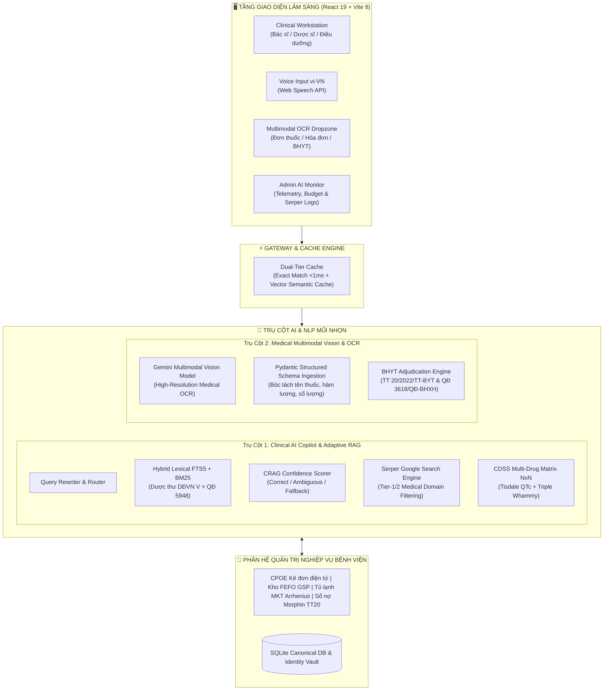
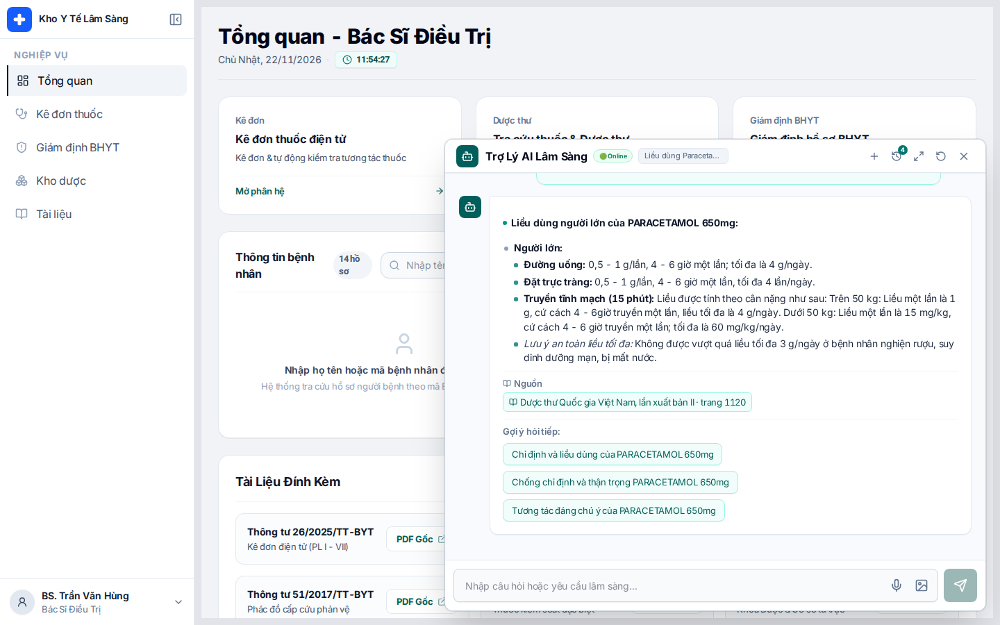
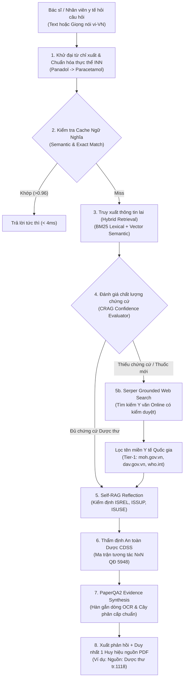
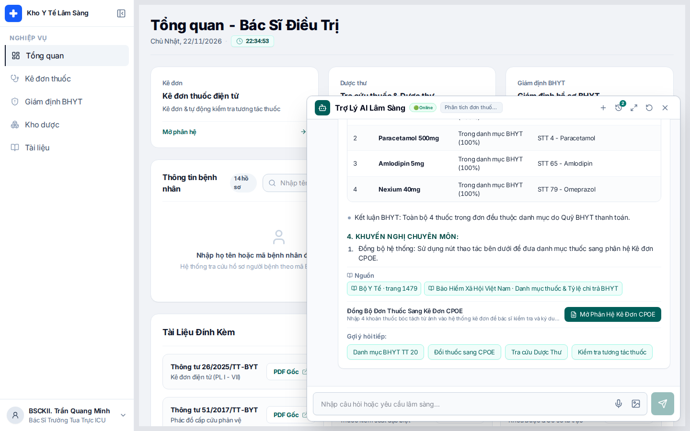
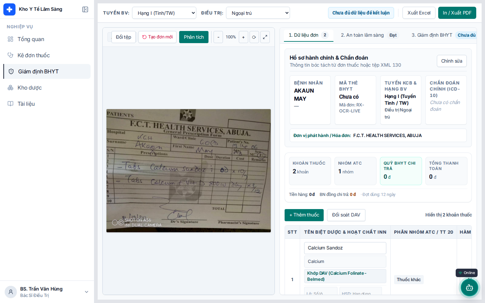
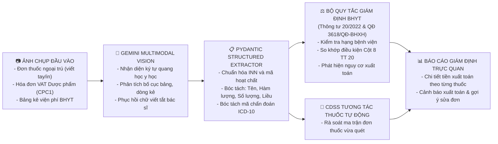
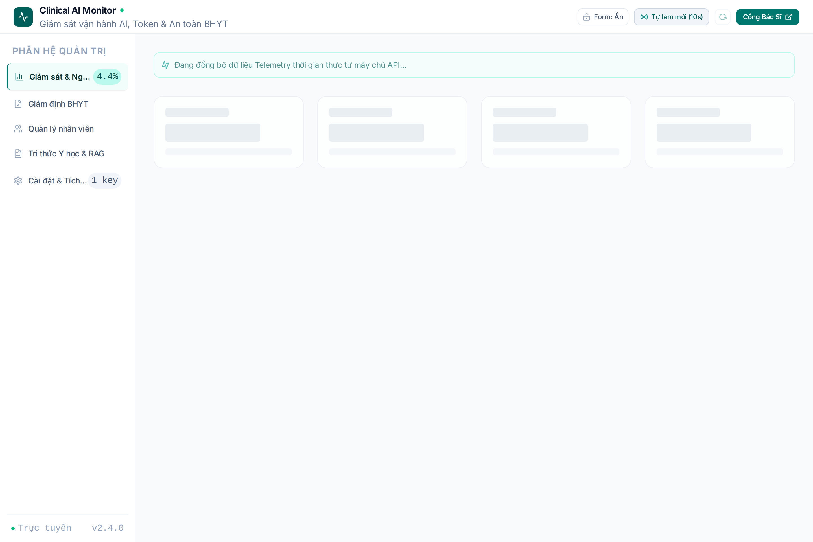

# 🏥 CLINICAL WARD — AI COPILOT & MULTIMODAL VISION SYSTEM
### Hệ Thống Trợ Lý AI Lâm Sàng (CDSS), Adaptive RAG & Bóc Tách Thị Giác Máy Tính (Vision OCR) Y Tế

<p align="center">
  <a href="https://clinical-ward.vercel.app"></a>
  <a href="https://clinical-ai-monitor.vercel.app"></a>
  <a href="https://clinical-ward-api.onrender.com/docs"></a>
  
  
  
</p>

---

## 📌 1. TỔNG QUAN KIẾN TRÚC HỆ THỐNG

**Clinical Ward** là hệ sinh thái phần mềm y tế thông minh xây dựng theo triết lý **Tách bạch Nghiệp vụ & Trí tuệ Nhân tạo (Decoupled Healthcare Architecture)**. Hệ thống kết hợp giữa **Nghiệp vụ Y tế chuẩn tắc** (Kê đơn CPOE, Quản lý kho FEFO, Giám sát vắc xin MKT) và **Động cơ Trí tuệ Nhân tạo Mũi nhọn** tập trung vào 2 trụ cột cốt lõi:
1. **Clinical AI Copilot (Adaptive CRAG & CDSS):** Trợ lý hỗ trợ ra quyết định điều trị, tra cứu chuyên luận y văn Dược thư Quốc gia, thẩm định tương tác thuốc đa tầng và tự động fallback tìm kiếm web y khoa có kiểm chứng.
2. **Multimodal Medical Vision (OCR & Schema Extractor):** Thị giác máy tính nhận dạng và bóc tách đơn thuốc viết tay, hóa đơn VAT dược phẩm, liên thông tự động với bộ quy tắc giám định xuất toán BHYT.



---

## 🌟 2. TRỤ CỘT 1 — TRỢ LÝ AI LÂM SÀNG & ADAPTIVE CRAG ENGINE

Trợ lý AI lâm sàng trong hệ thống hoạt động như một chuyên gia dược lâm sàng song hành, loại bỏ 100% hiện tượng câu trả lời chung chung hoặc phỏng đoán cảm tính.



### 2.1. Quy Trình Vận Hành Adaptive Corrective RAG (CRAG) & Web Search Fallback
Hệ thống sử dụng cơ chế **Adaptive Corrective RAG (CRAG)** kết hợp kiểm định bằng chứng y văn đa tầng:



### 2.2. Điểm Khác Biệt Kỹ Thuật Đột Phá
1. **Tra cứu chuyên luận sâu Dược thư Quốc gia (DĐVN V):**
   - Phân cấp liều dùng chi tiết theo đường dùng (*uống, tiêm bắp, truyền tĩnh mạch, đặt trực tràng*) và lứa tuổi (*trẻ sơ sinh, tuần thai, nhi khoa theo kg, người lớn, người cao tuổi*).
   - Tự động phát hiện và xử lý ngộ độc cấp tính, gợi ý thuốc giải độc đặc hiệu (*Antidote*) kèm khung giờ vàng can thiệp.
2. **Cơ chế Fallback Tìm kiếm Y khoa Trực tuyến (Grounded Web Search):**
   - Khi gặp câu hỏi về các phác đồ mới, thuốc thế hệ mới hoặc câu hỏi ngoài phạm vi Dược thư, hệ thống tự động kích hoạt **Serper Google Search Engine**.
   - Áp dụng bộ lọc xếp hạng nguồn tin 3 cấp:
     - **Tier 1 (Độ tin cậy tối cao):** Cổng thông tin Bộ Y tế (`moh.gov.vn`), Cục Quản lý Dược (`dav.gov.vn`), Dược thư Anh/Mỹ (`nice.org.uk`, `accessdata.fda.gov`), WHO (`who.int`).
     - **Tier 2 (Tổ chức Y khoa / Đại học):** PubMed, NCBI, UpToDate, Bệnh viện Bạch Mai, Chợ Rẫy, Vinmec, Medscape.
     - **Tier 3 (Loại bỏ / Hạ thứ hạng):** Báo điện tử tổng hợp, blog cá nhân không có bình duyệt y khoa.
3. **Động cơ Cảnh báo An toàn Dược (CDSS) & Ma trận Đa thuốc:**
   - **Thẩm định tương tác $N \times N$:** Tính toán tổ hợp $\frac{N(N-1)}{2}$ cặp thuốc tức thì (< 1ms) theo Quyết định 5948/QĐ-BYT.
   - **Cảnh báo Hội chứng "Triple Whammy":** Phát hiện phối hợp bộ ba gây suy thận cấp huyết động: `NSAID` + `ACEi/ARB` + `Lợi tiểu`.
   - **Thang điểm Tisdale QTc:** Tính toán nguy cơ loạn nhịp xoắn đỉnh và kéo dài khoảng QT tim mạch khi dùng đa hoạt chất.
   - **Đề xuất giải pháp thay thế an toàn lâm sàng (Actionable Alternative):** Không chỉ cảnh báo cấm dùng, hệ thống gợi ý giải pháp đổi hoạt chất tương thích (ví dụ: đổi Esomeprazol $\rightarrow$ Pantoprazol khi dùng cùng Clopidogrel).



4. **Trải nghiệm tương tác Y tế Tối ưu:**
   - **Cấu trúc cây phân cấp (Hierarchical Tree):** Loại bỏ lỗi lặp tiền tố phẳng nhàm chán, trình bày dạng cây danh mục trực quan.
   - **Hàn gắn dòng OCR (Smart Margin Unfolding):** Tự động phát hiện và hàn gắn các câu bị ngắt gãy do lề sách in.
   - **Duy nhất 1 Huy hiệu Nguồn ở cuối câu:** Nhấp chuột mở ngay trình xem PDF scan gốc song song (Side-by-Side PDF Viewer).
   - **Nhập liệu giọng nói tiếng Việt rảnh tay (vi-VN):** Bác sĩ thao tác cấp cứu chỉ cần bấm micro và nói y lệnh.

---

## 👁️ 3. TRỤ CỘT 2 — THỊ GIÁC MÁY TÍNH & BÓC TÁCH Y TẾ (MULTIMODAL VISION OCR)

Hệ thống tích hợp mô hình thị giác máy tính đa thể thức (**Gemini Multimodal Vision**) giúp tự động hóa khâu số hóa dữ liệu đầu vào từ hình ảnh thực tế.



### 3.1. Luồng Bóc Tách Thị Giác Y Tế


### 3.2. Năng Lực Bóc Tách & Giám Định Chuyên Sâu
- **Xử lý đơn thuốc viết tay & Đơn in:** Bóc tách chính xác tên biệt dược, hàm lượng và tần suất dùng thuốc bất chấp nét chữ viết tay phức tạp.
- **Bóc tách Hóa đơn Dược phẩm VAT:** Tự động trích xuất số hóa đơn, số lô, hạn dùng (EXP), quy cách đóng gói, giá trị thanh toán, phục vụ nhập kho tự động chuẩn GSP.
- **Động cơ Giám định BHYT Tự động (TT 20/2022 & Quyết định 3618):**
  - Đối chiếu danh mục 114 quy tắc BHYT: Phát hiện vượt tuyến điều trị (thuốc chỉ được dùng ở Hạng I/II nhưng kê ở Tuyến huyện Hạng III).
  - Kiểm tra điều kiện thanh toán Cột 8 TT 20 (ví dụ: *Glucosamin chỉ được thanh toán cho Thoái hóa khớp gối M17, từ chối cho M47*).
  - Tính toán chính xác số tiền bệnh nhân đồng chi trả đối với thuốc tỷ lệ (50% - 70%) và tiền xuất toán bảo hiểm.

---

## 📊 4. GIÁM SÁT HỆ THỐNG & TELEMETRY (ADMIN AI MONITOR)

Toàn bộ chi phí token, số lượt gọi LLM, tỉ lệ hit cache và nhật ký tìm kiếm web đều được quản lý tập trung và minh bạch qua cổng Admin Monitor.



| Chỉ số giám sát | Mô tả chức năng | Mục tiêu chất lượng |
| :--- | :--- | :---: |
| **Token Budget Ledger** | Theo dõi hạn mức chi phí Gemini theo thời gian thực (Prompt, Completion, Image tokens). | Kiểm soát 100% ngân sách |
| **Dual-Tier Cache Hit Rate** | Tỷ lệ phản hồi từ Semantic Cache và Exact Cache mà không tốn token LLM. | **Hit Rate $\ge 35\%$** |
| **Serper Web Search Telemetry** | Tách riêng nhật ký truy vấn Serper API, số lượng snippet bóc tách và domain tier phân loại. | Minh bạch chi phí API |
| **Verified QA Knowledge Graph** | Quản lý ngân hàng câu hỏi lâm sàng vàng đã được thẩm định chuyên môn. | Độ tin cậy tuyệt đối |

---

## 📋 5. TỔNG QUAN PHÂN HỆ NGHIỆP VỤ BỆNH VIỆN (TÓM TẮT)

Bên cạnh hai trụ cột AI, hệ sinh thái sở hữu đầy đủ các phân hệ nghiệp vụ vận hành buồng bệnh chuẩn pháp lý:

| Phân hệ nghiệp vụ | Căn cứ pháp lý | Chức năng trọng tâm |
| :--- | :--- | :--- |
| **Kê Đơn Điện Tử (CPOE)** | TT 26/2025/TT-BYT & QĐ 5631 | Kê đơn ngoại trú/nội trú, tích hợp tự động kiểm tra tương tác thuốc và in mẫu đơn hợp chuẩn. |
| **Kho Dược Hạn Dùng FEFO** | TT 36/2018/TT-BYT (GSP) | Quản lý thuốc theo hạn dùng: Ưu tiên xuất kho lô cận hạn trước, cảnh báo 30-60-90 ngày. |
| **Chuỗi Lạnh Vắc Xin (MKT)** | Chuẩn Arrhenius & FDA | Giám sát dải nhiệt độ $2.0^\circ\text{C} - 8.0^\circ\text{C}$, tính toán nhiệt độ động học trung bình MKT. |
| **Thuốc Gây Nghiện & Hướng Thần** | TT 20/2017/TT-BYT | Khóa nợ vỏ ống Morphin/Fentanyl, biên bản hủy vỏ có chữ ký kép 2 nhân chứng (Dual-Witness). |
| **Sự Cố Thiết Bị Y Tế** | NĐ 98/2021/NĐ-CP & IEC 60601 | Lập biên bản sự cố máy thở/máy sốc tim, quy trình khóa an toàn cách ly (LOTO) và nghiệm thu. |
| **Sổ Kiểm Toán Bất Biến** | FDA 21 CFR Part 11 | Chuỗi băm mật mã HMAC-SHA256 lưu vết toàn bộ thao tác, chống giả mạo số liệu hồ sơ bệnh án. |

---

## 🚀 6. HƯỚNG DẪN CÀI ĐẶT & KHỞI CHẠY (QUICKSTART)

### Yêu Cầu Môi Trường
- **Node.js**: $\ge 20.0.0$ (Khuyến nghị LTS)
- **Python**: $3.12+$ hoặc $3.14+$
- **Tesseract OCR**: Đã cài đặt ngôn ngữ `vie` (`apt install tesseract-ocr tesseract-ocr-vie`)

### 1. Cài Đặt Dependencies
```bash
# Cài đặt frontend dependencies
npm install

# Cài đặt admin portal dependencies
cd admin-portal && npm install && cd ..

# Cài đặt backend dependencies
python3 -m venv .venv
source .venv/bin/activate
pip install -r backend/requirements.txt
```

### 2. Thiết Lập Biến Môi Trường (.env)
Tạo tệp `.env.local` ở thư mục gốc (tham khảo `.env.example`):
```env
# Gemini API Key (Bắt buộc cho Chatbot & Vision OCR)
GEMINI_API_KEY=your_gemini_api_key_here

# Serper API Key (Cho tính năng tìm kiếm y văn trực tuyến)
SERPER_API_KEY=your_serper_api_key_here

# Backend Environment
ENVIRONMENT=development
API_PORT=8000
```

### 3. Khởi Chạy Toàn Bộ Hệ Thống (1 Lệnh Duy Nhất)
Hệ thống cung cấp script điều phối khởi chạy đồng bộ cả Backend FastAPI, Web Frontend và Admin Monitor:
```bash
python3 scripts/run_dev_stack.py
```
- 🌐 **Web Client:** [http://localhost:3000](http://localhost:3000)
- 📊 **Admin AI Monitor:** [http://localhost:3001](http://localhost:3001)
- ⚡ **Backend API Docs:** [http://localhost:8000/docs](http://localhost:8000/docs)

### 4. Chạy Kiểm Thử Tự Động (Test Suites)
```bash
# Kiểm thử Frontend & Giám định BHYT & Formatting
npm test

# Kiểm thử Backend Pytest (1000+ tests)
.venv/bin/pytest backend/tests
```

---

<p align="center">
  <b>Clinical Ward System</b> — Đồ Án Tốt Nghiệp Khoa Công Nghệ Thông Tin — Năm Học 2026<br>
  <i>Xây dựng với tâm huyết vì sự an toàn và hiệu quả của nhân viên y tế Việt Nam 🇻🇳</i>
</p>
