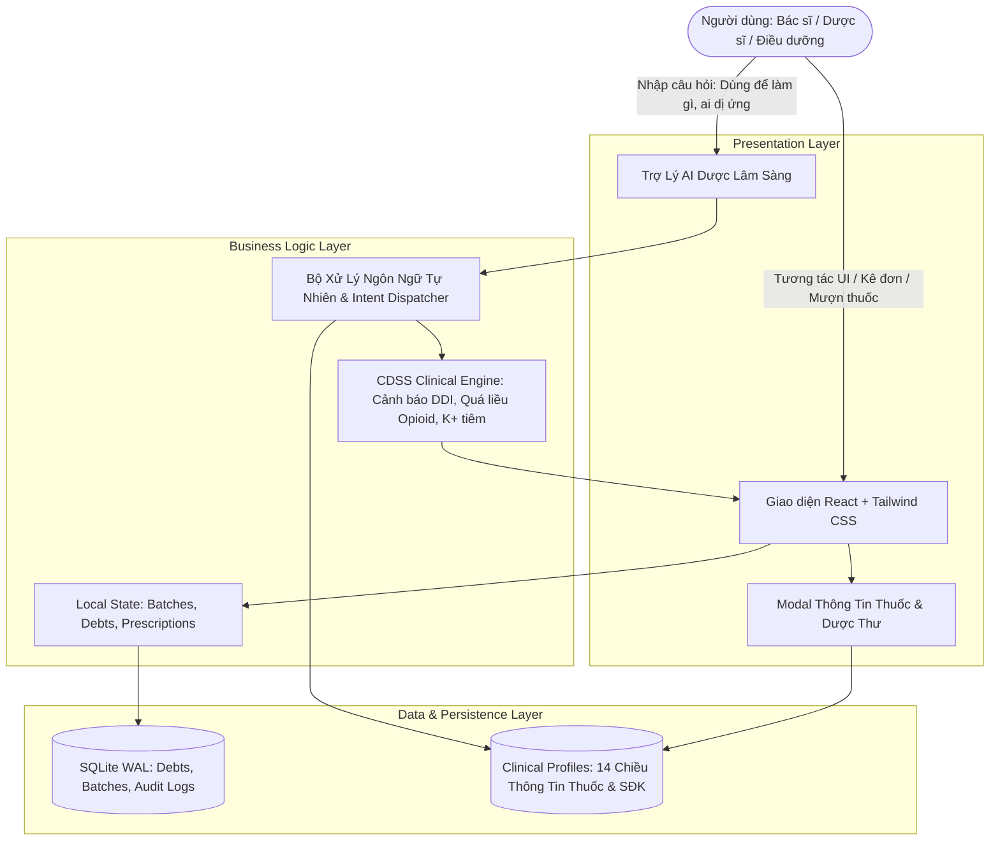

# BẢN ĐỒ KIẾN TRÚC & CÔNG NGHỆ (TECH_STACK.MD)

## 1. Danh Sách Thư Viện & Lý Do Lựa Chọn

| Thành phần | Thư viện / Công nghệ | Phiên bản | Lý do lựa chọn & Vai trò trong hệ thống |
| :--- | :--- | :--- | :--- |
| **Frontend Framework** | **React** + **TypeScript** | 19.x / 5.x | Xây dựng Single Page Application chuẩn y tế, strict type-checking chống lỗi runtime khi tính liều và tra cứu hoạt chất. |
| **Build Tool & Bundler** | **Vite** | 8.x | Thời gian build siêu tốc (<1s), Hot Module Replacement (HMR) tức thời cho trải nghiệm vibecoding mượt mà. |
| **CSS Engine** | **Tailwind CSS** | 4.x | Thiết kế giao diện lâm sàng chuẩn Atomic, không CSS phình to, dễ tùy biến màu sắc cảnh báo theo bảng màu Bộ Y Tế. |
| **Biểu tượng (Icons)** | **Lucide React** | Mới nhất | Bộ icon y tế chuẩn mực (`Pill`, `Stethoscope`, `Boxes`, `FileText`, `ShieldAlert`), siêu nhẹ và sắc nét. |
| **Database & Persistence** | **SQLite (WAL mode)** + **Better-SQLite3** | 11.x | Cơ sở dữ liệu nhúng cục bộ siêu nhanh, chuẩn ACID y tế, hỗ trợ Write-Ahead Logging (WAL) đảm bảo tính toàn vẹn của sổ kiểm toán dược. |
| **E2E Testing & Verification** | **Playwright** | 1.50+ | Tự động hóa kiểm thử UI, chụp ảnh màn hình đa thiết bị (Desktop + Mobile) và kiểm chứng kép các luồng lâm sàng. |
| **NLP & CDSS Engine** | **TypeScript Native Deterministic Engine** | Tự phát triển | Phân tích cú pháp y lệnh và câu hỏi lâm sàng không phụ thuộc mạng ngoài, tốc độ đáp ứng <5ms, bảo mật dữ liệu bệnh án 100%. |

---

## 2. Bản Đồ Luồng Dữ Liệu (Data Flow)

---

## 3. Quy Chuẩn State Machine (4 Trạng Thái Bắt Buộc)

Mọi luồng thao tác với dữ liệu thuốc (Kê đơn, Mượn tủ trực, Xuất kho FEFO, Hoàn trả vỏ rỗng) đều được khóa cứng qua 4 trạng thái:
1. `Idle`: Trạng thái chờ khởi tạo hoặc hiển thị danh mục tĩnh.
2. `Loading`: Đang truy xuất hồ sơ Dược thư hoặc đang gửi yêu cầu xác thực RFID/PIN.
3. `Success`: Thao tác thành công, ghi sổ kiểm toán SHA-256 bất biến.
4. `Error / Empty`: Báo lỗi vi phạm quy chế dược (ví dụ: quá liều trần 24h, tương tác thuốc nguy kịch, hoặc dị ứng tiền sử) kèm hướng dẫn khắc phục.
