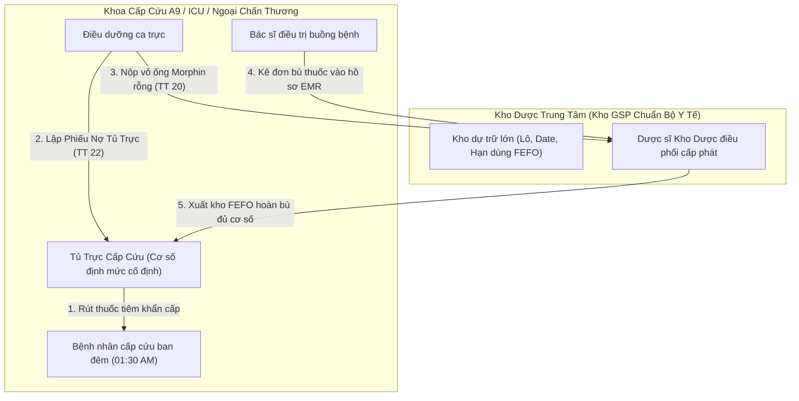
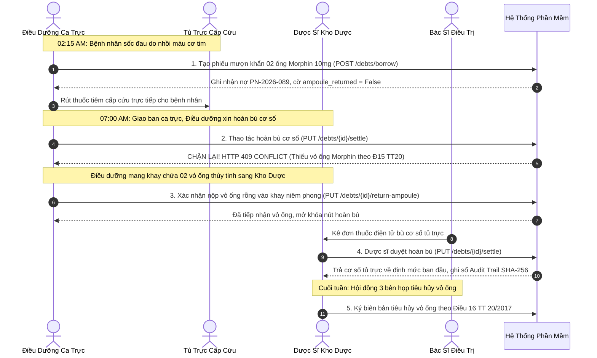
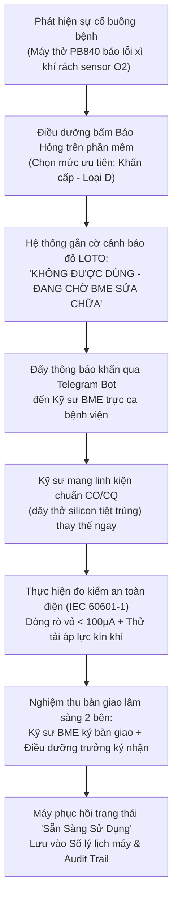

# CẨM NANG TOÀN DIỆN VỀ NGHIỆP VỤ Y TẾ LÂM SÀNG & BẢO VỆ ĐỒ ÁN 2
## HỆ THỐNG QUẢN LÝ KHO DƯỢC, VẬT TƯ, TỦ TRỰC LÂM SÀNG & TRANG THIẾT BỊ Y TẾ BỆNH VIỆN

---

> [!IMPORTANT]
> **Mục tiêu của tài liệu:** Cung cấp cho sinh viên và hội đồng thẩm định toàn bộ nền tảng kiến thức y tế, quy trình lâm sàng thực tế tại các bệnh viện Việt Nam, cơ sở pháp lý bắt buộc (Thông tư, Nghị định), 05 biểu mẫu hành chính A4 chuẩn hóa và bộ câu hỏi - phản biện đắt giá nhất để tự tin thuyết trình, bảo vệ xuất sắc Đồ án 2 trước Hội đồng Chấm điểm.
> 
> **Phiên bản PDF xuất bản:** [`01_Cam_Nang_Toan_Dien_Nghiep_Vu_Y_Te.pdf`](file:///home/tontonyuta/Downloads/DoAn2/01_Cam_Nang_Toan_Dien_Nghiep_Vu_Y_Te.pdf) (13 trang chuẩn A4)  
> **Ứng dụng trực tuyến:** [https://clinical-ward.vercel.app](https://clinical-ward.vercel.app)

---

## MỤC LỤC
1. [Bản Chất Vấn Đề: Tại Sao Cần Hệ Thống Kho Lâm Sàng Bệnh Viện?](#1-bản-chất-vấn-đề-tại-sao-cần-hệ-thống-kho-lâm-sàng-bệnh-viện)
2. [Hệ Thống 8 Văn Bản Pháp Quy Y Tế Việt Nam Bắt Buộc](#2-hệ-thống-8-văn-bản-pháp-quy-y-tế-việt-nam-bắt-buộc)
3. [Chi Tiết 5 Quy Trình Nghiệp Vụ Y Tế Cốt Lõi (Clinical SOPs)](#3-chi-tiết-5-quy-trình-nghiệp-vụ-y-tế-cốt-lõi-clinical-sops)
   - [Quy trình 1: Mượn Khẩn Thuốc Ca Đêm & Khóa Nợ Vỏ Ống Morphin (TT 22 & TT 20)](#quy-trình-1-mượn-khẩn-thuốc-ca-đêm--khóa-nợ-vỏ-ống-morphin-tt-22--tt-20)
   - [Quy trình 2: Báo Hỏng, Cảnh Báo LOTO & Nghiệm Thu An Toàn TBYT (NĐ 98/2021)](#quy-trình-2-báo-hỏng-cảnh-báo-loto--nghiệm-thu-an-toàn-tbyt-nđ-982021)
   - [Quy trình 3: Quản Lý Kho Dược Theo Hạn Dùng FEFO & Lập Dự Trù Mẫu 01/TT22](#quy-trình-3-quản-lý-kho-dược-theo-hạn-dùng-fefo--lập-dự-trù-mẫu-01tt22)
   - [Quy trình 4: Giám Sát Chuỗi Lạnh Datalogger, Xử Lý Mất Điện & Biệt Trữ Vắc Xin](#quy-trình-4-giám-sát-chuỗi-lạnh-datalogger-xử-lý-mất-điện--biệt-trữ-vắc-xin)
   - [Quy trình 5: Kiểm Kê Tài Sản 31/12, Điều Chuyển & Thanh Lý Tài Sản Nhà Nước (NĐ 151)](#quy-trình-5-kiểm-kê-tài-sản-3112-điều-chuyển--thanh-lý-tài-sản-nhà-nước-nđ-151)
4. [Hệ Thống 05 Biểu Mẫu Hành Chính Y Tế Chuẩn A4 Tích Hợp Sẵn](#4-hệ-thống-05-biểu-mẫu-hành-chính-y-tế-chuẩn-a4-tích-hợp-sẵn)
5. [Ma Trận Phân Quyền Vai Trò Lâm Sàng (RBAC Matrix)](#5-ma-trận-phân-quyền-vai-trò-lâm-sàng-rbac-matrix)
6. [Bộ Câu Hỏi & Phản Biện Đắt Giá Khi Bảo Vệ Đồ Án (Defense Q&A)](#6-bộ-câu-hỏi--phản-biện-đắt-giá-khi-bảo-vệ-đồ-án-defense-qa)

---

## 1. BẢN CHẤT VẤN ĐỀ: TẠI SAO CẦN HỆ THỐNG KHO LÂM SÀNG BỆNH VIỆN?

### 1.1. Sự khác biệt sống còn giữa Kho Thương Mại (Retail ERP) và Kho Lâm Sàng Bệnh Viện
Trong kho bán lẻ thông thường, chu trình chỉ đơn giản là: *Nhập hàng -> Lưu kho -> Bán hàng -> Trừ tồn kho*. 

Tuy nhiên, trong bệnh viện, nghiệp vụ kho lâm sàng hoàn toàn khác biệt bởi **3 yếu tố cốt tử**:
1. **Tính mạng người bệnh (Patient Safety):** Trong ca trực cấp cứu ban đêm (01:00 AM - 04:00 AM), bệnh nhân ngừng tim hoặc sốc phản vệ không thể chờ người nhà đi đóng tiền viện phí rồi Dược sĩ Kho Dược mới mở cửa phát thuốc. Điều dưỡng phải được phép **"rút khẩn cấp thuốc/vật tư từ Tủ trực khoa lâm sàng"** để cứu sống người bệnh trước, sau đó mới hợp thức hóa thủ tục giấy tờ bù cơ số sau.
2. **Kiểm soát ma túy & tiền chất (Controlled Substances):** Thuốc gây nghiện (Morphin, Fentanyl) có nguy cơ bị lạm dụng hoặc tuồn ra chợ đen. Nếu điều dưỡng lấy thuốc ra tiêm cho bệnh nhân mà không nộp lại vỏ ống thủy tinh rỗng, nguy cơ gian lận là cực kỳ cao. Pháp luật Việt Nam quy định: **Phải nộp lại vỏ ống thuốc rỗng mới được cấp bù ống thuốc mới**.
3. **Trang thiết bị y tế can thiệp sự sống (Life-support Devices):** Máy thở (PB840) hay máy sốc tim (Zoll) nếu bị rách dây thở, sai số xung phóng năng lượng hay hở dòng rò điện (> 100µA) sẽ gián tiếp làm tử vong người bệnh. Do đó, quy trình báo hỏng, sửa chữa và nghiệm thu thử tải bàn giao 2 bên phải chặt chẽ tuyệt đối theo tiêu chuẩn đo lường nhà nước.

### 1.2. Mối quan hệ giữa Kho Dược Trung Tâm và Tủ Trực Khoa Lâm Sàng

- **Kho Dược trung tâm:** Lưu trữ hàng nghìn danh mục theo chuẩn GSP (Nhiệt độ phòng < 30°C, Kho lạnh vắc xin 2.0°C - 8.0°C).
- **Tủ trực cấp cứu (Ward Stock):** Tủ cơ số cố định đặt tại buồng bệnh cấp cứu (Ví dụ: 10 ống Morphin 10mg, 10 ống Adrenalin 1mg).
- **Nguyên tắc "Đầu ca nhận bao nhiêu, cuối ca phải đủ bấy nhiêu":** Khi giao ban lúc 07:00 AM, nếu thiếu 2 ống Morphin, điều dưỡng phải trình ra: (1) Phiếu nợ mượn khẩn; (2) Khay 2 vỏ ống Morphin rỗng; (3) Đơn thuốc bù có ký số của Bác sĩ.

---

## 2. HỆ THỐNG 8 VĂN BẢN PHÁP QUY Y TẾ VIỆT NAM BẮT BUỘC

| STT | Văn bản pháp luật | Cơ quan ban hành | Trọng tâm nghiệp vụ bắt buộc áp dụng |
| :--- | :--- | :--- | :--- |
| **1** | **Thông tư 22/2011/TT-BYT** | Bộ Y tế | **Quy chế Khoa Dược & Tủ trực lâm sàng:** Quy định cơ số thuốc tủ trực, chế độ bàn giao ca trực, đối soát giao ban 07:00 AM, mẫu dự trù 01/TT22. |
| **2** | **Thông tư 20/2017/TT-BYT & NĐ 54/2017/NĐ-CP** | Bộ Y tế & Chính phủ | **Quản lý thuốc phải kiểm soát đặc biệt:** Quy định xuất nhập thuốc gây nghiện. Điều 15: Thu hồi vỏ ống rỗng. Điều 16: Tiêu hủy vỏ ống Hội đồng 3 bên. Lưu trữ hồ sơ 2 năm. |
| **3** | **Nghị định 98/2021/NĐ-CP & TT 05/2022/TT-BYT** | Chính phủ & Bộ Y tế | **Quản lý Trang thiết bị y tế:** Phân loại rủi ro 4 cấp (A, B, C, D). Thiết bị loại D can thiệp sự sống bắt buộc kiểm định định kỳ, dán tem và ghi sổ lý lịch máy. |
| **4** | **Thông tư 36/2018/TT-BYT (GSP)** | Bộ Y tế | **Thực hành tốt bảo quản thuốc:** Bắt buộc áp dụng nguyên tắc **FEFO (First Expired, First Out)**; duy trì chuỗi lạnh 2.0°C – 8.0°C; ghi nhận dữ liệu Datalogger liên tục. |
| **5** | **Nghị định 151/2017/NĐ-CP & NĐ 114/2024/NĐ-CP** | Chính phủ | **Quản lý tài sản công y tế:** Kiểm kê thời điểm 00:00 ngày 31/12 hằng năm; biên bản điều chuyển Mẫu 01-TSC; thẩm quyền duyệt thanh lý tài sản của Giám đốc viện. |
| **6** | **Nghị định 130/2018/NĐ-CP & QĐ 3149/QĐ-BYT** | Chính phủ & Bộ Y tế | **Giao dịch điện tử & Bệnh án điện tử (EMR):** Định danh người hành nghề qua CCHN, mã PIN lâm sàng, chữ ký kép Dual-Witness và tính bất biến của sổ Audit Trail. |
| **7** | **Tiêu chuẩn IEC 60601-1** | Ủy ban Kỹ thuật Điện Quốc tế | **An toàn thiết bị điện y tế:** Đo kiểm dòng rò vỏ máy và dòng rò qua bệnh nhân không vượt quá 100µA đối với thiết bị tiếp xúc buồng tim (Type CF). |
| **8** | **Tiêu chuẩn WHO PQS & Chỉ số MKT** | Tổ chức Y tế Thế giới | **Giám sát chuỗi lạnh vắc xin:** Tính toán Nhiệt độ động học trung bình (Mean Kinetic Temperature - MKT) theo phương trình Arrhenius khi xảy ra sự cố mất điện. |

---

## 3. CHI TIẾT 5 QUY TRÌNH NGHIỆP VỤ Y TẾ CỐT LÕI (CLINICAL SOPS)

### Quy trình 1: Mượn Khẩn Thuốc Ca Đêm & Khóa Nợ Vỏ Ống Morphin (TT 22 & TT 20)

> [!CAUTION]
> **Quy tắc "Khóa an toàn vỏ ống" (Ampoule Lockout):** Nếu ca trực mượn thuốc gây nghiện mà đến 07:00 AM chưa nộp lại vỏ ống rỗng, hệ thống tự động khóa quyền mượn thuốc gây nghiện tiếp theo của ca trực đó cho đến khi có xác nhận nộp vỏ hoặc Biên bản giải trình mất/vỡ vỏ có xác nhận của Bác sĩ trưởng ca.

### Quy trình 2: Báo Hỏng, Cảnh Báo LOTO & Nghiệm Thu An Toàn TBYT (NĐ 98/2021)

### Quy trình 3: Quản Lý Kho Dược Theo Hạn Dùng FEFO & Lập Dự Trù Mẫu 01/TT22
- **Tại sao FEFO bắt buộc trong y tế?** Hạn dùng in trên nhãn là yếu tố sống còn. Nhà phân phối có thể giao một lô thuốc nhập sau nhưng hạn dùng ngắn hơn lô nhập trước. Xuất theo FEFO bảo đảm lô có hạn dùng ngắn hơn phải được xuất dùng trước.
- **Phân loại cảnh báo 3 cấp:**
  - `An Toàn` (> 6 tháng): Hoạt động xuất nhập bình thường.
  - `Cận Hạn` (3 - 6 tháng): Hệ thống ưu tiên xuất trước, cảnh báo vàng.
  - `Nguy Cơ Quá Hạn` (< 3 tháng): Cảnh báo đỏ, đề xuất điều chuyển khoa dùng nhiều hoặc trả về Kho Dược.

### Quy trình 4: Giám Sát Chuỗi Lạnh Datalogger, Xử Lý Mất Điện & Biệt Trữ Vắc Xin
- **Dải nhiệt độ chuẩn:** 2.0°C – 8.0°C cho vắc xin, huyết thanh và sinh phẩm.
- **Xử lý sự cố mất điện:**
  1. Cảm biến Datalogger ghi nhận nhiệt độ tăng vọt (> 8.0°C).
  2. Hệ thống kích hoạt cảnh báo còi chuông và thông báo khẩn.
  3. Kích hoạt tự động chế độ **"Biệt Trữ Cách Ly (Quarantine Mode)"** — Khóa toàn bộ quyền xuất tiêm.
  4. Sau khi khôi phục điện, hệ thống **không tự mở khóa**. Dược sĩ QA phải thẩm định chỉ số MKT theo phương trình Arrhenius và kiểm tra chỉ thị màu lọ vắc xin VVM. Chỉ khi Ban Giám Đốc và Dược sĩ cùng ký lệnh giải phóng lô thì vắc xin mới được đưa trở lại sử dụng.

### Quy trình 5: Kiểm Kê Tài Sản 31/12, Điều Chuyển & Thanh Lý Tài Sản Nhà Nước (NĐ 151)
- **Kiểm kê thời điểm 00:00 ngày 31/12:** Bắt buộc đối soát 3 bên giữa số liệu trên hệ thống, thực tế kiểm đếm mã QR tại buồng bệnh và sổ sách Phòng Tài chính Kế toán.
- **Điều chuyển buồng phòng (Mẫu 01-TSC):** Khi máy thở bị di chuyển từ Cấp cứu sang Phòng mổ, kỹ sư BME và điều dưỡng tiếp nhận ký biên bản điều chuyển trên hệ thống.
- **Thanh lý tài sản nhà nước:** Chỉ Ban Giám Đốc mới có thẩm quyền ký quyết định thanh lý khi máy hết niên hạn sử dụng (khấu hao 100%) hoặc chi phí sửa chữa vượt quá 50% nguyên giá.

---

## 4. HỆ THỐNG 05 BIỂU MẪU HÀNH CHÍNH Y TẾ CHUẨN A4 TÍCH HỢP SẴN

| STT | Tên biểu mẫu hành chính | Căn cứ pháp lý | Mục đích nghiệp vụ & Các trường bắt buộc |
| :---: | :--- | :--- | :--- |
| **01** | **Sổ Theo Dõi Thuốc Gây Nghiện & Hướng Thần** | Mẫu 07, Thông tư 20/2017/TT-BYT | Theo dõi nhập - xuất - tồn, số lô, hạn dùng, tên bệnh nhân, số bệnh án, chữ ký người nhận - người phát, kiểm đếm vỏ ống thủy tinh thu hồi hằng ngày. |
| **02** | **Phiếu Dự Trù Thuốc / Vật Tư Tiêu Hao** | Mẫu 01, Thông tư 22/2011/TT-BYT | Dự trù định kỳ bổ sung cơ số tủ trực: Tồn kho thực tế, cơ số trần an toàn (Max Quota), số lượng đề nghị cấp bù, chữ ký Trưởng khoa lâm sàng và Trưởng khoa Dược. |
| **03** | **Biên Bản Bàn Giao & Điều Chuyển Tài Sản** | Mẫu 01-TSC, NĐ 151/2017 & NĐ 114/2024 | Hợp thức hóa điều chuyển máy thở, máy sốc tim: Nguyên giá, tỷ lệ hao mòn, lý do điều chuyển, chữ ký 3 bên (Bên giao, Bên nhận, Phòng Vật tư TBYT). |
| **04** | **Phiếu Mượn Khẩn & Bù Cơ Số Thuốc Ca Đêm** | Quy chế nội bộ Bệnh viện đa khoa chuẩn | Phục vụ rút thuốc khẩn cấp lúc 01:00 AM - 04:00 AM: Mã bệnh án, chỉ định cấp cứu, chữ ký Điều dưỡng mượn thuốc, hạn chốt hoàn bù 07:00 AM sáng hôm sau. |
| **05** | **Biên Bản Kiểm Định & Nghiệm Thu An Toàn TBYT** | Nghị định 98/2021 & Chuẩn IEC 60601-1 | Nghiệm thu kỹ thuật sau sửa chữa máy loại D: Số serial, phụ kiện CO/CQ thay thế, kết quả đo dòng rò vỏ (< 100µA), kết quả đo tải áp lực kín khí, chữ ký kép Kỹ sư BME và Bác sĩ/Điều dưỡng trưởng. |

---

## 5. MA TRẬN PHÂN QUYỀN VAI TRÒ LÂM SÀNG (RBAC MATRIX)

| Quyền hạn / Thao tác nghiệp vụ | Điều Dưỡng | Kỹ Sư BME | Dược Sĩ | Bác Sĩ | Ban Giám Đốc | Căn cứ pháp lý |
| :--- | :---: | :---: | :---: | :---: | :---: | :--- |
| **Ghi nợ thuốc cấp cứu ca đêm** | ✅ Thực hiện | ❌ | ❌ | ❌ | ✅ Toàn quyền | TT 22/2011 |
| **Nộp vỏ ống Morphin đã tiêm** | ✅ Thực hiện | ❌ | ❌ | ❌ | ✅ Toàn quyền | Điều 15 TT 20/2017 |
| **Duyệt hoàn bù phiếu nợ tủ trực** | ❌ | ❌ | ✅ Chủ trì | ❌ | ✅ Toàn quyền | TT 22/2011 |
| **Tiêu hủy vỏ ống Morphin 3 bên** | ✅ Thành viên | ❌ | ✅ Chủ trì | ✅ Làm chứng | ✅ Phê duyệt | Điều 16 TT 20/2017 |
| **Báo hỏng máy & phụ kiện TBYT** | ✅ Báo hỏng | ❌ | ❌ | ✅ Báo hỏng | ✅ Toàn quyền | NĐ 98/2021 |
| **Sửa chữa & Ký nghiệm thu an toàn** | ❌ (Chỉ nhận) | ✅ Chủ trì | ❌ | ✅ Tiếp nhận | ✅ Toàn quyền | NĐ 98 & TT 05 |
| **Xuất kho theo hạn dùng FEFO** | ❌ | ❌ | ✅ Thực hiện | ❌ | ✅ Toàn quyền | TT 36/2018 GSP |
| **Ký lệnh giải phóng lô vắc xin MKT** | ❌ | ❌ | ✅ Thẩm định QA | ❌ | ✅ Ký duyệt chính | WHO PQS & TT 36 |
| **Ký điều chuyển tài sản Mẫu 01-TSC** | ❌ (Chỉ nhận) | ✅ Chủ trì | ❌ | ❌ | ✅ Toàn quyền | NĐ 151/2017 |
| **Phê duyệt thanh lý tài sản công** | ❌ | ❌ (Đề xuất) | ❌ | ❌ | ✅ Quyết định | Điều 39 NĐ 151 |

---

## 6. BỘ CÂU HỎI & PHẢN BIỆN ĐẮT GIÁ KHI BẢO VỆ ĐỒ ÁN (DEFENSE Q&A)

### Câu 1: "Tại sao em lại chọn làm hệ thống kho lâm sàng bệnh viện thay vì kho hàng thương mại thông thường?"
> **Trả lời:** "Thưa Thầy/Cô, kho thương mại chỉ giải quyết bài toán mua - bán hàng hóa đơn thuần để tối ưu lợi nhuận. Còn Kho Lâm Sàng Bệnh Viện là bài toán **bảo vệ tính mạng con người và tuân thủ pháp luật y tế nghiêm ngặt**. Đồ án của em giải quyết 3 bài toán đặc thù mà thương mại không có: (1) Cơ chế nợ thuốc cấp cứu ca đêm cứu bệnh nhân trước - hợp thức hóa sau; (2) Cơ chế khóa nợ vỏ ống Morphin theo Thông tư 20 để chống thất thoát ma túy; và (3) Nghiệm thu an toàn điện máy thở theo Nghị định 98 và chuẩn IEC 60601-1. Đề tài này có độ phức tạp nghiệp vụ cao và mang giá trị thực tiễn phụng sự xã hội sâu sắc."

### Câu 2: "Tại sao trong y tế bắt buộc áp dụng nguyên tắc FEFO mà không dùng FIFO?"
> **Trả lời:** "Thưa Thầy/Cô, FIFO căn cứ theo ngày nhập kho, còn FEFO căn cứ theo ngày hết hạn in trên bao bì thuốc. Trong chuỗi cung ứng dược phẩm, nhà phân phối có thể giao một lô thuốc nhập sau nhưng hạn dùng lại ngắn hơn lô nhập trước đó. Nếu máy móc dùng FIFO, lô thuốc cận hạn sẽ bị đọng lại trong kho đến khi hết hạn và phải tiêu hủy, gây lãng phí hàng trăm triệu đồng ngân sách. Do đó, Thông tư 36/2018/TT-BYT GSP bắt buộc mọi phần mềm quản lý kho dược bệnh viện phải ưu tiên xuất theo **FEFO (First Expired, First Out)**."

### Câu 3: "Nếu điều dưỡng vô tình làm rơi vỡ ống Morphin trong lúc bẻ nắp thì hệ thống xử lý thế nào?"
> **Trả lời:** "Thưa Thầy/Cô, theo Điều 15 Thông tư 20/2017/TT-BYT, điều dưỡng không được tự ý xóa nợ. Quy trình thực tế bắt buộc: Điều dưỡng phải thu gom các mảnh thủy tinh vỡ, lập *Biên bản giải trình vỡ ống thuốc gây nghiện* có chữ ký xác nhận của Bác sĩ trực buồng bệnh làm chứng, sau đó nộp biên bản và mảnh vỡ về Kho Dược. Dược sĩ đối chiếu biên bản thì mới mở khóa xác nhận thu hồi vỏ ống trên phần mềm để cấp bù ống mới."

### Câu 4: "Tại sao khi khôi phục điện lưới, buồng vắc xin không tự mở khóa mà phải cần Giám đốc và Dược sĩ ký duyệt?"
> **Trả lời:** "Thưa Thầy/Cô, đây là nguyên lý an toàn sinh học của WHO. Khi tủ vắc xin mất điện lên 11°C, protein kháng nguyên có thể đã bị biến tính mà mắt thường không thấy được. Việc có điện trở lại chỉ hạ nhiệt độ về 4.5°C chứ không thể phục hồi được hoạt tính sinh học đã mất nếu phơi nhiễm quá lâu. Vì vậy hệ thống bắt buộc duy trì trạng thái **Biệt trữ (Quarantine)** để Dược sĩ QA thẩm định nhiệt độ động học Arrhenius (MKT) và chỉ thị màu lọ vắc xin (VVM Level 1). Chỉ khi Hội đồng xác nhận vắc xin an toàn thì Giám đốc mới ký lệnh giải phóng lô."

### Câu 5: "Cơ chế bảo mật chuỗi băm HMAC-SHA256 trong đồ án giải quyết vấn đề gì?"
> **Trả lời:** "Thưa Thầy/Cô, trong các phần mềm thông thường, quản trị viên CSDL có thể dùng quyền root để can thiệp xóa dấu vết sai phạm. Trong hệ thống của em, mỗi hành động lâm sàng được băm bằng HMAC-SHA256 kết hợp giữa khóa bí mật server, nội dung hành động và **chữ ký băm của bản ghi liền trước**. Bất kỳ sự sửa đổi trực tiếp nào vào CSDL sẽ làm gãy chuỗi băm. Khi chạy endpoint `verify-integrity`, hệ thống sẽ lập tức phát hiện bản ghi bị can thiệp, bảo đảm tính bất biến theo FDA 21 CFR Part 11 và Nghị định 130/2018/NĐ-CP."

### Câu 6: "Vai trò của Trợ lý AI Copilot trong đồ án là gì? Có sợ AI bị ảo giác (hallucination) kê sai thuốc không?"
> **Trả lời:** "Thưa Thầy/Cô, em quán triệt nguyên tắc kiến trúc: **AI chỉ là một Client phụ trợ (Decoupled Copilot), không can thiệp logic cứng của Backend**. Toàn bộ logic nghiệp vụ (kiểm tra vỏ ống Morphin, sắp xếp FEFO, phân quyền RBAC, xác thực PIN/RFID, khóa chuỗi băm) đều do Backend FastAPI và CSDL thực thi 100% độc lập, hoạt động hoàn hảo ngay cả khi không có AI. AI Copilot chỉ có nhiệm vụ lắng nghe câu lệnh tự nhiên của y bác sĩ để trích dẫn căn cứ luật và mở sẵn biểu mẫu thao tác, đồng thời luôn yêu cầu nhập mã PIN chuyên môn mới được ghi nhận vào hệ thống, do đó loại bỏ hoàn toàn rủi ro ảo giác gây nguy hiểm cho người bệnh."

---

*Hết tài liệu 01.*
