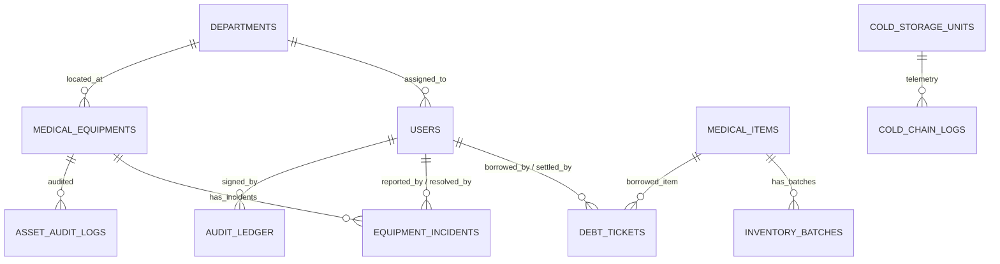
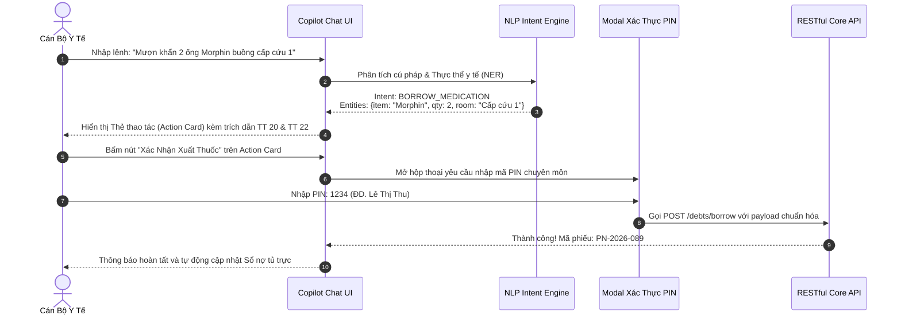

# TỔNG QUAN KIẾN TRÚC HỆ THỐNG & CẤU TRÚC CODE TOÀN DIỆN ĐỒ ÁN 2
## BÁO CÁO THIẾT KẾ KỸ THUẬT PHẦN MỀM FULLSTACK & DECOUPLED AI COPILOT

---

> [!IMPORTANT]
> **Mục tiêu của tài liệu:** Cung cấp cho sinh viên, giảng viên hướng dẫn và hội đồng thẩm định toàn bộ bức tranh kiến trúc hệ thống, cấu trúc mã nguồn chi tiết Frontend/Backend, sơ đồ ERD cơ sở dữ liệu, đặc tả RESTful API, cơ chế bảo mật chuỗi băm HMAC-SHA256, động cơ AI Copilot lâm sàng và bộ kiểm thử tự động Playwright.
> 
> **Phiên bản PDF xuất bản:** [`02_Kien_Truc_Va_Cau_Truc_Code_Do_An_2.pdf`](file:///home/tontonyuta/Downloads/DoAn2/02_Kien_Truc_Va_Cau_Truc_Code_Do_An_2.pdf) (10 trang chuẩn A4)  
> **Ứng dụng trực tuyến:** [https://clinical-ward.vercel.app](https://clinical-ward.vercel.app)

---

## MỤC LỤC
1. [Tổng Quan Kiến Trúc & Triết Lý Thiết Kế Modular Monolith](#1-tổng-quan-kiến-trúc--triết-lý-thiết-kế-modular-monolith)
2. [Cấu Trúc Cây Thư Mục Mã Nguồn Dự Án](#2-cấu-trúc-cây-thư-mục-mã-nguồn-dự-án)
3. [Chi Tiết Kiến Trúc Frontend (Client Layer)](#3-chi-tiết-kiến-trúc-frontend-client-layer)
4. [Chi Tiết Kiến Trúc Backend & Cơ Sở Dữ Liệu (Backend Layer)](#4-chi-tiết-kiến-trúc-backend--cơ-sở-dữ-liệu-backend-layer)
5. [Đặc Tả Hệ Thống RESTful API Endpoints](#5-đặc-tả-hệ-thống-restful-api-endpoints)
6. [Động Cơ Trợ Lý AI Lâm Sàng (Clinical AI Copilot Engine)](#6-động-cơ-trợ-lý-ai-lâm-sàng-clinical-ai-copilot-engine)
7. [Bộ Kịch Bản Kiểm Thử Tự Động Toàn Diện Playwright](#7-bộ-kịch-bản-kiểm-thử-tự-động-toàn-diện-playwright)
8. [Quy Trình Build & Triển Khai Thực Tế (CI/CD Deployment)](#8-quy-trình-build--triển-khai-thực-tế-cicd-deployment)

---

## 1. TỔNG QUAN KIẾN TRÚC & TRIẾT LÝ THIẾT KẾ MODULAR MONOLITH

### 1.1. Triết lý thiết kế cốt lõi
Hệ thống được thiết kế theo nguyên tắc: **"Nghiệp vụ lâm sàng cốt lõi phải hoạt động toàn vẹn, độc lập 100% trước khi có sự xuất hiện của AI"**. Trợ lý AI Copilot chỉ đóng vai trò là một giao diện phụ trợ thông minh (Decoupled Auxiliary Copilot), giao tiếp với Backend qua RESTful API tiêu chuẩn mà không bao giờ trực tiếp ghi đè cơ sở dữ liệu nếu thiếu sự xác thực của nhân viên y tế có thẩm quyền.

### 1.2. Mô hình 4 tầng Modular Monolith (Clean Architecture)

```mermaid
flowchart TD
    subgraph ClientLayer["1. TẦNG CLIENT / GIAO DIỆN NGƯỜI DÙNG"]
        SPA["React 19 SPA (Vite + TypeScript + Tailwind v4)"]
        PrintCenter["Printable Forms Center (5 Biểu Mẫu A4 Chuẩn Hóa)"]
        StationUI["Giao diện Máy Trạm Công Thái Học No-Scroll"]
    end

    subgraph APIGateway["2. TẦNG ĐIỀU PHỐI & BẢO MẬT (API GATEWAY)"]
        FastAPIRouter["FastAPI REST Controller (Auto OpenAPI / Swagger)"]
        CORS["CORS Middleware & Trusted Host Validation"]
        AuthGuard["RBAC Guard & Xác Thực CCHN / PIN (NĐ 130)"]
    end

    subgraph DomainCore["3. TẦNG LOGIC NGHIỆP VỤ LÂM SÀNG (DOMAIN SERVICES)"]
        DebtService["DebtService: Nợ ca đêm & Khóa vỏ Morphin (TT 22 & TT 20)"]
        EquipService["EquipService: Báo hỏng LOTO & An toàn điện (NĐ 98 & IEC 60601)"]
        FefoService["FefoService: Xuất kho FEFO & Dự trù Mẫu 01 (TT 36 & TT 22)"]
        ColdChainService["ColdChainService: Datalogger IoT & Arrhenius MKT (WHO)"]
        AssetService["AssetService: Kiểm kê 31/12 & Thanh lý tài sản (NĐ 151)"]
        AuditService["AuditService: Sổ kiểm toán chuỗi băm HMAC-SHA256 bất biến"]
    end

    subgraph AiCopilotLayer["TẦNG TRỢ LÝ AI PHỤ TRỢ (DECOUPLED COPILOT)"]
        IntentEngine["NLU Intent Classifier & Entity Extraction"]
        ActionCardGen["Action Cards Generator (Thẻ thao tác tương tác trực tiếp)"]
        LegalCitation["Legal Badges Linker (Trích dẫn Thông tư Bộ Y Tế)"]
    end

    subgraph DataLayer["4. TẦNG HẠ TẦNG DỮ LIỆU (DATA PERSISTENCE LAYER)"]
        AsyncORM["SQLAlchemy 2.0 Async Engine + aiosqlite"]
        ClinicalDB[("Cơ Sở Dữ Liệu Lâm Sàng (SQLite / PostgreSQL)")]
    end

    ClientLayer <--> APIGateway
    APIGateway <--> DomainCore
    DomainCore <--> DataLayer
    
    ClientLayer -.->|Truy vấn ngôn ngữ tự nhiên| AiCopilotLayer
    AiCopilotLayer -.->|Sinh Action Card kèm mã PIN| ClientLayer
```


---

## 2. CẤU TRÚC CÂY THƯ MỤC MÃ NGUỒN DỰ ÁN

```
DoAn2/
├── backend/                             # MÃ NGUỒN BACKEND FASTAPI
│   ├── app/
│   │   ├── main.py                      # Điểm khởi chạy FastAPI, cấu hình CORS & Routers
│   │   ├── core/                        # Cấu hình bảo mật, JWT, HMAC-SHA256 hash chaining
│   │   ├── db/                          # Kết nối cơ sở dữ liệu SQLAlchemy 2.0 Async
│   │   ├── models/                      # Định nghĩa ORM Models (Users, Debts, Equipments, Audit...)
│   │   ├── schemas/                     # Pydantic v2 Schemas xác thực Input/Output
│   │   ├── services/                    # Domain Services (Xử lý nghiệp vụ lâm sàng thuần túy)
│   │   └── api/v1/                      # RESTful Controllers phân theo 6 phân hệ
│   └── requirements.txt                 # Danh mục thư viện Python (FastAPI, SQLAlchemy, Playwright...)
├── src/                                 # MÃ NGUỒN FRONTEND REACT 19
│   ├── components/                      # CÁC MÔ-ĐUN GIAO DIỆN NGHIỆP VỤ CHÍNH
│   │   ├── ClinicalDebtLedger.tsx       # Quản lý nợ tủ trực, khóa vỏ Morphin, đối soát 07:00 AM
│   │   ├── EquipmentTracker.tsx         # Báo hỏng, cờ LOTO, bảo trì BME, nghiệm thu an toàn điện
│   │   ├── FefoInventory.tsx            # Bảng quản lý kho theo FEFO, cảnh báo cận hạn 3 mức
│   │   ├── ColdChainMonitor.tsx         # Giám sát nhiệt độ IoT 2-8°C, còi cảnh báo, biệt trữ vắc xin
│   │   ├── AssetTransferAudit.tsx       # Kiểm kê 31/12, điều chuyển Mẫu 01-TSC, thanh lý NĐ 151
│   │   ├── ClinicalAuthModal.tsx        # Hộp thoại xác thực PIN lâm sàng, chữ ký kép Dual-Witness
│   │   ├── PrintableFormModal.tsx       # Trung tâm in ấn 05 biểu mẫu hành chính y tế chuẩn A4
│   │   ├── CopilotChat.tsx              # Khung chat AI Copilot với thẻ thao tác tương tác động
│   │   └── RoleSwitcher.tsx             # Chuyển đổi 5 vai trò lâm sàng kèm mã CCHN và huy hiệu
│   ├── data/                            # Dữ liệu hạt giống (Seed Data) chuẩn mực y tế thực tế
│   │   └── initialData.ts               # Danh mục thuốc, thiết bị, buồng bệnh, nhân sự mẫu
│   ├── types/                           # TypeScript Interfaces & Enums chuẩn hóa toàn hệ thống
│   │   └── index.ts                     # Debt, Equipment, InventoryBatch, AuditRecord types
│   ├── App.tsx                          # Root Component, điều phối State đồng bộ và định tuyến Tab
│   ├── main.tsx                         # Entry point React DOM
│   └── index.css                        # Tailwind CSS v4 styling & CSS Print rules
├── scripts/                             # BỘ KIỂM THỬ TỰ ĐỘNG PLAYWRIGHT & TIỆN ÍCH
│   ├── test_copilot_ui.py               # E2E Test tương tác Copilot, mở Action Card, xác thực PIN
│   ├── test_printable_forms.py          # E2E Test mở modal in ấn, chuyển tab 5 biểu mẫu A4
│   ├── verify_refined_labels.py         # Rà soát 100% nhãn tiếng Việt, kiểm tra lỗi ký tự thô
│   └── generate_official_pdfs.py        # Kịch bản biên dịch toàn bộ tài liệu thành 02 ấn phẩm PDF
├── docs/                                # HỒ SƠ TÀI LIỆU DỰ ÁN & SLIDE THUYẾT TRÌNH
│   ├── 01_Cam_Nang_Toan_Dien_Nghiep_Vu_Y_Te.pdf
│   ├── 02_Kien_Truc_Va_Cau_Truc_Code_Do_An_2.pdf
│   ├── Slide_Thuyet_Trinh_Do_An_2.md    # Bộ Slide thuyết trình Marp hiện đại
│   └── README.md                        # Chỉ mục tra cứu toàn bộ hồ sơ dự án
├── index.html                           # HTML template, tải Google Fonts Inter
├── package.json                         # Vite 6, React 19, Lucide-react, Tailwind v4
├── tsconfig.json                        # Cấu hình TypeScript nghiêm ngặt
├── vercel.json                          # Cấu hình định tuyến SPA & Triển khai đám mây
└── vite.config.ts                       # Cấu hình build tối ưu hóa gói bundle
```

---

## 3. CHI TIẾT KIẾN TRÚC FRONTEND (CLIENT LAYER)

### 3.1. Stack công nghệ
- **Vite 6:** Bundler tốc độ cao, HMR tính bằng mili-giây.
- **React 19 + TypeScript:** Trải nghiệm phát triển an toàn kiểu (Type-safe), loại trừ runtime crashes.
- **Tailwind CSS v4:** Hệ thống utility CSS hiện đại, dung lượng biên dịch tối ưu (< 35KB).
- **Lucide React:** Bộ icon vector phẳng chuẩn y tế.

### 3.2. Bóc tách 8 Components giao diện nghiệp vụ
1. `ClinicalDebtLedger.tsx`: Sổ nợ tủ trực ca đêm, chốt đối soát 07:00 AM, nút nộp vỏ ống rỗng Morphin.
2. `EquipmentTracker.tsx`: Quản lý danh mục TBYT, chu trình trạng thái, gắn cờ LOTO đỏ đậm, kiểm tra hạn tem kiểm định.
3. `FefoInventory.tsx`: Bảng quản lý kho theo FEFO, cảnh báo 3 mức màu (Xanh, Vàng, Đỏ), nút dự trù Mẫu 01/TT22.
4. `ColdChainMonitor.tsx`: Biểu đồ nhiệt độ IoT 2-8°C, còi báo động visual khi mất điện, nút kích hoạt biệt trữ.
5. `AssetTransferAudit.tsx`: Kiểm kê 31/12, xuất biên bản điều chuyển Mẫu 01-TSC, tính khấu hao hao mòn NĐ 151.
6. `ClinicalAuthModal.tsx`: Hộp thoại xác thực mã PIN 4 số hoặc chạm thẻ RFID, hỗ trợ chữ ký kép Dual-Witness.
7. `PrintableFormModal.tsx`: Trung tâm in ấn 05 biểu mẫu hành chính y tế A4/A5 với CSS `@media print`.
8. `CopilotChat.tsx`: Cửa sổ trợ lý AI lâm sàng với các thẻ thao tác (Action Cards) tương tác trực tiếp.

---

## 4. CHI TIẾT KIẾN TRÚC BACKEND & CƠ SỞ DỮ LIỆU (BACKEND LAYER)

### 4.1. Stack công nghệ Backend
- **Python 3.12 + FastAPI:** Xử lý bất đồng bộ (Asynchronous I/O) tốc độ cao, tự động sinh Swagger UI OpenAPI 3.0.
- **SQLAlchemy 2.0 (Async/Await) + aiosqlite / PostgreSQL:** Truy vấn phi khối (Non-blocking queries), hỗ trợ khóa mức dòng (Pessimistic Row-level Locking) chống Race Conditions.
- **Pydantic v2:** Ràng buộc chặt chẽ kiểu dữ liệu đầu vào và đầu ra.

### 4.2. Sơ đồ thực thể cơ sở dữ liệu (ERD)


---

## 5. ĐẶC TẢ HỆ THỐNG RESTFUL API ENDPOINTS

| Phương thức | Đường dẫn Endpoint | Mô tả chức năng nghiệp vụ | Quyền hạn & Ràng buộc bảo mật |
| :---: | :--- | :--- | :--- |
| `POST` | `/api/v1/debts/borrow` | Tạo phiếu mượn khẩn thuốc/vật tư ca đêm. | Nurse, Director. Yêu cầu PIN. Nếu là thuốc gây nghiện, đặt `ampoule_status = PENDING`. |
| `GET` | `/api/v1/debts` | Truy vấn danh sách nợ cơ số tủ trực. | Tất cả vai trò. Hỗ trợ filter: `status`, `is_narcotic`, `search`. |
| `PUT` | `/api/v1/debts/{id}/return-ampoule` | Xác nhận thu hồi vỏ ống Morphin vào khay. | Nurse, Pharmacist. Bắt buộc thực hiện trước khi được hoàn bù theo Đ15 TT20. |
| `PUT` | `/api/v1/debts/{id}/settle` | Ký duyệt hoàn bù cơ số tủ trực. | Pharmacist, Director. **Chặn lỗi 409 Conflict** nếu là thuốc gây nghiện mà chưa nộp vỏ. |
| `POST` | `/api/v1/equipment/incidents` | Báo hỏng TBYT và gắn cờ cảnh báo đỏ LOTO. | Nurse, Doctor. Thiết bị loại D tự động kích hoạt mức ưu tiên Khẩn cấp (Urgent). |
| `PUT` | `/api/v1/equipment/incidents/{id}/handover` | Nghiệm thu an toàn điện và bàn giao 2 bên. | BME Engineer (chủ trì) + Clinical Staff (ký nhận). Ghi sổ lý lịch máy. |
| `GET` | `/api/v1/inventory/batches` | Tra cứu kho dược sắp xếp theo hạn dùng FEFO. | Tất cả vai trò. Tự động gắn cờ cảnh báo cận hạn theo 3 mức màu. |
| `POST` | `/api/v1/inventory/restock-proposal` | Lập phiếu dự trù cung ứng thuốc Mẫu 01/TT22. | Pharmacist, Director. Tự động tính: `Bù = Max - Tồn kho`. |
| `POST` | `/api/v1/coldchain/telemetry` | Tiếp nhận dữ liệu nhiệt độ từ Datalogger IoT. | IoT Device, Backend Worker. Nếu > 8.0°C kích hoạt báo động. |
| `POST` | `/api/v1/coldchain/release-quarantine` | Ký lệnh giải phóng lô vắc xin sau sự cố nhiệt độ. | Director (ký duyệt chính) + Pharmacist (thẩm định MKT & VVM). |
| `GET` | `/api/v1/audit/verify-integrity` | Quét và kiểm tra tính toàn vẹn chuỗi băm HMAC. | Director, Đoàn Thanh tra Bộ Y tế. Phát hiện mọi hành vi can thiệp CSDL. |

---

## 6. ĐỘNG CƠ TRỢ LÝ AI LÂM SÀNG (CLINICAL AI COPILOT ENGINE)



> [!TIP]
> **Đặc tính an toàn (Safety Guardrails):** AI không bao giờ tự ý ghi nhận dữ liệu nếu không có thao tác bấm xác nhận và nhập mã PIN của người dùng. AI luôn đính kèm Trích dẫn pháp lý chính thức (Legal Badges: TT 20, TT 22, NĐ 98, TT 36) để người dùng nắm rõ căn cứ pháp luật của hành động.

---

## 7. BỘ KỊCH BẢN KIỂM THỬ TỰ ĐỘNG TOÀN DIỆN PLAYWRIGHT

| Kịch bản kiểm thử | Nội dung kiểm tra & Luồng nghiệp vụ | Kết quả nghiệm thu |
| :--- | :--- | :--- |
| `scripts/test_copilot_ui.py` | Kiểm tra toàn diện cửa sổ Copilot: mở widget, gửi lệnh mượn khẩn Morphin, render Thẻ thao tác (Action Card), mở modal xác thực PIN, nhập mã PIN và kiểm tra bản ghi nợ xuất hiện chính xác trên bảng Sổ nợ tủ trực. | **Passed 100%**<br>Chụp ảnh minh chứng `01_...` đến `08_...` |
| `scripts/test_printable_forms.py` | Kiểm tra Trung tâm in ấn: mở modal biểu mẫu từ nút header, chuyển đổi qua lại liên tục 05 biểu mẫu hành chính A4, kiểm tra hiển thị đúng các trường dữ liệu pháp quy, nút Print và nút đóng modal. | **Passed 100%**<br>Chụp ảnh minh chứng `11_...` đến `17_...` |
| `scripts/verify_refined_labels.py` | Kiểm tra hiển thị ngôn ngữ: rà soát toàn bộ văn bản trên giao diện, bảo đảm 100% thuật ngữ y tế chuẩn xác, không còn bất kỳ ký tự định dạng thô nào (loại bỏ hoàn toàn các ký tự `**`). | **Passed 100%**<br>Chụp ảnh minh chứng `09_...` & `10_...` |

---

## 8. QUY TRÌNH BUILD & TRIỂN KHAI THỰC TẾ (DEPLOYMENT)

### 8.1. Triển khai đám mây Production trên Vercel
- **URL chính thức:** [https://clinical-ward.vercel.app](https://clinical-ward.vercel.app)
- **Cấu hình truy cập:** Đã tắt Vercel SSO Protection (Public Access 100%).
- Cấu hình định tuyến SPA tại `vercel.json`:
```json
{
  "rewrites": [
    { "source": "/(.*)", "destination": "/index.html" }
  ]
}
```

### 8.2. Đóng gói Container Backend FastAPI với Docker
```dockerfile
FROM python:3.12-slim
WORKDIR /app
COPY backend/requirements.txt .
RUN pip install --no-cache-dir -r requirements.txt
COPY backend/ .
EXPOSE 8000
CMD ["uvicorn", "app.main:app", "--host", "0.0.0.0", "--port", "8000", "--workers", "4"]
```

---

*Hết tài liệu 02.*
