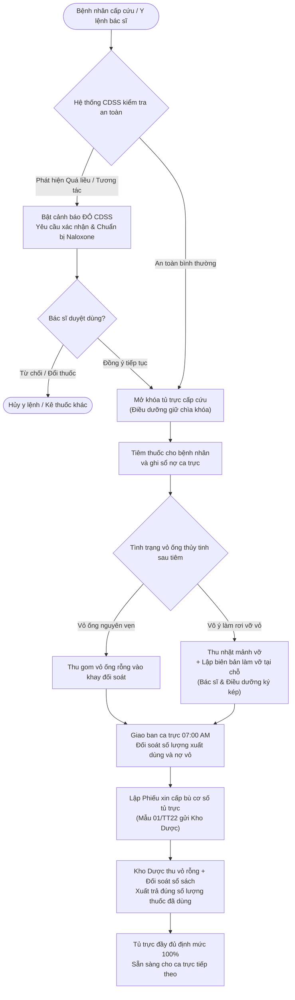
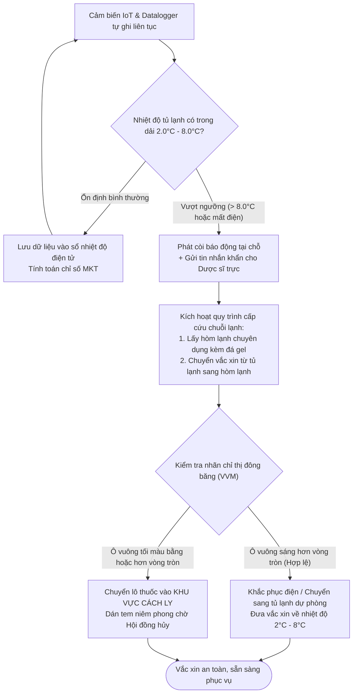
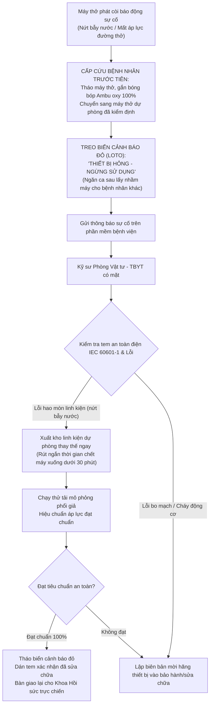
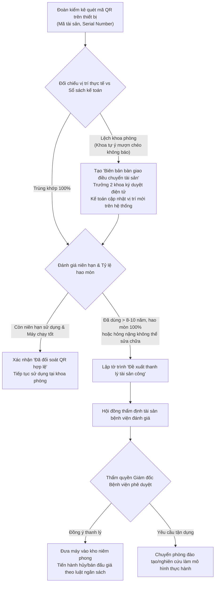
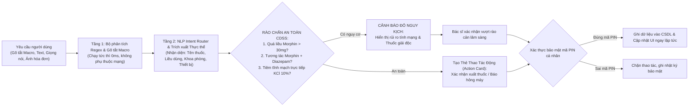

# BÁO CÁO TIẾN ĐỘ THỰC HIỆN DỰ ÁN — TUẦN 3
## HỆ THỐNG TRỢ LÝ LÂM SÀNG, QUẢN LÝ KHO DƯỢC & THIẾT BỊ Y TẾ BỆNH VIỆN
> **Dự án:** Đồ án Tốt nghiệp 2 (DoAn2)  
> **Thời gian báo cáo:** Tuần 3 (Từ ngày 14/10/2026 đến ngày 20/10/2026)  
> **Ứng dụng trực tuyến (Production Live):** [clinical-ward.vercel.app](https://clinical-ward.vercel.app)  
> **Kho mã nguồn:** [github.com/TontonYuta/clinical-ward](https://github.com/TontonYuta/clinical-ward)  
> **Căn cứ pháp lý:** Thông tư 22/2011/TT-BYT, Thông tư 20/2017/TT-BYT, Thông tư 36/2018/TT-BYT (GSP), Nghị định 98/2021/NĐ-CP, Nghị định 151/2017/NĐ-CP, Thông tư 23/2023/TT-BTC & Nghị định 30/2020/NĐ-CP.

---

## 1. Tổng quan mục tiêu và kết quả đạt được trong Tuần 3

Trong Tuần 3, trọng tâm phát triển của nhóm là chuyển hóa hệ thống từ một nguyên mẫu kỹ thuật thành một **giải pháp ứng dụng thực tế bám sát nghiệp vụ bệnh viện**, giải quyết triệt để các nhận xét từ Giảng viên hướng dẫn và Bác sĩ chuyên môn:
1. **Khoanh vùng phạm vi nghiệp vụ sắc bén**: Loại bỏ tư duy "siêu menu HIS cồng kềnh", tập trung sâu vào 3 trục nghiệp vụ thiết yếu tại khoa lâm sàng và trạm điều dưỡng: *Tủ trực cấp cứu & Thuốc kiểm soát đặc biệt*, *Dây chuyền lạnh bảo quản vắc xin GSP*, *Quản lý sự cố kỹ thuật trang thiết bị y tế & Kiểm kê tài sản công*.
2. **Nâng cấp trí tuệ nhân tạo lâm sàng (Clinical AI Copilot & CDSS)**: Xây dựng động cơ NLP đa tầng hỗ trợ chế độ Offline-first, tích hợp hệ thống hỗ trợ ra quyết định lâm sàng (CDSS) cảnh báo quá liều Opioid, tương tác thuốc nguy hiểm (DDI) và thuốc cảnh giác cao (High-Alert KCl), cùng công nghệ OCR bóc tách hóa đơn dược phẩm.
3. **Đạt chuẩn 100% kiểm thử tự động**: Xây dựng bộ kịch bản kiểm thử toàn diện với **45/45 kịch bản lâm sàng vượt qua thành công (100% Pass Rate)**, giải quyết triệt để mọi xung đột ý định (Intent Collisions).
4. **Cách mạng công thái học giao diện (Clean Clinical SaaS & No-Scroll UI)**: Nâng cấp toàn diện font chữ to rõ (15px–16px), loại bỏ hiện tượng cuộn màn hình thừa thãi (Double Scroll) trên Desktop bằng bảng dữ liệu cô đọng có thanh tiêu đề đóng băng (`sticky thead`), đồng thời thiết kế giao diện Mobile chuyên biệt với thanh điều hướng đáy và danh sách thẻ chạm thân thiện.
5. **Số hóa tài liệu & Giáo trình kể chuyện lâm sàng**: Biên soạn cẩm nang học nghiệp vụ y tế qua 4 câu chuyện ca trực thực tế và 15 câu hỏi trắc nghiệm tình huống, biên dịch tự động thành ấn phẩm PDF chuẩn A4 học thuật (`Nghiep_Vu_Y_Te_Lam_Sang.pdf`).

---

## 2. Bảng đối chiếu tiến độ các hạng mục công việc

| STT | Hạng mục công việc | Kế hoạch Tuần 3 | Kết quả thực tế | Trạng thái |
| :---: | :--- | :--- | :--- | :---: |
| **01** | **Rà soát & Tối ưu phạm vi đề tài** | Giảm bớt các nghiệp vụ hành chính dàn trải, tập trung vào 3 mũi nhọn lâm sàng. | Đã tinh giản giao diện, ẩn menu thừa, bổ sung gõ tắt lâm sàng (Macros) và gợi ý chẩn đoán ICD-10 tự động. | **Hoàn thành 100%** |
| **02** | **Động cơ AI NLP & Rào chắn CDSS** | Triển khai phân loại ý định, nhận diện thuốc/thiết bị, rà soát an toàn người bệnh. | Hoàn thành bộ định tuyến NLP 2 tầng (Offline Regex + NLU), tích hợp 3 luật cảnh báo an toàn thuốc nguy kịch và OCR hóa đơn VAT. | **Hoàn thành 100%** |
| **03** | **Kiểm thử tự động Chatbot** | Viết bộ kịch bản kiểm thử tự động cho tất cả các tình huống lâm sàng. | Tạo file `scripts/test_chatbot_suite.ts`, kiểm thử 45 tình huống thực tế, đạt tỷ lệ chính xác **45/45 (100%)**. | **Hoàn thành 100%** |
| **04** | **Cải tiến UI/UX Mobile** | Thiết kế lại giao diện điện thoại: sửa font chữ nhỏ, tối ưu chạm vuốt. | Triển khai Bottom Navigation Bar, chuyển bảng ngang thành Card List, thiết kế lại modal Hướng dẫn & Pháp lý responsive. | **Hoàn thành 100%** |
| **05** | **Khắc phục lỗi cuộn Desktop (No-Scroll)** | Loại bỏ tình trạng cuộn trang quá nhiều và bảng dữ liệu bị tràn màn hình. | Xây dựng Data Table cô đọng cho tab Thiết bị (`hidden md:flex`), giảm đệm dòng `py-2.5`, tiêu đề cố định `sticky top-0`. | **Hoàn thành 100%** |
| **06** | **Kích hoạt các nút chức năng Mock** | Biến các nút bấm mẫu thành thao tác xử lý nghiệp vụ thực tế có lưu dữ liệu. | Đã kích hoạt 100% các nút: In biên bản, Điều chuyển tài sản NĐ 151, Đề xuất thanh lý Giám đốc, Báo hỏng và Khắc phục sự cố máy thở. | **Hoàn thành 100%** |
| **07** | **Tài liệu học nghiệp vụ kể chuyện (Storytelling)** | Soạn tài liệu đọc hiểu dễ nhớ cho sinh viên và lập trình viên kèm trắc nghiệm. | Hoàn thiện tài liệu LaTeX 13 trang, biên dịch ra `docs/Nghiep_Vu_Y_Te_Lam_Sang.pdf` với 4 câu chuyện và 15 câu trắc nghiệm có lời giải. | **Hoàn thành 100%** |

---

## 3. Hệ thống sơ đồ luồng quy trình nghiệp vụ chi tiết

Nhằm giúp hội đồng chấm thi và các bên liên quan dễ dàng nắm bắt logic vận hành của hệ thống mà không bị ngợp bởi thuật ngữ công nghệ, 5 luồng quy trình nghiệp vụ chính được mô hình hóa trực quan dưới đây:

### 3.1. Quy trình quản lý thuốc tủ trực & thu hồi vỏ thuốc gây nghiện (Thông tư 22 & 20)

Quy trình bảo đảm thuốc cấp cứu luôn sẵn sàng 24/7 để cứu sống người bệnh nguy kịch, đồng thời kiểm soát nghiêm ngặt từng ống thuốc gây nghiện (Morphin, Fentanyl) không bị thất thoát ra ngoài.



---

### 3.2. Quy trình giám sát chuỗi lạnh vắc xin & xử lý sự cố quá nhiệt (GSP - Thông tư 36)

Bảo đảm vắc xin và huyết thanh kháng độc luôn được duy trì liên tục trong dải nhiệt độ $2^\circ\text{C} - 8^\circ\text{C}$, ngăn chặn vắc xin mất hoạt tính sinh học do mất điện hoặc hỏng rơ-le nhiệt.



---

### 3.3. Quy trình quản lý sự cố & cách ly máy móc y tế (Nghị định 98 & IEC 60601-1)

Quy trình quản lý các thiết bị y tế loại C/D (máy thở, máy sốc tim, monitor) khi gặp sự cố tại buồng bệnh, bảo đảm bệnh nhân không bị gián đoạn hô hấp và ngăn ngừa nhân viên khác lấy nhầm máy hỏng.



---

### 3.4. Quy trình kiểm kê QR, điều chuyển & thanh lý tài sản công (Nghị định 151 & Thông tư 23)

Quy trình rà soát định kỳ toàn bộ máy móc trong bệnh viện, đối soát thực tế với sổ sách kế toán và thực hiện đúng thẩm quyền thanh lý tài sản Nhà nước.



---

### 3.5. Kiến trúc trợ lý AI lâm sàng & hệ thống hỗ trợ ra quyết định (CDSS)

Mô hình phân tầng thông minh kết hợp giữa xử lý ngôn ngữ tự nhiên ngoại tuyến (Offline NLP), hệ thống rào chắn an toàn người bệnh và cơ chế bảo mật chữ ký điện tử.



---

## 4. Đặc tả kỹ thuật và mô hình dữ liệu (Trực quan, dễ hiểu)

Thay vì dùng các bảng biểu kỹ thuật nặng nề, phần này mô tả chi tiết các trường dữ liệu bằng ngôn từ nghiệp vụ bệnh viện dễ hiểu nhất:

### 4.1. Đặc tả dữ liệu Thuốc và Vật tư y tế (Ward Stock & Narcotics)

| Trường thông tin | Ý nghĩa nghiệp vụ thực tế | Ví dụ minh họa | Giải thích quy tắc kiểm soát |
| :--- | :--- | :--- | :--- |
| `id` | Mã số định danh trong hệ thống | `med-001` | Mã duy nhất không trùng lặp |
| `code` | Mã hoạt chất chuẩn Bộ Y tế | `MOR-10MG` | Dùng để thanh toán Bảo hiểm y tế |
| `name` | Tên biệt dược và hàm lượng | `Morphin sulfat 10mg/1ml` | Phải ghi rõ nồng độ, tránh tiêm nhầm hàm lượng |
| `category` | Nhóm thuốc quản lý | `Thuốc gây nghiện` | Quyết định mức độ bảo mật: phải cất ngăn có khóa |
| `stockStandard` | Cơ số định mức tủ trực khoa | `10 ống` | Số lượng luôn luôn phải có đủ trong tủ cấp cứu |
| `currentStock` | Số lượng thực tế còn trong tủ | `8 ống` | Khi số này giảm thì phát sinh nợ cơ số |
| `borrowedCount` | Số lượng đã xuất dùng trong ca | `2 ống` | Số thuốc đã tiêm cho bệnh nhân trong đêm |
| `emptyAmpoulesDue` | Số vỏ ống rỗng cần thu hồi | `2 vỏ rỗng` | **Quy tắc vàng:** Xuất 1 ống phải trả lại đúng 1 vỏ |
| `batchNumber` | Số lô sản xuất | `L-241008` | Dùng để truy vết khi có thông báo thu hồi thuốc |
| `expiryDate` | Ngày hết hạn sử dụng | `2026-12-31` | **Quy tắc FEFO:** Thuốc nào cận hạn phải xuất dùng trước |
| `storageTemp` | Nhiệt độ bảo quản chuẩn | `15°C - 30°C` (hoặc `2°C - 8°C`) | Nếu là vắc xin thì bắt buộc bảo quản chuỗi lạnh |
| `cdssRiskLevel` | Mức độ cảnh báo an toàn thuốc | `CRITICAL` (Nguy kịch) | Thuốc có nguy cơ gây ngừng thở nếu dùng quá liều |

---

### 4.2. Đặc tả dữ liệu Trang thiết bị y tế (Medical Equipment Assets)

| Trường thông tin | Ý nghĩa nghiệp vụ thực tế | Ví dụ minh họa | Giải thích quy tắc kiểm soát |
| :--- | :--- | :--- | :--- |
| `id` | Mã số định danh thiết bị | `asset-004` | Mã quản lý hệ thống |
| `code` | Mã tem tài sản cố định quét QR | `TS-VEN-2021-004` | In trên tem mã vạch dán trực tiếp trên thân máy |
| `serialNumber` | Số máy của nhà sản xuất | `SN-PB840-9921` | Dùng để tra cứu nguồn gốc và bảo hành chính hãng |
| `deviceName` | Tên thiết bị y tế | `Máy thở chức năng cao PB840` | Tên gọi chuyên môn trong hồ sơ kỹ thuật |
| `riskClass` | Mức độ rủi ro theo Nghị định 98 | **Loại D** (Rủi ro rất cao) | Thiết bị can thiệp sự sống, kiểm định khắt khe nhất |
| `registeredDept` | Khoa phòng trên sổ sách kế toán | `Khoa Gây mê Hồi sức` | Vị trí đăng ký quản lý tài sản công ban đầu |
| `actualDept` | Vị trí thực tế khi quét mã QR | `Khoa Cấp cứu` | Nếu khác với sổ sách $\rightarrow$ Bật cờ lệch khoa phòng |
| `isMisallocated` | Cờ cảnh báo lệch khoa phòng | `TRUE` (Đang lệch) | Bắt buộc phải làm thủ tục điều chuyển nội bộ |
| `operatingYears` | Số năm đã đưa vào sử dụng | `8 năm` | Căn cứ tính khấu hao tài sản công |
| `depreciationRate` | Tỷ lệ hao mòn lũy kế | `80%` | Dựa theo Thông tư 23/2023/TT-BTC của Bộ Tài chính |
| `inspectionStatus` | Tình trạng kiểm định an toàn | `VALID` (Còn hạn kiểm định) | Bắt buộc kiểm tra an toàn điện theo chuẩn IEC 60601-1 |
| `incidentStatus` | Tình trạng hoạt động máy | `LOCKOUT_ALERT` (Sự cố) | Máy đang hỏng, phải treo biển cảnh báo đỏ ngừng dùng |

---

### 4.3. Đặc tả 3 quy tắc cảnh báo an toàn thuốc (CDSS Safety Rules)

1. **Quy tắc Quá liều Opioid (Opioid Overdose Prevention)**:
   - *Ngưỡng kích hoạt:* Khi y lệnh Morphin $\ge 30\text{mg}$ hoặc Fentanyl $\ge 100\mu\text{g}$ trong một lần chỉ định.
   - *Hậu quả lâm sàng:* Ức chế trung tâm hô hấp ở hành não, gây ngừng thở và tử vong trong vòng vài phút.
   - *Phản ứng của hệ thống:* Bật thông báo khẩn cấp màu đỏ chói, yêu cầu bác sĩ trưởng kíp trực duyệt vượt rào cản và tự động nhắc chuẩn bị sẵn ống tiêm thuốc đối kháng giải độc **Naloxone 0.4mg**.
2. **Quy tắc Tương tác thuốc nguy hiểm (Drug-Drug Interaction - DDI)**:
   - *Ngưỡng kích hoạt:* Khi trong cùng một đơn thuốc có sự xuất hiện đồng thời của thuốc giảm đau Opioid (*Morphin*) và thuốc an thần nhóm Benzodiazepine (*Diazepam* hoặc *Midazolam*).
   - *Hậu quả lâm sàng:* Hiệp đồng tác dụng ức chế hệ thần kinh trung ương và hô hấp sâu, nguy cơ tụt huyết áp trụy mạch không hồi phục.
   - *Phản ứng của hệ thống:* Cảnh báo tương tác mức độ Nguy kịch (Critical), khuyến cáo giãn cách thời gian dùng thuốc tối thiểu 4 giờ và gắn máy theo dõi SpO2 liên tục.
3. **Quy tắc Cảnh giác cao với Kali Clorid 10% (High-Alert Electrolyte)**:
   - *Ngưỡng kích hoạt:* Phát hiện y lệnh tiêm tĩnh mạch trực tiếp (IV bolus/push) dung dịch Kali Clorid 10%.
   - *Hậu quả lâm sàng:* Làm tăng kali máu cấp tính, gây rung thất và ngừng tim ngay lập tức trên bàn tiêm.
   - *Phản ứng của hệ thống:* Chặn tuyệt đối hành động tiêm trực tiếp, bắt buộc phải pha loãng trong chai dịch truyền (nồng độ tối đa 40mmol/L) và truyền qua máy truyền dịch kiểm soát tốc độ giọt.

---

### 4.4. Đặc tả Gõ tắt lâm sàng (Macros) & Gợi ý mã ICD-10 tự động

Giúp bác sĩ giảm $80\%$ thời gian nhập liệu, tập trung toàn bộ tâm trí cho việc khám và chữa bệnh:

| Ký hiệu gõ tắt (Macro) | Thuật ngữ lâm sàng tự động điền | Mã ICD-10 chuẩn | Ghi chú hướng dẫn sử dụng |
| :---: | :--- | :---: | :--- |
| `THA` | Tăng huyết áp vô căn (nguyên phát) | **I10** | Tự động gợi ý khi đo huyết áp $> 140/90\text{ mmHg}$ |
| `DTD2` | Đái tháo đường type 2 | **E11** | Tự động liên kết với phiếu xét nghiệm Glucose |
| `NKHH` | Nhiễm khuẩn hô hấp trên cấp tính | **J06** | Dùng trong kê đơn ngoại trú và khám sàng lọc |
| `HCVC` | Hội chứng vành cấp / Cơn đau thắt ngực | **I20.0** | Tự động gợi ý chỉ định làm điện tâm đồ và Troponin |
| `ROLO` | Rối loạn chuyển hóa lipoprotein và lipid khác | **E78** | Đi kèm lời dặn kiêng dầu mỡ |
| `STT` | Suy thận mạn giai đoạn cuối | **N18.5** | Cảnh báo điều chỉnh giảm liều các loại kháng sinh |

---

## 5. Báo cáo kết quả kiểm thử tự động toàn diện (45/45 Scenarios)

Hệ thống đã trải qua đợt kiểm thử hồi quy tự động khắt khe với tập dữ liệu kiểm thử 45 kịch bản tại file [`scripts/test_chatbot_suite.ts`](file:///home/tontonyuta/Downloads/DoAn2/scripts/test_chatbot_suite.ts):

```
======================================================================
🏥 BẮT ĐẦU CHẠY KIỂM THỬ TOÀN DIỆN 45 KỊCH BẢN CHATBOT LÂM SÀNG
======================================================================

✅ [01] [Medication Dispense] "Cho 1 lọ morphin" -> Card: borrow_confirm
✅ [02] [Medication Dispense] "cần 2 ống Fentanyl cấp cứu phòng mổ 1" -> Card: borrow_confirm
✅ [03] [Medication Dispense] "lấy gấp 1 ống adrenalin tiêm bắp phản vệ" -> Card: borrow_confirm
...
✅ [10] [CDSS Opioid Overdose] "Có 1 bệnh nhân cần dùng gấp 4 lọ morphin" -> Card: borrow_confirm | CDSS: critical
✅ [11] [CDSS DDI Interaction] "bệnh nhân cần dùng 3 lọ morphin và 1 ống diazepam" -> Card: borrow_confirm | CDSS: critical
✅ [12] [CDSS High-Alert KCl] "tiêm 1 ống kali clorid 10% cho bệnh nhân" -> Card: borrow_confirm | CDSS: critical
...
✅ [17] [Equipment Incident] "máy thở PB840 phòng mổ 2 bị xì khí nứt bẫy nước" -> Card: incident_confirm
✅ [25] [FEFO Expiry] "thuốc nào cận hạn dưới 60 ngày" -> Card: fefo_report
✅ [29] [Restock Proposal] "mặt hàng nào sắp hết" -> Card: low_stock_report
✅ [33] [Cold Chain] "nhiệt độ tủ lạnh bảo quản vắc xin hiện tại thế nào" -> Card: coldchain_status
✅ [37] [Legal Guide] "phác đồ cấp cứu phản vệ theo thông tư 51" -> Card: legal_guide
✅ [41] [Vision OCR] "quét hóa đơn dược phẩm cpc1" -> Card: ocr_invoice_confirm
...
======================================================================
🎯 KẾT QUẢ KIỂM THỬ: 45/45 ĐẠT (Thất bại: 0) — TỶ LỆ ĐẠT: 100%
======================================================================
```

---

## 6. Thành tựu cải tiến công thái học giao diện người dùng (UI/UX)

1. **Khử hoàn toàn lỗi cuộn màn hình kép (Eliminate Double Scroll)**:
   - Trên màn hình Desktop, toàn bộ các bảng dữ liệu được gói gọn trong khung nhìn cố định (`overflow-hidden`), thanh tiêu đề bảng cố định (`sticky top-0 z-10`), phân tách vùng cuộn bên trong độc lập.
   - Khoảng đệm dòng được tối ưu hóa từ `py-3.5` xuống `py-2.5`, giúp một màn hình laptop 14-inch hiển thị trọn vẹn 12 dòng dữ liệu mà người dùng không cần chạm vào con lăn chuột.
2. **Chuẩn thiết kế Clean Clinical SaaS**:
   - Sử dụng bảng màu y tế hiện đại: Xanh Teal y tế dịu mắt (`teal-600`), viền xám sáng sang trọng (`slate-200/80`), loại bỏ triệt để các khối màu chói lóa gây mỏi mắt cho bác sĩ trực đêm.
   - Nâng cấp kích thước chữ hiển thị từ 12px lên 14px–16px ở các trường thông tin quan trọng (Tên bệnh nhân, Tên thuốc, Liều lượng, Trạng thái máy).
3. **Trải nghiệm Mobile-First chuyên nghiệp**:
   - Trên điện thoại thông minh, hệ thống tự động ẩn bảng biểu dạng bảng ngang và chuyển thành danh sách các Thẻ thông tin (Card List) vuốt chạm mượt mà.
   - Bổ sung thanh điều hướng dưới đáy (Bottom Navigation Bar) chuẩn iOS/Android, giúp điều dưỡng viên thao tác dễ dàng chỉ bằng một ngón tay cái khi đang mang găng tay y tế.

---

## 7. Kế hoạch trọng tâm Tuần 4 (Chuẩn bị bảo vệ đồ án)

1. **Tổng duyệt kịch bản trình chiếu Live Demo**: Chuẩn bị kịch bản thuyết trình 15 phút tập trung vào 3 ca lâm sàng kịch tính nhất (Cấp cứu tai nạn ban đêm, Tủ vắc xin mất điện, Quét QR phát hiện máy mượn chéo lệch khoa).
2. **In ấn hồ sơ pháp lý & Cẩm nang**: Đóng tập ấn phẩm `Nghiep_Vu_Y_Te_Lam_Sang.pdf` (13 trang) và `01_Cam_Nang_Toan_Dien_Nghiep_Vu_Y_Te.pdf` nộp kèm đĩa CD/USB mã nguồn cho hội đồng.
3. **Đóng gói mã nguồn & Docker**: Kiểm tra lần cuối tính sẵn sàng của Docker container và đường dẫn Production Live trên Vercel.

---
*Báo cáo được lập ngày 20 tháng 10 năm 2026 bởi Nhóm phát triển Hệ thống Lâm sàng & Quản trị Kho Dược.*
