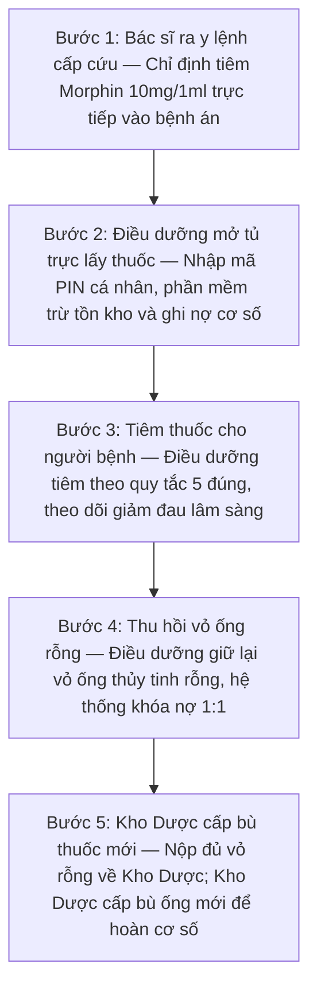
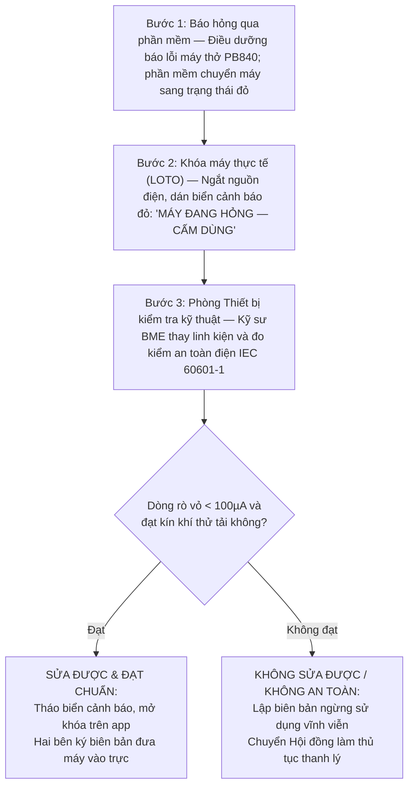
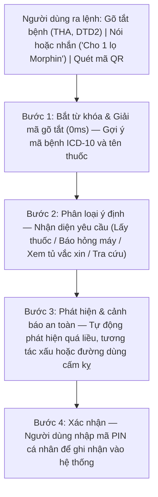

# BÁO CÁO TIẾN ĐỘ TUẦN 3 — ĐỒ ÁN 2
## Hệ thống quản lý kho dược và thiết bị y tế trong bệnh viện kết hợp AI chatbot

- **Sinh viên thực hiện:** **Trần Huy Hoàng** | **MSSV:** **20237337** | **Tháng 10/2026**
- **Prototype trực tuyến:** [clinical-ward.vercel.app](https://clinical-ward.vercel.app)
- **Mã nguồn:** [github.com/TontonYuta/clinical-ward](https://github.com/TontonYuta/clinical-ward)
- **Tài liệu quy định tham chiếu:** Thông tư 20/2017/TT-BYT (Thuốc gây nghiện), Thông tư 22/2011/TT-BYT (Dược lâm sàng), Thông tư 36/2018/TT-BYT (Thực hành tốt bảo quản thuốc GSP), Nghị định 98/2021/NĐ-CP (Quản lý trang thiết bị y tế), Tiêu chuẩn quốc tế an toàn điện y tế IEC 60601-1.

---

## 1. Đặt vấn đề

Trong ca trực cấp cứu ban đêm tại bệnh viện (từ 01:00 đến 04:00 sáng), người bệnh nhập viện trong tình trạng nguy kịch (sốc phản vệ, nhồi máu cơ tim, suy hô hấp). Khác hoàn toàn với mô hình kho hàng thương mại hay mua bán hàng hóa thông thường, hoạt động quản trị buồng bệnh cấp cứu bị chi phối bởi **ba yếu tố đặc thù**:

* **Cứu người trước, hoàn tất thủ tục sau:** Người bệnh đe dọa tính mạng không thể chờ đóng viện phí rồi Kho Dược mới phát thuốc. Điều dưỡng phải được phép rút khẩn cấp thuốc từ Tủ trực khoa lâm sàng để tiêm ngay, sau đó mới hợp thức hóa thủ tục bù cơ số sau.
* **Kiểm soát thuốc ma túy y tế nghiêm ngặt:** Thuốc gây nghiện (Morphin, Fentanyl) có nguy cơ lạm dụng cao. Pháp luật y tế (Thông tư 20/2017/TT-BYT) quy định: *"Phải nộp lại vỏ ống thuốc rỗng mới được cấp bù ống thuốc mới"*. Đầu ca nhận bao nhiêu ống, cuối ca bàn giao phải đủ bấy nhiêu.
* **An toàn thiết bị can thiệp sự sống:** Máy móc y tế như máy thở hay máy sốc tim nếu gặp sự cố phải có quy trình khóa an toàn, tuyệt đối không để người khác dùng nhầm cho người bệnh.

---

## 2. Các quy trình nghiệp vụ lâm sàng qua ví dụ thực tế

### 2.1. Tình huống 1 — Mượn khẩn thuốc tủ trực & Đối soát vỏ ống thuốc gây nghiện

**Bối cảnh:** Lúc 02:15 sáng, người bệnh vào cấp cứu trong tình trạng sốc đau dữ dội do nhồi máu cơ tim cấp. Bác sĩ ra y lệnh tiêm khẩn cấp 01 ống Morphin 10mg/1ml. Quy trình luân chuyển thuốc và vỏ rỗng diễn ra qua 5 bước nghiêm ngặt theo Thông tư 20/2017/TT-BYT và Thông tư 22/2011/TT-BYT:

**Quy tắc an toàn khi xảy ra sự cố:** Khi giao ban lúc 07:00 sáng, nếu thiếu vỏ ống Morphin đã dùng, phần mềm tự động khóa quyền xuất thuốc gây nghiện tiếp theo. Trường hợp điều dưỡng vô tình làm vỡ vỏ ống trong lúc bẻ nắp, theo Điều 15 Thông tư 20/2017, điều dưỡng phải thu gom các mảnh vỡ và lập *Biên bản giải trình vỡ ống thuốc gây nghiện* có chữ ký của bác sĩ trực ca làm chứng, nộp về Kho Dược mới được mở khóa cấp bù.

### 2.2. Tình huống 2 — Sự cố ở thiết bị cấp cứu & Khóa an toàn

**Bối cảnh:** Lúc 03:30 sáng, máy thở PB840 tại buồng hồi sức báo lỗi xì khí bẫy nước và rách cảm biến oxy. Trong buồng bệnh cấp cứu, nếu máy hỏng để nguyên vị trí mà không có biển báo, kíp trực sau vào cấp cứu có thể nối nhầm máy hỏng cho bệnh nhân nguy kịch tiếp theo.

Do đó, phần mềm kích hoạt quy trình khóa an toàn **LOTO (Lockout / Tagout)** kết hợp đo kiểm an toàn điện y tế theo chuẩn quốc tế **IEC 60601-1** và Nghị định 98/2021/NĐ-CP:

### 2.3. Tình huống 3 — Quản lý thuốc theo hạn dùng FEFO (Thông tư 36/2018 GSP)

**Tại sao kho dược bệnh viện bắt buộc dùng FEFO thay vì FIFO?**
* **Hạn chế của FIFO (Nhập trước xuất trước):** Trong cung ứng dược phẩm, nhà phân phối có thể giao một lô thuốc nhập sau nhưng hạn sử dụng in trên bao bì lại ngắn hơn lô nhập trước. Nếu máy móc áp dụng FIFO theo kiểu hàng tạp hóa, lô thuốc cận hạn sẽ bị lưu cữu ở đáy kho đến khi hết hạn và phải tiêu hủy, gây lãng phí hàng trăm triệu đồng ngân sách bệnh viện.
* **Nguyên tắc FEFO (Hạn gần dùng trước):** Thông tư 36/2018/TT-BYT GSP bắt buộc mọi phần mềm kho dược phải xếp thuốc theo hạn dùng thực tế: thuốc có hạn dùng gần nhất được ưu tiên xuất trước.

| Mức cảnh báo | Thời gian hạn dùng | Hành vi tự động của hệ thống | Cách xử lý của kíp trực |
| :---: | :--- | :--- | :--- |
| **An toàn** | Còn hạn $> 6$ tháng | Hiển thị nhãn xanh, cấp phát và sử dụng bình thường. | Kê đơn theo định mức. |
| **Cận hạn** | Còn hạn $3 - 6$ tháng | Đổi nhãn vàng, tự động đẩy lên đầu danh sách kê đơn. | **Ưu tiên dùng trước**. |
| **Nguy cơ quá hạn** | Còn hạn $< 3$ tháng | Bật cảnh báo đỏ, gửi thông báo đề xuất điều chuyển. | Điều chuyển khoa dùng nhiều hoặc trả Kho Dược. |

---

## 3. Ý nghĩa và vai trò thực tế của Chatbot trong Đồ án 2

### 3.1. Bản chất: Trợ lý lâm sàng chuyên trách cạnh giường bệnh (Bedside Copilot)

Trong ca trực cấp cứu, bác sĩ và điều dưỡng đang đeo găng tay cao su vô trùng, hai tay bận ép tim, đặt ống nội khí quản hoặc giữ ven truyền dịch. Việc bắt nhân viên y tế cởi găng tay ra để cầm chuột bấm qua 4–5 tầng menu phần mềm là nguyên nhân gây chậm trễ cấp cứu.

Chatbot đóng vai trò là một **trợ lý lâm sàng**: lắng nghe câu lệnh tự nhiên hoặc từ gõ tắt của bác sĩ, kiểm tra an toàn y khoa tức thì và tạo sẵn phiếu nghiệp vụ.

### 3.2. Tác dụng cụ thể của Chatbot trong ca trực cấp cứu

* **Ra lệnh siêu tốc và gõ tắt ICD-10:** Bác sĩ gõ `THA` ra "Tăng huyết áp vô căn (I10)", `DTD2` ra "Đái tháo đường type 2 (E11)", giúp giảm $80\%$ thao tác nhập liệu khi đang khám chữa bệnh.
* **Rào chắn an toàn thuốc tự động (CDSS):** Tự động phát hiện và chặn các lỗi kê đơn nguy hiểm: quá liều Morphin $\ge 30\text{mg}$, phối hợp Morphin cùng Diazepam gây ngừng thở, tiêm tĩnh mạch trực tiếp Kali Clorid 10% hoặc dị ứng Penicillin.
* **Tự sinh thẻ thao tác (Action Card) có bảo mật:** Trích xuất đúng tên thuốc, khoa phòng, sinh sẵn thẻ mượn thuốc hoặc báo hỏng. Người dùng bắt buộc nhập mã PIN cá nhân để xác nhận chịu trách nhiệm chuyên môn.
* **Chạy ngoại tuyến 100% ($0\text{ms}$) và chống ảo giác:** Định tuyến trực tiếp trên trình duyệt, bệnh viện mất mạng Internet vẫn hoạt động bình thường. Logic do backend thực thi độc lập nên loại bỏ hoàn toàn rủi ro AI ảo giác kê sai thuốc.

---

## 4. Kế hoạch Tuần 4

1. **Chuẩn bị kịch bản Live Demo 15 phút trước Hội đồng:** Trình diễn 3 tình huống:
   - (1) Rút khẩn Morphin ca đêm và đối soát trả vỏ ống $1:1$;
   - (2) Báo hỏng máy thở khóa LOTO đo an toàn điện IEC 60601-1;
   - (3) Chatbot chặn quá liều Morphin và tiêm nhầm KCl 10%.
2. **Đóng gói mã nguồn và hoàn thiện hồ sơ:** Đóng gói toàn bộ hệ thống lên môi trường Docker cục bộ, chuẩn bị slide thuyết trình và in ấn hồ sơ báo cáo nộp cho Giảng viên hướng dẫn.

---

*Báo cáo tiến độ Tuần 3 được biên soạn bởi sinh viên Trần Huy Hoàng (MSSV: 20237337).*

| **Sinh viên thực hiện** | **Giảng viên hướng dẫn duyệt** |
| :---: | :---: |
| **Trần Huy Hoàng** | *(Ký và ghi rõ họ tên)* |
