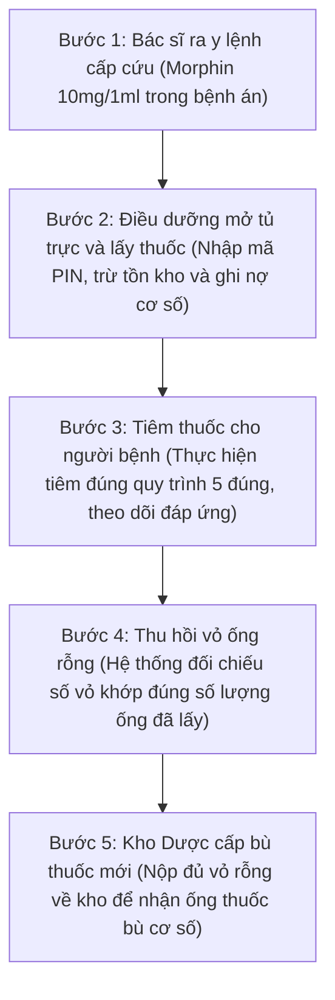
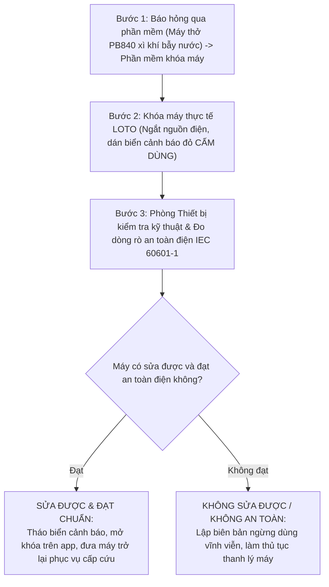
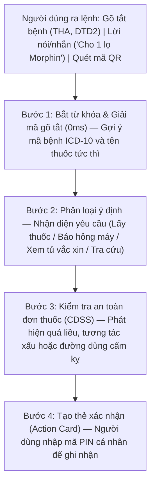

# BÁO CÁO TIẾN ĐỘ THỰC HIỆN DỰ ÁN — TUẦN 3
## HỆ THỐNG TRỢ LÝ LÂM SÀNG, QUẢN LÝ KHO DƯỢC VÀ THIẾT BỊ Y TẾ BỆNH VIỆN

- **Đồ án tốt nghiệp 2:** Ngành Công nghệ Thông tin
- **Sinh viên thực hiện:** **Trần Huy Hoàng** — MSSV: **20237337**
- **Thời gian báo cáo:** Tuần 3 (Tháng 10/2026)
- **Ứng dụng trực tuyến:** [clinical-ward.vercel.app](https://clinical-ward.vercel.app)
- **Mã nguồn:** [github.com/TontonYuta/clinical-ward](https://github.com/TontonYuta/clinical-ward)
- **Tài liệu quy định tham chiếu:** Thông tư 22/2011/TT-BYT (Dược lâm sàng), Thông tư 20/2017/TT-BYT (Thuốc gây nghiện), Thông tư 36/2018/TT-BYT (Bảo quản vắc xin), Nghị định 98/2021/NĐ-CP (Thiết bị y tế), Thông tư 23/2023/TT-BTC (Tài sản công), Chuẩn an toàn điện y tế IEC 60601-1.

---

## 1. Xác định lại phạm vi bài toán của đồ án

### 1.1. Lý do điều chỉnh và thu gọn phạm vi
Ban đầu, đề tài hướng tới xây dựng hệ thống quản lý tổng thể bệnh viện (HIS). Tuy nhiên, qua quá trình làm việc thực tế cùng góp ý của giảng viên hướng dẫn và bác sĩ lâm sàng, phạm vi ban đầu bộc lộ hai bất cập lớn:
1. **Phạm vi quá rộng:** HIS bao trùm tiếp đón, tài chính viện phí, bảo hiểm y tế đến kho tổng khiến đề tài bị dàn trải, khó đi sâu nghiệp vụ và khó trình bày khi bảo vệ.
2. **Giao diện bị quá tải:** Gom tất cả tính năng vào một màn hình khiến y bác sĩ phải tìm kiếm qua nhiều tầng menu phức tạp và thao tác cuộn chuột liên tục.

### 1.2. Phạm vi trọng tâm sau khi điều chỉnh
Nhóm quyết định thu hẹp phạm vi, tập trung giải quyết bài toán cốt lõi tại **Khoa Lâm sàng (Clinical Ward)** theo tư duy thiết kế theo vai trò (Role-based Design):
- **Màn hình Bác sĩ:** Ra y lệnh cấp cứu nhanh, tra cứu mã bệnh ICD-10 và kiểm tra cảnh báo an toàn đơn thuốc (CDSS: quá liều, tương tác thuốc).
- **Màn hình Điều dưỡng:** Xuất dùng thuốc tại tủ trực cấp cứu, theo dõi thu hồi vỏ thuốc gây nghiện và ghi nhận báo hỏng thiết bị.
- **Hai nhóm đối tượng trọng tâm:** Thuốc/vắc xin tủ trực (Morphin theo TT 20/2017/TT-BYT, nhiệt độ $2^\circ\text{C} - 8^\circ\text{C}$ VVM) và thiết bị y tế (quét QR vị trí, khóa LOTO theo IEC 60601-1).

### 1.3. Bảng phân định phạm vi chức năng thực hiện trong đồ án

| Nhóm nghiệp vụ | Nội dung đồ án tập trung thực hiện | Phần lược bỏ (ngoài phạm vi) |
| :--- | :--- | :--- |
| **Dược và Tủ trực** | Xuất dùng thuốc cấp cứu, ghi nợ cơ số tủ trực, truy vết vỏ thuốc gây nghiện $1:1$, nhiệt độ vắc xin VVM. | Đấu thầu thuốc tập trung, nhập khẩu dược phẩm, thanh toán BHYT. |
| **Thiết bị y tế** | Quét mã QR kiểm kê, cờ cảnh báo máy để sai khoa phòng, quy trình khóa an toàn LOTO khi máy hỏng. | Đấu thầu mua sắm máy lớn, bảo dưỡng chuyên sâu của hãng sản xuất. |
| **Hỗ trợ ra y lệnh** | Chatbot nhận diện giọng nói/gõ tắt, kiểm tra 4 cảnh báo an toàn đơn thuốc, tạo thẻ xác nhận có mã PIN. | Chẩn đoán hình ảnh AI chuyên sâu (MRI/CT), quản lý viện phí thu ngân. |

---

## 2. Các quy trình nghiệp vụ đã tìm hiểu (Phần 1: Dược lâm sàng)

### 2.1. Quy trình xuất dùng thuốc gây nghiện và thu hồi vỏ rỗng (Thông tư 20/2017/TT-BYT)

Thuốc gây nghiện (như Morphin, Fentanyl) tại tủ trực khoa bắt buộc cất trong ngăn riêng có khóa. Khi lấy thuốc tiêm cho người bệnh, quy trình luân chuyển thuốc và vỏ rỗng qua 5 bước:

### 2.2. Theo dõi nhiệt độ bảo quản vắc xin và chỉ thị nhiệt độ VVM

Theo Thông tư 36/2018/TT-BYT và hướng dẫn của WHO, vắc xin cần bảo quản từ $+2^\circ\text{C}$ đến $+8^\circ\text{C}$. Trên lọ vắc xin có nhãn chỉ thị nhiệt độ VVM (Vaccine Vial Monitor) đổi màu theo nhiệt độ tích lũy:

| Mức chỉ thị | Màu sắc miếng dán VVM | Tình trạng chất lượng vắc xin | Cách xử lý |
| :---: | :--- | :--- | :--- |
| **Mức 1** | Ô vuông trong màu trắng, sáng hơn nhiều so với vòng tròn ngoài. | Vắc xin được bảo quản tốt, chưa bị nóng. | **Dùng bình thường** (Theo hạn dùng) |
| **Mức 2** | Ô vuông trong hơi sẫm màu nhưng vẫn sáng hơn vòng tròn ngoài. | Đã tiếp xúc với nhiệt độ môi trường ở mức cho phép, chất lượng còn tốt. | **Được phép dùng** (Ưu tiên dùng trước) |
| **Mức 3** | Ô vuông trong đổi màu tối bằng đúng màu vòng tròn ngoài. | Điểm giới hạn (Discard Point): Kháng nguyên bắt đầu bị biến tính. | **Ngừng dùng ngay** |
| **Mức 4** | Ô vuông trong tối hơn hẳn so với vòng tròn ngoài. | Vắc xin đã bị hỏng hoàn toàn do tích lũy nhiệt độ quá mức. | **Hủy bỏ lập biên bản** |

### 2.3. Nguyên tắc xuất kho FEFO (Hạn gần dùng trước)
Hệ thống tự động xếp danh mục thuốc theo hạn sử dụng. Thuốc có hạn dùng gần nhất được ưu tiên xuất trước. Khi hạn dùng dưới 60 ngày, hệ thống tự động đổi màu cảnh báo vàng và đẩy lên đầu danh sách để kíp trực ưu tiên dùng, tránh lãng phí dược phẩm.

---

## 3. Các quy trình nghiệp vụ đã tìm hiểu (Phần 2: Thiết bị y tế)

### 3.1. Quy trình kiểm kê thiết bị bằng mã QR và phát hiện máy để sai vị trí
- **Phát hiện máy mượn chéo lệch khoa:** Đối chiếu vị trí thực tế quét được với vị trí trên sổ sách kế toán. Nếu phát hiện mượn chéo lệch khoa (ví dụ: máy thở thuộc Phòng mổ nhưng quét tại Cấp cứu), hệ thống báo cờ vàng và tạo phiếu điều chuyển nội bộ.
- **Theo dõi hao mòn máy:** Tự động tính số năm đã dùng và tỷ lệ hao mòn tài sản lũy kế theo Thông tư 23/2023/TT-BTC phục vụ công tác đề xuất mua sắm thay thế.

### 3.2. Quy trình xử lý sự cố thiết bị y tế — Khóa an toàn LOTO (IEC 60601-1)

Khi máy thở hoặc máy theo dõi bị hỏng (xì khí, chập điện, lỗi cảm biến), nhân viên báo lỗi trên phần mềm. Hệ thống chuyển máy sang trạng thái cảnh báo đỏ và kích hoạt quy trình khóa máy LOTO (Lockout / Tagout) để tránh việc người khác dùng nhầm cho bệnh nhân:

### 3.3. Phân loại rủi ro thiết bị y tế theo Nghị định 98/2021/NĐ-CP

| Mức rủi ro | Thiết bị ví dụ | Mục đích sử dụng lâm sàng | Yêu cầu kiểm tra an toàn |
| :---: | :--- | :--- | :--- |
| **Loại A** | Bơm tiêm, găng tay y tế | Dụng cụ tiêu hao thông thường, không can thiệp sâu. | Tiêu chuẩn cơ sở áp dụng |
| **Loại B** | Máy đo điện tim 3 cần | Theo dõi chẩn đoán gián tiếp ngoài da, không xâm lấn. | Đăng ký lưu hành tiêu chuẩn |
| **Loại C** | Máy sốc tim, monitor | Can thiệp cấp cứu, theo dõi nhịp tim người bệnh. | Kiểm tra an toàn điện hằng năm |
| **Loại D** | Máy thở chức năng cao | Hỗ trợ hoặc thay thế chức năng thở sống còn. | Kiểm định nghiêm ngặt IEC 60601-1 |

---

## 4. Tác dụng của Chatbot trong dự án

### 4.1. Lý do cần Chatbot trong môi trường bệnh viện
Trong ca trực cấp cứu ban đêm, bác sĩ và điều dưỡng chịu áp lực thời gian rất lớn. Việc bắt buộc người dùng mở từng thư mục, gõ bàn phím dài dòng hoặc bấm chuột qua 4–5 tầng menu để xuất một ống thuốc là nguyên nhân gây chậm trễ cấp cứu. Chatbot trong đồ án đóng vai trò như một **trợ lý lâm sàng chuyên trách**:

### 4.2. 4 Tác dụng cụ thể của Chatbot trong dự án

| STT | Tác dụng của Chatbot | Cách hoạt động thực tế | Giá trị đem lại cho kíp trực |
| :---: | :--- | :--- | :--- |
| 1 | **Ra y lệnh và gõ tắt chẩn đoán siêu tốc** | Bác sĩ gõ `THA` tự gợi ý "Tăng huyết áp vô căn (I10)", `DTD2` ra "Đái tháo đường type 2 (E11)". | Giảm $80\%$ thời gian nhập liệu bàn phím trong lúc khám bệnh. |
| 2 | **Cảnh báo an toàn thuốc tự động (CDSS)** | Tự phát hiện: Quá liều Opioid, tương tác Morphin + Diazepam, chặn tiêm tĩnh mạch trực tiếp KCl 10%, dị ứng Penicillin. | Ngăn ngừa sự cố y khoa đe dọa tính mạng người bệnh. |
| 3 | **Tạo thẻ thao tác (Action Card) có bảo mật** | Trích xuất đúng tên thuốc, khoa phòng, tạo thẻ hành động; yêu cầu nhập mã PIN cá nhân để xác nhận. | Tránh nhầm lẫn dữ liệu và bảo đảm trách nhiệm cá nhân. |
| 4 | **Chạy ngoại tuyến hoàn toàn ($0\text{ms}$)** | Bộ định tuyến Regex chạy trực tiếp trên máy trình duyệt, không cần kết nối Internet ra bên ngoài. | Hoạt động liên tục $24/7$ ngay cả khi bệnh viện mất mạng. |

### 4.3. 3 Điểm cải tiến giao diện theo góp ý chuyên môn bác sĩ
1. **Gõ tắt phác đồ mẫu (Order Sets):** Có nút sao chép nhanh diễn biến bệnh từ ngày hôm trước sang ngày hôm sau để bác sĩ không phải gõ lại từ đầu.
2. **Xem lịch sử theo dòng thời gian (Timeline):** Biểu đồ nhịp tim, huyết áp hiển thị trực quan; cố định khung thông tin dị ứng màu đỏ ở góc màn hình để bác sĩ không bị bỏ sót.
3. **Chuẩn hóa cấu trúc dữ liệu theo HL7 FHIR:** Tương thích với các đối tượng y tế chuẩn quốc tế (`MedicationRequest`, `MedicationStatement`, `Observation`, `Condition`).

---

## 5. Kiểm chứng thực tế, giao diện người dùng và kế hoạch tuần 4

### 5.1. Kết quả kiểm thử tự động 45 kịch bản (45/45 Passed)

Toàn bộ 45 kịch bản giao tiếp và cảnh báo an toàn được kiểm tra tự động qua bộ mã kiểm thử tích hợp ([`test_chatbot_suite.ts`](file:///home/tontonyuta/Downloads/DoAn2/scripts/test_chatbot_suite.ts)):

| Nhóm | Nhóm kịch bản kiểm thử | Ví dụ câu lệnh kiểm thử | Kết quả |
| :---: | :--- | :--- | :---: |
| Nhóm 1 | Lấy thuốc tủ trực cấp cứu | "Cho 1 lọ morphin", "Lấy gấp 2 ống Fentanyl mổ 1" | Đạt $9 / 9$ ($100\%$) |
| Nhóm 2 | Báo hỏng máy và khóa LOTO | "Máy thở PB840 xì khí bẫy nước", "Máy hút dịch hỏng" | Đạt $8 / 8$ ($100\%$) |
| Nhóm 3 | Cảnh báo an toàn đơn thuốc | "Dùng 4 lọ morphin", "Tiêm trực tiếp 1 ống KCl 10%" | Đạt $8 / 8$ ($100\%$) |
| Nhóm 4 | Theo dõi nhiệt độ và hạn dùng | "Thuốc nào cận hạn dưới 60 ngày", "Tủ vắc xin bao độ" | Đạt $10 / 10$ ($100\%$) |
| Nhóm 5 | Tra cứu quy định và quét OCR | "Phác đồ phản vệ TT 51", "Quét hóa đơn dược phẩm" | Đạt $10 / 10$ ($100\%$) |
| **TỔNG KẾT** | **KIỂM THỬ:** | | **45 / 45 ($100\%$)** |

- **Đánh giá kết quả kỹ thuật:** Chatbot phản hồi tức thì ($0\text{ms}$), nhận diện đúng từ khóa của thuốc và máy móc, không bị nhầm lẫn giữa hai loại. Mọi lượt xuất thuốc và báo hỏng đều được lưu vết nhật ký kiểm toán bằng mã băm SHA-256 để chống sửa đổi dữ liệu.

### 5.2. Cải tiến giao diện người dùng (UI/UX)
- **Sửa lỗi cuộn trang trên máy tính (Double Scroll):** Cố định tiêu đề bảng dữ liệu (`sticky header`), chỉnh lại chiều cao dòng để màn hình laptop 14 inch xem được đầy đủ mà không phải cuộn chuột nhiều lần.
- **Màu sắc dịu mắt:** Dùng tông xanh Teal y tế (`teal-600`) nhẹ nhàng, phân chia rõ ràng các khối thông tin, tránh gây mỏi mắt cho bác sĩ và điều dưỡng khi trực ca đêm.
- **Tối ưu cho điện thoại di động:** Bảng dữ liệu tự đổi thành dạng thẻ (Card List) vuốt chạm mượt mà; thanh điều hướng đặt ở đáy màn hình để thuận tiện thao tác bằng ngón tay cái.

### 5.3. Kế hoạch trọng tâm Tuần 4 (Chuẩn bị bảo vệ đồ án)
1. **Chuẩn bị kịch bản Live Demo 15 phút:** Trình bày 3 tình huống chính: Lấy thuốc gây nghiện cấp cứu ban đêm, Tủ vắc xin bị mất điện, và Quét mã QR phát hiện máy thở để sai khoa phòng.
2. **Đóng gói mã nguồn và tài liệu:** Hoàn thiện mã nguồn trên GitHub, chạy thử môi trường Docker và in ấn tài liệu nộp cho Hội đồng chấm đồ án.

---

*Báo cáo tiến độ Tuần 3 được biên soạn bởi sinh viên Trần Huy Hoàng (MSSV: 20237337).*
