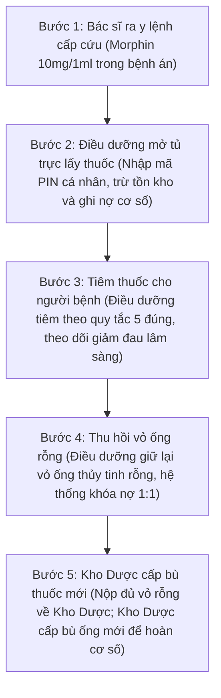
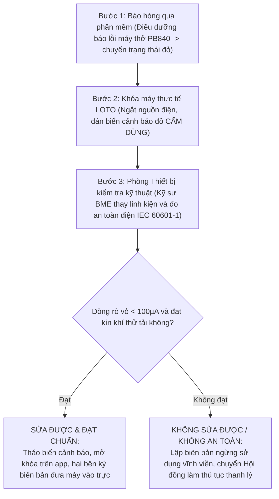
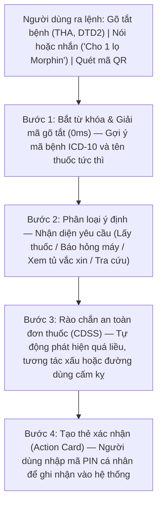

# BÁO CÁO TIẾN ĐỘ THỰC HIỆN DỰ ÁN — TUẦN 3
## HỆ THỐNG TRỢ LÝ LÂM SÀNG, QUẢN LÝ KHO DƯỢC VÀ THIẾT BỊ Y TẾ BỆNH VIỆN

- **Đồ án tốt nghiệp 2:** Ngành Công nghệ Thông tin
- **Sinh viên thực hiện:** **Trần Huy Hoàng** — MSSV: **20237337**
- **Thời gian báo cáo:** Tuần 3 (Tháng 10/2026)
- **Ứng dụng trực tuyến:** [clinical-ward.vercel.app](https://clinical-ward.vercel.app)
- **Mã nguồn:** [github.com/TontonYuta/clinical-ward](https://github.com/TontonYuta/clinical-ward)
- **Tài liệu quy định tham chiếu:** Thông tư 22/2011/TT-BYT (Dược lâm sàng), Thông tư 20/2017/TT-BYT (Thuốc gây nghiện), Thông tư 36/2018/TT-BYT (Bảo quản thuốc GSP), Nghị định 98/2021/NĐ-CP (Thiết bị y tế), Chuẩn an toàn điện y tế IEC 60601-1.

---

## 1. Đặc thù ca trực cấp cứu bệnh viện & Đặt vấn đề bài toán

Trong ca trực cấp cứu ban đêm tại bệnh viện (từ 01:00 đến 04:00 sáng), người bệnh nhập viện trong tình trạng nguy kịch (sốc phản vệ, nhồi máu cơ tim, suy hô hấp). Khác hoàn toàn với mô hình kho hàng thương mại hay mua bán hàng hóa thông thường, hoạt động quản trị buồng bệnh cấp cứu bị chi phối bởi **ba yếu tố đặc thù**:

1. **Cứu người trước, hoàn tất thủ tục sau:** Người bệnh đe dọa tính mạng không thể chờ đóng viện phí rồi Kho Dược mới phát thuốc. Điều dưỡng phải được phép rút khẩn cấp thuốc từ Tủ trực khoa lâm sàng để tiêm ngay, sau đó mới hợp thức hóa thủ tục bù cơ số sau.
2. **Kiểm soát ma túy y tế nghiêm ngặt:** Thuốc gây nghiện (Morphin, Fentanyl) có nguy cơ lạm dụng cao. Pháp luật y tế (Thông tư 20/2017/TT-BYT) quy định: *"Phải nộp lại vỏ ống thuốc rỗng mới được cấp bù ống thuốc mới"*. Đầu ca nhận bao nhiêu ống, cuối ca bàn giao phải đủ bấy nhiêu.
3. **An toàn thiết bị can thiệp sự sống:** Máy móc y tế như máy thở hay máy sốc tim nếu gặp sự cố phải có quy trình khóa an toàn dứt khoát, tuyệt đối không để người khác dùng nhầm cho người bệnh.

---

## 2. Các quy trình nghiệp vụ lâm sàng qua tình huống thực tế

### 2.1. Tình huống 1 (02:15 AM) — Mượn khẩn thuốc tủ trực & Đối soát vỏ ống Morphin

**Bối cảnh lâm sàng:** Lúc 02:15 sáng, người bệnh vào cấp cứu trong tình trạng sốc đau dữ dội do nhồi máu cơ tim cấp. Bác sĩ ra y lệnh tiêm khẩn cấp 01 ống Morphin 10mg/1ml. Quy trình luân chuyển thuốc và vỏ rỗng diễn ra qua 5 bước nghiêm ngặt theo Thông tư 20/2017/TT-BYT và Thông tư 22/2011/TT-BYT:

- **Quy tắc khóa an toàn vỏ ống (Ampoule Lockout):** Khi giao ban lúc 07:00 sáng, nếu thiếu vỏ ống Morphin đã dùng, phần mềm tự động khóa quyền xuất thuốc gây nghiện tiếp theo. Trường hợp điều dưỡng vô tình làm vỡ vỏ ống trong lúc bẻ nắp, theo Điều 15 Thông tư 20/2017, điều dưỡng phải thu gom các mảnh vỡ và lập *Biên bản giải trình vỡ ống thuốc gây nghiện* có chữ ký của bác sĩ trực ca làm chứng, nộp về Kho Dược mới được mở khóa cấp bù.

### 2.2. Tình huống 2 (03:30 AM) — Sự cố máy thở buồng cấp cứu & Khóa an toàn LOTO

**Bối cảnh lâm sàng:** Lúc 03:30 sáng, máy thở PB840 tại buồng hồi sức báo lỗi xì khí bẫy nước và rách cảm biến oxy. Trong buồng bệnh cấp cứu, nếu máy hỏng để nguyên vị trí mà không có biển báo, kíp trực sau vào cấp cứu có thể nối nhầm máy hỏng cho bệnh nhân nguy kịch tiếp theo.

Do đó, phần mềm kích hoạt quy trình khóa an toàn **LOTO (Lockout / Tagout)** kết hợp đo kiểm an toàn điện y tế theo chuẩn quốc tế **IEC 60601-1** và Nghị định 98/2021/NĐ-CP:

### 2.3. Tình huống 3 — Quản lý thuốc theo hạn dùng FEFO (Thông tư 36/2018 GSP)

**Tại sao kho dược bệnh viện bắt buộc dùng FEFO thay vì FIFO?**
- **Hạn chế của FIFO (Nhập trước xuất trước):** Trong cung ứng dược phẩm, nhà phân phối có thể giao một lô thuốc nhập sau nhưng hạn sử dụng in trên bao bì lại ngắn hơn lô nhập trước. Nếu máy móc áp dụng FIFO theo kiểu hàng tạp hóa, lô thuốc cận hạn sẽ bị lưu cữu ở đáy kho đến khi hết hạn và phải tiêu hủy, gây lãng phí hàng trăm triệu đồng ngân sách bệnh viện.
- **Nguyên tắc FEFO (Hạn gần dùng trước):** Thông tư 36/2018/TT-BYT GSP bắt buộc mọi phần mềm kho dược phải xếp thuốc theo hạn dùng thực tế: thuốc có hạn dùng gần nhất được ưu tiên xuất trước.

| Mức cảnh báo | Thời gian hạn dùng | Hành vi tự động của hệ thống | Cách xử lý của kíp trực |
| :---: | :--- | :--- | :--- |
| **An toàn** | Còn hạn $> 6$ tháng | Hiển thị nhãn xanh, cấp phát và sử dụng bình thường. | Kê đơn theo định mức. |
| **Cận hạn** | Còn hạn $3 - 6$ tháng | Đổi nhãn vàng, tự động đẩy lên đầu danh sách kê đơn. | **Ưu tiên dùng trước**. |
| **Nguy cơ quá hạn** | Còn hạn $< 3$ tháng | Bật cảnh báo đỏ, gửi thông báo đề xuất điều chuyển. | Điều chuyển khoa dùng nhiều hoặc trả Kho Dược. |

---

## 3. Ý nghĩa và vai trò thực tế của Chatbot trong Đồ án 2

### 3.1. Bản chất: Trợ lý lâm sàng chuyên trách cạnh giường bệnh (Bedside Copilot)

Trong ca trực cấp cứu, bác sĩ và điều dưỡng đang đeo găng tay cao su vô trùng, hai tay bận ép tim, đặt ống nội khí quản hoặc giữ ven truyền dịch. Việc bắt nhân viên y tế cởi găng tay ra để cầm chuột bấm qua 4–5 tầng menu phần mềm là nguyên nhân gây chậm trễ cấp cứu.

Chatbot trong Đồ án 2 đóng vai trò là một **trợ lý lâm sàng chuyên trách**: lắng nghe câu lệnh tự nhiên hoặc từ gõ tắt của bác sĩ, kiểm tra an toàn y khoa tức thì và tạo sẵn phiếu nghiệp vụ.

### 3.2. 4 Giá trị cốt tử của Chatbot đối với ca trực bệnh viện

| STT | Giá trị của Chatbot | Cách thức hoạt động thực tế | Ý nghĩa với kíp trực |
| :---: | :--- | :--- | :--- |
| 1 | **Ra lệnh siêu tốc & Gõ tắt chẩn đoán** | Bác sĩ gõ `THA` tự gợi ý "Tăng huyết áp vô căn (I10)", `DTD2` ra "Đái tháo đường type 2 (E11)". | Giảm $80\%$ thời gian gõ bàn phím trong lúc cấp cứu. |
| 2 | **Lá chắn an toàn thuốc tự động (CDSS)** | Chặn 4 lỗi chết người: Quá liều Morphin $\ge 30\text{mg}$, tương tác Morphin + Diazepam, chặn tiêm trực tiếp KCl 10%, dị ứng Penicillin. | Ngăn ngừa tai biến y khoa đe dọa tính mạng người bệnh. |
| 3 | **Tự tạo Thẻ thao tác (Action Card) có mã PIN** | Trích xuất đúng tên thuốc, khoa phòng, tạo thẻ hành động; yêu cầu người dùng nhập mã PIN cá nhân để xác nhận. | Tránh nhầm lẫn dữ liệu và bảo đảm trách nhiệm cá nhân. |
| 4 | **Chạy ngoại tuyến hoàn toàn ($0\text{ms}$)** | Bộ định tuyến Regex chạy trực tiếp trên máy trình duyệt, không cần Internet, loại bỏ hoàn toàn nguy cơ AI ảo giác. | Hoạt động $24/7$ ngay cả khi bệnh viện mất mạng. |

- **Cơ chế chống ảo giác y khoa (Anti-Hallucination):** Chatbot không tự ý can thiệp hay sửa đổi cơ sở dữ liệu. Toàn bộ logic nghiệp vụ (kiểm tra vỏ ống Morphin, sắp xếp FEFO, trừ cơ số tủ trực) đều do hệ thống backend thực thi độc lập. Chatbot chỉ sinh ra Thẻ thao tác tóm tắt để người dùng kiểm tra lại và nhập mã PIN xác nhận, do đó loại bỏ hoàn toàn rủi ro AI kê sai thuốc gây nguy hiểm cho người bệnh.

---

## 4. Kiểm chứng thực tế qua 45 tình huống lâm sàng & Kế hoạch tuần 4

### 4.1. Kết quả kiểm thử tự động 45 tình huống ca trực thực tế

Toàn bộ 45 tình huống lâm sàng giả định đã được kiểm tra tự động qua bộ mã kiểm thử tích hợp ([`test_chatbot_suite.ts`](file:///home/tontonyuta/Downloads/DoAn2/scripts/test_chatbot_suite.ts)), tỷ lệ vượt qua đạt **45/45 ($100\%$)**:

| Nhóm | Nhóm tình huống kiểm thử | Ví dụ câu lệnh kiểm thử | Kết quả |
| :---: | :--- | :--- | :---: |
| Nhóm 1 | Lấy thuốc tủ trực cấp cứu | "Cho 1 lọ morphin", "Lấy gấp 2 ống Fentanyl mổ 1" | Đạt $9 / 9$ ($100\%$) |
| Nhóm 2 | Báo hỏng máy thở & Khóa LOTO | "Máy thở PB840 xì khí bẫy nước", "Máy hút dịch hỏng" | Đạt $8 / 8$ ($100\%$) |
| Nhóm 3 | Cảnh báo an toàn đơn thuốc CDSS | "Dùng 4 lọ morphin", "Tiêm trực tiếp 1 ống KCl 10%" | Đạt $8 / 8$ ($100\%$) |
| Nhóm 4 | Theo dõi hạn dùng FEFO | "Thuốc nào cận hạn dưới 60 ngày", "Tủ vắc xin bao độ" | Đạt $10 / 10$ ($100\%$) |
| Nhóm 5 | Tra cứu quy định y tế & OCR | "Phác đồ phản vệ TT 51", "Quét hóa đơn dược phẩm" | Đạt $10 / 10$ ($100\%$) |
| **TỔNG KẾT** | **KIỂM THỬ TỰ ĐỘNG:** | | **45 / 45 ($100\%$)** |

- **Đánh giá kết quả kỹ thuật:** Chatbot phản hồi tức thì ($0\text{ms}$), phân loại chuẩn xác tên thuốc và thiết bị y tế. Mọi lượt xuất thuốc tủ trực và báo hỏng thiết bị đều được ghi nhận vào nhật ký kiểm toán với mã băm SHA-256 bảo đảm tính bất biến, chống giả mạo hồ sơ y tế theo quy định của Luật Giao dịch điện tử.

### 4.2. Kế hoạch trọng tâm Tuần 4 (Chuẩn bị bảo vệ đồ án)
1. **Xây dựng kịch bản Live Demo 15 phút trước Hội đồng:** Trình diễn 3 tình huống thực tế xuyên suốt:
   - *Tình huống 1:* Điều dưỡng rút khẩn 01 ống Morphin lúc 02:15 sáng, giao ban 07:00 sáng đối soát trả vỏ ống $1:1$ để Kho Dược cấp bù.
   - *Tình huống 2:* Máy thở PB840 báo lỗi xì khí, kích hoạt quy trình khóa máy LOTO và đo an toàn điện IEC 60601-1.
   - *Tình huống 3:* Chatbot phát hiện bác sĩ kê quá liều Morphin $\ge 30\text{mg}$ và chặn tiêm trực tiếp dung dịch Kali Clorid 10%.
2. **Đóng gói mã nguồn và hoàn thiện hồ sơ:** Đóng gói toàn bộ hệ thống lên môi trường Docker cục bộ, hoàn thiện slide thuyết trình và in ấn hồ sơ báo cáo nộp cho Giảng viên hướng dẫn và Hội đồng chấm đồ án.

---

*Báo cáo tiến độ Tuần 3 được biên soạn bởi sinh viên Trần Huy Hoàng (MSSV: 20237337).*
