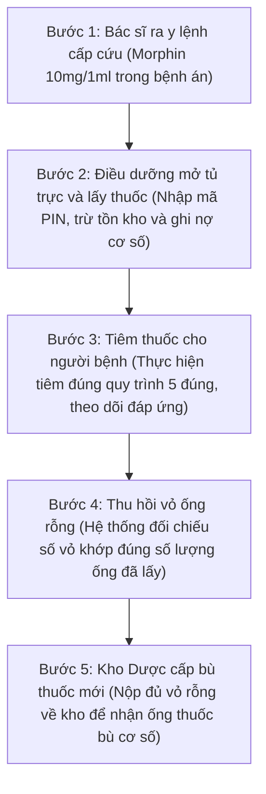
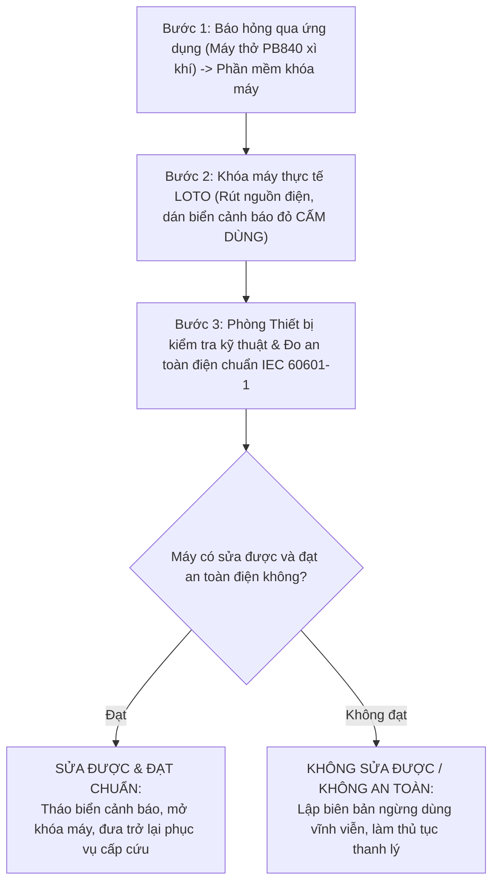
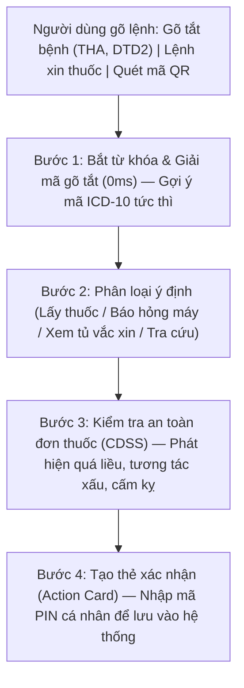

# BÁO CÁO TIẾN ĐỘ THỰC HIỆN DỰ ÁN — TUẦN 3
## HỆ THỐNG TRỢ LÝ LÂM SÀNG, QUẢN LÝ KHO DƯỢC VÀ THIẾT BỊ Y TẾ BỆNH VIỆN

- **Đồ án tốt nghiệp 2:** Ngành Công nghệ Thông tin
- **Sinh viên thực hiện:** **Trần Huy Hoàng** — MSSV: **20237337**
- **Thời gian báo cáo:** Tuần 3 (Tháng 10/2026)
- **Ứng dụng trực tuyến:** [clinical-ward.vercel.app](https://clinical-ward.vercel.app)
- **Mã nguồn:** [github.com/TontonYuta/clinical-ward](https://github.com/TontonYuta/clinical-ward)
- **Tài liệu quy định tham chiếu:** Thông tư 22/2011/TT-BYT (Dược lâm sàng), Thông tư 20/2017/TT-BYT (Thuốc gây nghiện), Thông tư 36/2018/TT-BYT (Bảo quản vắc xin), Nghị định 98/2021/NĐ-CP (Thiết bị y tế), Thông tư 23/2023/TT-BTC (Tài sản công), Chuẩn an toàn điện y tế IEC 60601-1.

---

## 🎯 Kết quả thực hiện chính trong tuần 3

| Phân hệ hoàn thành | Kiểm thử tự động | Độ trễ AI ngoại tuyến | Cảnh báo an toàn thuốc |
| :---: | :---: | :---: | :---: |
| **07 / 07** Phân hệ chính | **45 / 45** Kịch bản ($100\%$) | **0 ms** Phản hồi tức thì | **04** Tình huống nguy cơ |

Theo góp ý của giảng viên hướng dẫn và bác sĩ lâm sàng, tuần này em tập trung vào 3 nội dung cốt lõi:
1. **Quản lý thuốc tủ trực cấp cứu và bảo quản vắc xin:** Kiểm soát cơ số tủ trực, ghi nợ khi dùng và theo dõi thu hồi vỏ thuốc gây nghiện đối soát $1:1$ (Thông tư 20/2017); theo dõi nhiệt độ bảo quản vắc xin theo chỉ thị màu VVM (WHO).
2. **Quản lý thiết bị y tế và quy trình khi máy hỏng:** Quét mã QR kiểm kê máy móc, cảnh báo khi máy để sai khoa phòng và quy trình khóa an toàn LOTO (Lockout / Tagout) kiểm tra an toàn điện IEC 60601-1.
3. **Trợ lý chatbot hỗ trợ ra y lệnh ngoại tuyến (offline):** Xử lý nhanh $0\text{ms}$, tự động cảnh báo 4 lỗi kê đơn nguy hiểm (CDSS) và yêu cầu mã PIN cá nhân khi xác nhận xuất thuốc.

---

## 1. Bảng tổng hợp các công việc đã làm trong tuần 3

| STT | Hạng mục | Nội dung thực hiện chi tiết | Trạng thái |
| :---: | :--- | :--- | :---: |
| 1 | **Quản lý thuốc tủ trực** | Quản lý cơ số thuốc trong tủ trực cấp cứu, ghi nợ cơ số khi dùng và theo dõi thu hồi vỏ thuốc gây nghiện theo Thông tư 20/2017/TT-BYT. | Hoàn thành $100\%$ |
| 2 | **Quản lý thiết bị y tế** | Quét mã QR kiểm kê máy móc, cảnh báo khi máy để sai khoa phòng, tính hao mòn theo TT 23/2023/TT-BTC và ghi nhận báo hỏng. | Hoàn thành $100\%$ |
| 3 | **Giám sát chuỗi lạnh** | Theo dõi nhiệt độ tủ lạnh vắc xin ($2^\circ\text{C} - 8^\circ\text{C}$), nhận diện 4 mức chỉ thị nhiệt độ VVM theo WHO và ưu tiên dùng thuốc cận hạn trước (FEFO). | Hoàn thành $100\%$ |
| 4 | **Trợ lý AI và CDSS** | Chatbot xử lý ngoại tuyến nhanh ($0\text{ms}$), phát hiện 4 lỗi kê đơn nguy hiểm (CDSS) và yêu cầu mã PIN khi xác nhận xuất thuốc. | Hoàn thành $100\%$ |
| 5 | **Gõ tắt lâm sàng** | Bảng gõ tắt tên bệnh gợi ý nhanh mã ICD-10 (THA, DTD2, ...) và hoàn thiện giao diện bệnh án theo góp ý của bác sĩ. | Hoàn thành $100\%$ |
| 6 | **Kiểm thử tự động** | Chạy kiểm thử tự động 45 kịch bản thường gặp (lấy thuốc, báo hỏng máy, cảnh báo đơn thuốc, tra cứu), tỷ lệ vượt qua đạt $100\%$. | Đạt $45/45$ ($100\%$) |
| 7 | **Cải tiến giao diện** | Sửa lỗi cuộn trang trên máy tính (double scroll), dùng bảng màu dịu mắt khi trực đêm và tối ưu thao tác trên điện thoại. | Đã đưa vào dùng |

---

## 2. Quản lý thuốc tủ trực và theo dõi vắc xin

### 2.1. Quy trình xuất dùng thuốc gây nghiện và thu hồi vỏ rỗng (Thông tư 20/2017/TT-BYT)

Thuốc gây nghiện (như Morphin, Fentanyl) tại tủ trực khoa bắt buộc cất trong ngăn riêng có khóa. Khi lấy thuốc tiêm cho người bệnh, hệ thống tự động ghi nợ cơ số và theo dõi trả vỏ ống rỗng để Kho Dược cấp bù:

### 2.2. Theo dõi nhiệt độ bảo quản vắc xin và chỉ thị nhiệt độ VVM

Theo Thông tư 36/2018/TT-BYT và hướng dẫn của WHO, vắc xin cần bảo quản từ $+2^\circ\text{C}$ đến $+8^\circ\text{C}$. Trên lọ vắc xin có nhãn chỉ thị nhiệt độ VVM (Vaccine Vial Monitor) đổi màu theo nhiệt độ tích lũy:

| Mức chỉ thị | Màu sắc miếng dán VVM | Tình trạng chất lượng vắc xin | Cách xử lý |
| :---: | :--- | :--- | :--- |
| **Mức 1** | Ô vuông trong màu trắng, sáng hơn nhiều so với vòng tròn ngoài. | Vắc xin được bảo quản tốt, chưa bị nóng. | **Dùng bình thường** (Theo hạn dùng) |
| **Mức 2** | Ô vuông trong hơi sẫm màu nhưng vẫn sáng hơn vòng tròn ngoài. | Đã tiếp xúc với nhiệt độ môi trường ở mức cho phép, chất lượng còn tốt. | **Được phép dùng** (Ưu tiên dùng trước) |
| **Mức 3** | Ô vuông trong đổi màu tối bằng đúng màu vòng tròn ngoài. | Điểm giới hạn (Discard Point): Thuốc đã bị nóng, bắt đầu giảm tác dụng. | **Ngừng dùng ngay** |
| **Mức 4** | Ô vuông trong tối hơn hẳn so với vòng tròn ngoài. | Vắc xin đã bị hỏng do nhiệt độ cao. | **Hủy bỏ lập biên bản** |

### 2.3. Xuất thuốc theo hạn dùng (FEFO — Hạn gần dùng trước)
Hệ thống tự động xếp thuốc cận hạn lên đầu danh sách kê đơn. Thuốc còn hạn dưới 60 ngày sẽ đổi sang màu vàng để nhân viên y tế ưu tiên dùng trước, tránh để thuốc quá hạn gây lãng phí.

---

## 3. Quản lý thiết bị y tế và xử lý khi máy hỏng

### 3.1. Quét mã QR kiểm kê thiết bị y tế
- **Tự phát hiện máy để sai khoa phòng:** Đối chiếu vị trí thực tế quét được với vị trí trên sổ sách kế toán. Nếu phát hiện mượn chéo lệch khoa, hệ thống báo cờ vàng và tạo phiếu điều chuyển nội bộ.
- **Theo dõi hao mòn máy:** Tự động tính số năm đã dùng và tỷ lệ hao mòn tài sản theo Thông tư 23/2023/TT-BTC.

### 3.2. Quy trình khóa an toàn khi máy hỏng (Lockout / Tagout)

Khi máy thở hoặc máy theo dõi bị hỏng (xì khí, chập điện, lỗi cảm biến), nhân viên báo lỗi trên ứng dụng. Hệ thống chuyển máy sang trạng thái cảnh báo đỏ và kích hoạt quy trình khóa máy để không ai dùng nhầm cho bệnh nhân:

### 3.3. Phân loại thiết bị y tế theo mức độ rủi ro (Nghị định 98/2021/NĐ-CP)

| Mức rủi ro | Thiết bị ví dụ | Mục đích sử dụng lâm sàng | Yêu cầu kiểm tra an toàn |
| :---: | :--- | :--- | :--- |
| **Loại A** | Bơm tiêm, găng tay y tế | Dụng cụ tiêu hao thông thường, không can thiệp sâu. | Tiêu chuẩn cơ sở áp dụng |
| **Loại B** | Máy đo điện tim 3 cần | Theo dõi chẩn đoán gián tiếp ngoài da, không xâm lấn. | Đăng ký lưu hành tiêu chuẩn |
| **Loại C** | Máy sốc tim, monitor | Can thiệp cấp cứu, theo dõi nhịp tim người bệnh. | Kiểm tra an toàn điện hằng năm |
| **Loại D** | Máy thở chức năng cao | Hỗ trợ hoặc thay thế chức năng thở sống còn. | Kiểm định nghiêm ngặt IEC 60601-1 |

---

## 4. Trợ lý AI ngoại tuyến và cảnh báo an toàn kê đơn (CDSS)

### 4.1. Mô hình xử lý chatbot chạy ngoại tuyến (0ms)

Để đảm bảo ca trực cấp cứu vẫn tra cứu và ra lệnh được khi mất kết nối mạng Internet, chatbot chạy trực tiếp trên máy với các bước xử lý nội bộ:

### 4.2. 4 Cảnh báo an toàn thuốc quan trọng (CDSS)

| STT | Tình huống cảnh báo | Nguy cơ khi dùng sai | Cách hệ thống xử lý |
| :---: | :--- | :--- | :--- |
| 1 | **Kê quá liều thuốc Opioid** | Kê Morphin $\ge 30\text{mg}$ hoặc Fentanyl $\ge 100\mu\text{g}$ một lần, dễ gây ức chế hô hấp dẫn đến ngừng thở. | Bật cảnh báo đỏ khẩn cấp; nhắc chuẩn bị sẵn thuốc giải độc Naloxone 0.4mg. |
| 2 | **Tương tác thuốc xấu** | Kê cùng lúc thuốc giảm đau Morphin và thuốc an thần Diazepam, dễ gây hạ huyết áp và ức chế hô hấp sâu. | Cảnh báo tương tác; khuyên dùng cách nhau tối thiểu 4 giờ và theo dõi SpO2. |
| 3 | **Tiêm trực tiếp Kali Clorid 10%** | Tiêm tĩnh mạch trực tiếp dung dịch KCl 10% làm tăng kali máu đột ngột gây ngừng tim ngay lập tức. | **Chặn hoàn toàn**; bắt buộc phải pha loãng vào chai dịch truyền. |
| 4 | **Dị ứng chéo nhóm Penicillin** | Người bệnh có tiền sử dị ứng Penicillin nhưng kê Cephalosporin thế hệ 1, có nguy cơ gây sốc phản vệ. | Bật cảnh báo dị ứng; yêu cầu chuyển sang nhóm kháng sinh an toàn khác. |

### 4.3. 3 Điểm cải tiến bệnh án điện tử (theo góp ý của bác sĩ)
1. **Gõ tắt chẩn đoán nhanh:** Gõ `THA` tự điền "Tăng huyết áp vô căn (I10)", `DTD2` ra "Đái tháo đường type 2 (E11)", có nút sao chép diễn biến bệnh từ ngày trước giúp giảm $80\%$ thời gian nhập liệu.
2. **Xem lịch sử theo dòng thời gian (Timeline):** Hiển thị quá trình khám và biểu đồ nhịp tim, huyết áp dạng đồ thị dễ nhìn; cố định khung thông tin dị ứng màu đỏ ở góc màn hình để bác sĩ không bị bỏ sót.
3. **Cấu trúc dữ liệu theo chuẩn HL7 FHIR:** Thiết kế bảng dữ liệu tương thích với chuẩn trao đổi thông tin y tế quốc tế (`MedicationRequest`, `MedicationStatement`, `Observation`, `Condition`).

---

## 5. Kiểm thử tự động, giao diện người dùng và kế hoạch tuần 4

### 5.1. Kết quả kiểm thử tự động 45 kịch bản (45/45 Passed)

Các kịch bản hỏi đáp và cảnh báo an toàn được kiểm tra tự động qua file kiểm thử [`scripts/test_chatbot_suite.ts`](file:///home/tontonyuta/Downloads/DoAn2/scripts/test_chatbot_suite.ts):

| Nhóm | Nhóm kịch bản kiểm thử | Ví dụ câu lệnh kiểm thử | Kết quả |
| :---: | :--- | :--- | :---: |
| Nhóm 1 | Lấy thuốc tủ trực cấp cứu | "Cho 1 lọ morphin", "Lấy gấp 2 ống Fentanyl mổ 1" | Đạt $9 / 9$ ($100\%$) |
| Nhóm 2 | Báo hỏng máy và khóa LOTO | "Máy thở PB840 xì khí bẫy nước", "Máy hút dịch hỏng" | Đạt $8 / 8$ ($100\%$) |
| Nhóm 3 | Cảnh báo an toàn đơn thuốc | "Dùng 4 lọ morphin", "Tiêm trực tiếp 1 ống KCl 10%" | Đạt $8 / 8$ ($100\%$) |
| Nhóm 4 | Theo dõi nhiệt độ và hạn dùng | "Thuốc nào cận hạn dưới 60 ngày", "Tủ vắc xin bao độ" | Đạt $10 / 10$ ($100\%$) |
| Nhóm 5 | Tra cứu quy định và quét OCR | "Phác đồ phản vệ TT 51", "Quét hóa đơn dược phẩm" | Đạt $10 / 10$ ($100\%$) |
| **TỔNG KẾT** | **KIỂM THỬ:** | | **45 / 45 ($100\%$)** |

- **Đánh giá kết quả kỹ thuật:** Chatbot phản hồi tức thì ($0\text{ms}$), nhận diện đúng từ khóa của thuốc và máy móc, không bị nhầm lẫn giữa hai loại. Mọi lượt xuất thuốc và báo hỏng đều được lưu vết nhật ký kiểm toán bằng mã băm SHA-256 để chống sửa đổi dữ liệu.

### 5.2. Cải tiến giao diện người dùng (UI/UX)
- **Sửa lỗi cuộn trang trên máy tính (Double Scroll):** Cố định tiêu đề bảng dữ liệu (`sticky header`), chỉnh lại chiều cao dòng để màn hình laptop 14 inch xem được đầy đủ mà không phải cuộn chuột nhiều lần.
- **Màu sắc dịu mắt:** Dùng tông xanh Teal y tế (`teal-600`) nhẹ nhàng, phân chia rõ ràng các khối thông tin, tránh gây mỏi mắt cho bác sĩ và điều dưỡng khi trực ca đêm.
- **Tối ưu cho điện thoại di động:** Bảng dữ liệu tự đổi thành dạng thẻ (Card List) vuốt chạm mượt mà; thanh điều hướng đặt ở đáy màn hình để thuận tiện thao tác bằng ngón tay cái.

### 5.3. Kế hoạch trọng tâm Tuần 4 (Chuẩn bị bảo vệ đồ án)
1. **Chuẩn bị kịch bản Live Demo 15 phút:** Trình bày 3 tình huống chính: Lấy thuốc gây nghiện cấp cứu ban đêm, Tủ vắc xin bị mất điện, và Quét mã QR phát hiện máy thở để sai khoa phòng.
2. **Đóng gói mã nguồn và tài liệu:** Hoàn thiện mã nguồn trên GitHub, chạy thử môi trường Docker và in ấn tài liệu nộp cho Hội đồng chấm đồ án.

---
*Báo cáo tiến độ Tuần 3 được biên soạn bởi sinh viên Trần Huy Hoàng (MSSV: 20237337).*
