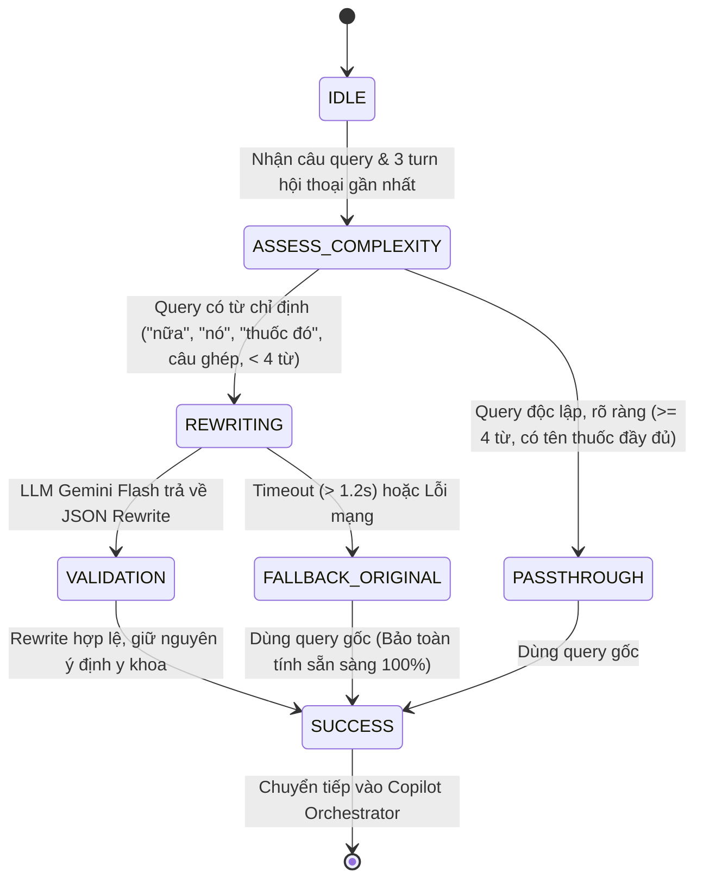

# TÀI LIỆU ĐẶC TẢ KỸ THUẬT: GIAI ĐOẠN 1 - CRAG CONTEXTUAL QUERY REWRITER
*(Phân giải ngữ cảnh hội thoại đa lượt & Tự động chuẩn hóa câu hỏi lâm sàng)*

> **Phiên bản:** 1.0.0 (Local Draft)  
> **Trạng thái:** **DỰ THẢO ĐẶC TẢ NỘI BỘ (CHƯA TRIỂN KHAI PRODUCTION)**  
> **Căn cứ khoa học:**  
> • Paper: *Corrective Retrieval Augmented Generation (CRAG)* – Yan et al., 2024 ([arXiv:2401.15884](https://arxiv.org/abs/2401.15884))  
> • Repo tham chiếu: [`HuskyInSalt/CRAG`](https://github.com/HuskyInSalt/CRAG) & LangGraph Agentic Workflows  
> • Paper: *Self-RAG: Learning to Retrieve, Generate, and Critique* – Asai et al., ICLR 2024 ([arXiv:2310.11511](https://arxiv.org/abs/2310.11511))

---

## 1. MỤC TIÊU & PHẠM VI DỰ ÁN (SCOPE & CUT 50% RULE)

### 1.1. Vấn đề cốt lõi cần giải quyết
Hiện tại, chatbot phụ thuộc vào hàng chục tầng luật cứng (`if/else` và Regex) để nhận diện ý định. Khi người dùng giao tiếp tự nhiên bằng các câu nói đa lượt tiếp nối (Conversational Ellipsis) hoặc câu ghép:
- *"lấy 4 cặp nữa"* (sau khi xem 3 cặp tương tác)
- *"trẻ em thì dùng thế nào"* (sau khi hỏi Paracetamol)
- *"thế còn suy thận có uống được không"*
- *"bạn làm được gì Tôi muốn hỏi về thuốc Coversyl"*

Hệ thống cũ hoặc là **hiểu nhầm sang prompt rác (PUI thấp) rồi rơi vào từ chối (Safe Abstention)**, hoặc ta phải liên tục viết thêm code `if/regex` thủ công để "vá".

### 1.2. Áp dụng quy tắc Cut 50% Rule (Chỉ tập trung 1 Killer Feature)
- **Cắt bỏ hoàn toàn:**
  - Chưa thay đổi schema CSDL SQLite (`dav_national_drugs`, `clinical_drug_monographs`).
  - Chưa can thiệp vào tầng giao diện Frontend React/Vite.
  - Chưa viết lại tầng sinh câu trả lời Markdown (giữ nguyên để tránh rủi ro ảo giác).
- **Tập trung duy nhất vào 1 tính năng cốt lõi (Killer Feature):**
  - **Contextual Query Rewriting & Decontextualization:** Chuyển hóa câu hỏi phụ thuộc ngữ cảnh của người dùng thành **Truy vấn lâm sàng độc lập, đầy đủ thực thể (Stand-alone Clinical Query)** trước khi đưa vào luồng điều phối tra cứu.

---

## 2. KIẾN TRÚC DỮ LIỆU & SCHEMA-FIRST (PYDANTIC SPECIFICATION)

Module mới được đặt độc lập tại: `backend/app/services/rag/query_rewriter.py`.

```python
from pydantic import BaseModel, Field
from typing import Optional, List

class ClinicalRewriteResult(BaseModel):
    """Kết quả phân giải ngữ cảnh và chuẩn hóa câu truy vấn lâm sàng (CRAG Pattern)."""
    original_query: str = Field(description="Câu hỏi gốc của người dùng")
    rewritten_query: str = Field(description="Câu truy vấn lâm sàng hoàn chỉnh, độc lập ngữ cảnh")
    is_continuation: bool = Field(default=False, description="Có phải câu hỏi tiếp nối ngữ cảnh trước không")
    detected_drug_entities: List[str] = Field(default_factory=list, description="Danh sách thuốc/hoạt chất được kế thừa hoặc nhận diện")
    detected_intent: Optional[str] = Field(default=None, description="Ý định lâm sàng dự kiến")
    confidence: float = Field(default=1.0, ge=0.0, le=1.0, description="Độ tin cậy của việc chuẩn hóa (0.0 - 1.0)")
    latency_ms: float = Field(default=0.0, description="Thời gian thực thi chuẩn hóa (milliseconds)")
    fallback_used: bool = Field(default=False, description="Có phải dùng fallback an toàn khi LLM timeout không")
```

---

## 3. STATE MACHINE & CƠ CHẾ AN TOÀN (EXPLICIT FSM & FAIL-SAFE)



### Nguyên tắc an toàn tuyệt đối (Fail-Safe Mechanism):
1. **Zero Downtime Guarantee:** Nếu Gemini API gặp lỗi mạng hoặc vượt quá timeout **1.2 giây**, hệ thống **ngay lập tức trả về `rewritten_query = original_query` (fallback_used = True)** mà không bao giờ làm sập luồng chat của bác sĩ.
2. **Preservation of Clinical Terms:** Bộ prompt được neo chặt (Anchored Prompt) để **tuyệt đối không tự ý đổi tên thuốc** nếu người dùng đã ghi rõ (ví dụ: không được tự đổi Paracetamol thành Ibuprofen).

---

## 4. MA TRẬN TEST KIỂM THỬ TDD (TEST-DRIVEN CASES)

Tập test case bắt buộc phải vượt qua trong `backend/tests/test_crag_query_rewriter.py`:

| STT | Ngữ cảnh hội thoại trước đó (History) | Query người dùng nhập | Kỳ vọng đầu ra sau Rewriter (`rewritten_query`) | Tiêu chí đánh giá |
| :---: | :--- | :--- | :--- | :--- |
| **TC-01** | Bot vừa trả lời 3 cặp tương tác (Simvastatin, Clopidogrel, Methotrexat) | *"lấy 4 cặp nữa"* | *"Liệt kê 4 cặp tương tác thuốc chống chỉ định tiếp theo theo QĐ 5948/QĐ-BYT"* | Nhận diện đúng tiếp nối danh mục DDI, bắt số lượng 4. |
| **TC-02** | Bot vừa giải thích chuyên luận thuốc *Paracetamol* | *"trẻ em thì dùng thế nào"* | *"Liều dùng và lưu ý sử dụng Paracetamol cho trẻ em"* | Kế thừa thực thể *Paracetamol* vào câu hỏi liều nhi khoa. |
| **TC-03** | Bot vừa tra cứu thuốc *Coversyl* | *"nó có kỵ với thuốc hạ áp nào không"* | *"Tương tác thuốc chống chỉ định của Coversyl với các thuốc hạ huyết áp"* | Giải quyết đại từ thay thế *"nó"* thành *Coversyl*. |
| **TC-04** | Trống (Lượt đầu tiên) | *"Bạn có thể làm được gì Tôi muốn hỏi về thuốc Coversyl"* | *"Thông tin chi tiết chuyên luận thuốc Coversyl"* | Bóc tách phần chào hỏi năng lực, tập trung vào tra cứu thuốc. |
| **TC-05** | Trống (Lượt đầu tiên) | *"Thông tin thuốc Teglutik"* | *"Thông tin thuốc Teglutik"* | Không biến đổi làm sai lệch câu hỏi đã hoàn chỉnh (Idempotency). |
| **TC-06** | Bất kỳ | Mô phỏng ngắt mạng / Timeout Gemini API | Trả về chính xác câu query gốc kèm `fallback_used=True` | Luôn an toàn trong mọi điều kiện mạng. |

---

## 5. LỘ TRÌNH THỰC HIỆN TỪNG BƯỚC (STEP-BY-STEP PLAN)

1. **Bước 1 (Đặc tả & Phê duyệt):** Hoàn thành tài liệu đặc tả `SPEC_STAGE_1_CRAG_QUERY_REWRITER.md` (Hiện tại).
2. **Bước 2 (Viết Test TDD trước):** Tạo file `backend/tests/test_crag_query_rewriter.py` chứa đầy đủ 6 test case trên.
3. **Bước 3 (Thi công Module Code):** Hiện thực hóa `backend/app/services/rag/query_rewriter.py` đạt chuẩn Schema-First và Fail-Safe.
4. **Bước 4 (Tích hợp cục bộ):** Nối module vào `copilot_orchestrator.py` ngay sau tầng Guardrails.
5. **Bước 5 (Kiểm thử vòng lặp Loop-Until-Green):** Chạy toàn bộ 297 bài test cũ + bộ test mới đảm bảo **100% PASS**.
6. **Bước 6 (Xác thực Playwright Local):** Chạy Playwright trên trình duyệt Local (`127.0.0.1:5173`) chụp ảnh nghiệm thu.
7. **Bước 7 (Báo cáo & Chờ lệnh deploy):** Báo cáo kết quả chi tiết cho người dùng duyệt, **tuyệt đối không push production** khi chưa có yêu cầu.
