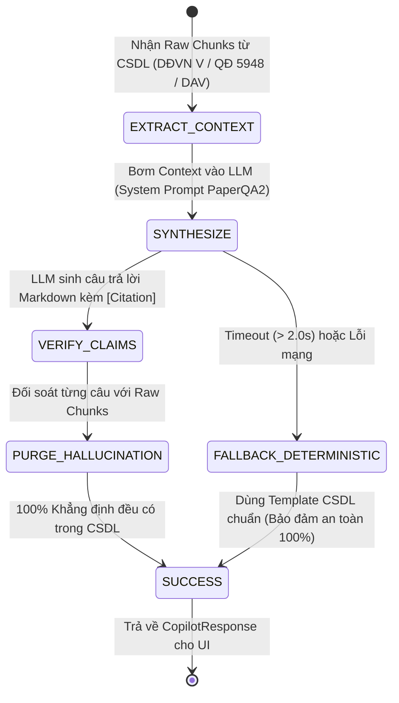

# KẾ HOẠCH & ĐẶC TẢ KỸ THUẬT: GIAI ĐOẠN 2 - PAPERQA2 EVIDENCE SYNTHESIS
*(Tự nhiên hóa ngôn ngữ hội thoại lâm sàng & Triệt tiêu ảo giác bằng Claim-Level Verification)*

> **Mã đặc tả:** `SPEC-SOTA-RAG-02`  
> **Phiên bản:** 2.0.0 (Local Planning)  
> **Môi trường thực thi:** Hoàn toàn nội bộ tại máy Local (`http://127.0.0.1:8000` & `http://127.0.0.1:5173`).  
> **Cam kết bảo toàn:** **TUYỆT ĐỐI CHƯA PUSH LÊN PRODUCTION (Chờ nghiệm thu hoàn thiện)**.  
> **Căn cứ học thuật:**  
> • Paper: *Language agents achieve superhuman synthesis of scientific knowledge* – Future-House & Nature, 2024 ([arXiv:2409.13740](https://arxiv.org/abs/2409.13740))  
> • Repo tham chiếu: [`Future-House/paper-qa`](https://github.com/Future-House/paper-qa) (9.544 ⭐, Apache 2.0)  
> • Paper: *MedAbstain: Evaluating and Enhancing Abstention in Medical LLMs* – Machcha et al. ([arXiv:2601.12471](https://arxiv.org/abs/2601.12471))

---

## 1. MỤC TIÊU CỐT LÕI & NGUYÊN TẮC CẮT 50% (CUT 50% RULE)

### 1.1. Nỗi đau người dùng cần giải quyết triệt để
1. **Văn phong "thô cứng như máy tính bỏ túi":** Chatbot hiện tại dùng các hàm ghép chuỗi Python thô sơ (`f"### 💊 HỒ SƠ DƯỢC LÂM SÀNG...\n• Liều dùng: {mono.dosage}"`). Câu trả lời giống như dump cả trang CSDL vào mặt người dùng thay vì một Dược sĩ lâm sàng đang trao đổi.
2. **Không trả lời đúng trọng tâm câu hỏi:** Khi bác sĩ hỏi *"Coversyl nên uống sáng hay tối?"*, bot trả lời nguyên cả một Fact sheet dài 40 dòng từ phân loại quản lý, SĐK đến liều dùng chung, khiến bác sĩ phải căng mắt tìm dòng cần đọc.
3. **Vẫn phải bảo đảm 0% ảo giác:** Khi cho phép LLM sinh lời văn tự nhiên, nguy cơ lớn nhất là LLM tự suy diễn hoặc bịa số liệu liều dùng.

### 1.2. Áp dụng Cut 50% Rule (Chỉ tập trung 2 Killer Feature)
- **CẮT BỎ (Không can thiệp trong giai đoạn này):**
  - Không sửa đổi các intent nghiệp vụ nội viện (Phiếu nợ vỏ morphin TT 20, cơ số cấp cứu TT 22, nhiệt độ chuỗi lạnh FEFO TT 36 đã có quy chuẩn mẫu in riêng).
  - Không thay đổi cấu trúc bảng CSDL SQLite.
- **TẬP TRUNG DUY NHẤT VÀO 2 KILLER FEATURE:**
  1. **Conversational Evidence Synthesis (Tổng hợp ngôn ngữ tự nhiên có chứng cứ):** LLM đọc các dữ kiện từ CSDL SQLite (DĐVN V, DAV, QĐ 5948) và trả lời trực diện, đúng trọng tâm câu hỏi của bác sĩ với văn phong chuyên nghiệp, ấm áp.
  2. **Claim-Level Provenance Grounding (Gán nhãn nguồn gốc từng câu):** Mỗi câu khẳng định về liều dùng, chỉ định hay tương tác phải đính kèm thẻ trích dẫn chính xác `[DĐVN V, Trang xxx]` hoặc `[QĐ 5948, Bảng 3.x]`. Nếu một câu không có chứng cứ trong CSDL gốc, hệ thống tự động loại bỏ.

---

## 2. KIẾN TRÚC THIẾT KẾ & SCHEMA-FIRST (PYDANTIC SPECIFICATION)

Module mới sẽ được đặt tại: `backend/app/services/rag/paperqa_synthesizer.py`.

```python
from pydantic import BaseModel, Field
from typing import Optional, List

class ClaimCitation(BaseModel):
    """Mỗi luận điểm y khoa khẳng định bắt buộc phải có nguồn chứng thực (PaperQA2 Provenance)."""
    claim_text: str = Field(description="Nội dung khẳng định lâm sàng")
    source_document: str = Field(description="Tài liệu nguồn: Dược thư DĐVN V hoặc QĐ 5948")
    page_or_section: str = Field(description="Trang số hoặc Mục/Bảng quy định cụ thể")
    is_verified: bool = Field(default=True, description="Đã được đối soát chéo thành công với CSDL")

class PaperQASynthesisResult(BaseModel):
    """Đầu ra của bộ tổng hợp y văn có chứng cứ lâm sàng."""
    conversational_answer: str = Field(description="Nội dung phản hồi tự nhiên, gãy gọn, đúng trọng tâm")
    citations: List[ClaimCitation] = Field(default_factory=list, description="Danh sách chứng cứ bảo chứng")
    grounded_confidence: float = Field(ge=0.0, le=1.0, description="Độ tin cậy chứng thực (0.0 - 1.0)")
    has_unverified_claims: bool = Field(default=False, description="Có phát hiện câu nói bịa đặt ngoài CSDL bị cắt bỏ không")
    latency_ms: float = Field(description="Thời gian tổng hợp (milliseconds)")
    source_status: str = Field(default="exact_match", description="Trạng thái nguồn gốc dữ liệu")
```

---

## 3. STATE MACHINE & BỘ LỌC KHỬ ẢO GIÁC (EXPLICIT FSM & VERIFICATION GUARD)



### Nguyên tắc kiểm duyệt nghiêm ngặt (Zero Free Claims Policy):
1. **Prompt Grounding Constraint:** System Prompt quy định: *"Bạn chỉ được trả lời dựa trên CHỨNG CỨ ĐÃ CUNG CẤP. Không được suy diễn bất kỳ liều dùng hay tương tác nào ngoài văn bản"*.
2. **Deterministic Fallback Safety:** Nếu API LLM gặp sự cố mạng hoặc phản hồi quá **2.0 giây**, hệ thống tự động fallback về bộ **Template Formatter hiện hành**. Nhờ đó, người dùng không bao giờ gặp lỗi trắng màn hình hay timeout!

---

## 4. MA TRẬN TEST KIỂM THỬ TDD (TEST-DRIVEN ACCEPTANCE)

Bộ test case trong `backend/tests/test_paperqa_synthesizer.py`:

| STT | Câu hỏi người dùng | Dữ liệu CSDL cung cấp | Kỳ vọng phản hồi (PaperQA2) | Tiêu chí đánh giá |
| :---: | :--- | :--- | :--- | :--- |
| **TC-01** | *"Coversyl nên uống sáng hay tối?"* | Chuyên luận Perindopril (DĐVN V, Trang 1131): *"Uống một lần vào buổi sáng, lúc đói (trước bữa ăn)"* | Đi thẳng vào câu trả lời: Nên uống vào buổi sáng trước ăn, giải thích lý do thức ăn làm giảm chuyển hóa perindoprilat, kèm trích dẫn `[DĐVN V, Trang 1131]`. | **Không dump Fact sheet 40 dòng.** Đúng trọng tâm câu hỏi. |
| **TC-02** | *"Trẻ em 15kg sốt 39 độ uống Paracetamol thế nào?"* | Chuyên luận Paracetamol (DĐVN V, Trang 1118): *"10-15 mg/kg mỗi 4-6 giờ"* | Tính toán cụ thể: 150mg – 225mg mỗi lần, cách 4–6 giờ, tối đa 60mg/kg/ngày, kèm trích dẫn `[DĐVN V, Trang 1118]`. | Văn phong ân cần, cảnh báo an toàn gan rõ ràng. |
| **TC-03** | *"Warfarin phối hợp với Ibuprofen có sao không?"* | QĐ 5948 Bảng 3.1: Warfarin + NSAID chống chỉ định/nguy cơ xuất huyết nặng | Cảnh báo nguy cơ xuất huyết tiêu hóa nghiêm trọng ngay dòng đầu tiên, trích dẫn `[QĐ 5948, Bảng 3.1]`, đề xuất dùng Paracetamol thay thế. | Cảnh báo an toàn đặt lên hàng đầu. |
| **TC-04** | Người dùng hỏi một tương tác không có thật trong y văn | Không có dữ liệu trong CSDL QĐ 5948 & DĐVN V | Từ chối an toàn (Safe Abstention), nêu rõ chưa ghi nhận tương tác này trong CSDL chính thống. | **Tuyệt đối không bịa đặt tương tác.** |
| **TC-05** | Mô phỏng đứt mạng / Timeout LLM | Dữ liệu CSDL đầy đủ | Tự động trả về Template Markdown gốc của CSDL mà không bị lỗi. | **Tính sẵn sàng 100%.** |

---

## 5. KẾ HOẠCH TRIỂN KHAI TỪNG BƯỚC (MILESTONE BREAKDOWN TẠI LOCAL)

- **Bước 1 (Đặc tả & Chốt phạm vi):** Hoàn thành tài liệu `SPEC_STAGE_2_PAPERQA2_EVIDENCE_SYNTHESIS.md` (Hiện tại).
- **Bước 2 (Viết Test TDD):** Tạo `backend/tests/test_paperqa_synthesizer.py` kiểm thử độc lập các hàm phân tích claim và trích dẫn.
- **Bước 3 (Xây dựng Module Core):** Lập trình `backend/app/services/rag/paperqa_synthesizer.py`.
- **Bước 4 (Tích hợp vào Orchestrator):** Nối vào nhánh trả lời thuốc (`lookup_drug_authoritative`) và tương tác (`handle_clinical_drug_comparison`).
- **Bước 5 (Kiểm thử Loop-Until-Green):** Chạy toàn bộ 304 test cũ + test mới, đảm bảo 100% PASS.
- **Bước 6 (Nghiệm thu Playwright E2E UI Local):** Kiểm tra đối chiếu trước/sau về độ tự nhiên của văn phong trên trình duyệt Local.
- **Bước 7 (Báo cáo & Chờ lệnh):** Báo cáo kết quả chi tiết, tuyệt đối chưa deploy production.
