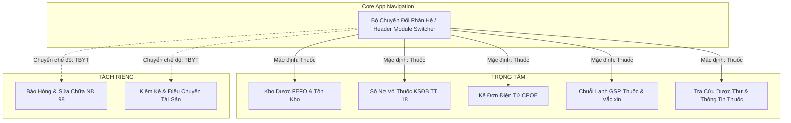

# ĐẶC TẢ YÊU CẦU & PHẠM VI (SPEC.MD)
## Phân Tách Độc Lập Phân Hệ Thuốc & Trang Thiết Bị Y Tế (TBYT)

> [!IMPORTANT]
> **Quyết định Chiến lược Sản phẩm (Cut 50% Rule & MoSCoW Scoping):**
> Nhằm tập trung tối đa nguồn lực vào nghiệp vụ nhạy cảm và phức tạp nhất trong bệnh viện — **DƯỢC & THUỐC LÂM SÀNG**, hệ thống được cấu trúc lại để **tách rời hoàn toàn** 2 phân hệ:
> 1. **Phân hệ Dược & Thuốc Lâm Sàng (Clinical Pharmacy Core)**: Trở thành phân hệ trung tâm mặc định (Primary Focus).
> 2. **Phân hệ Trang Thiết Bị Y Tế (Biomedical Engineering - BME)**: Tách thành phân hệ riêng biệt (Decoupled Module), không làm xáo trộn luồng nghiệp vụ của Dược sĩ và Điều dưỡng.

---

## 1. Phân Rã Phạm Vi Nghiệp Vụ Theo Chuẩn MoSCoW

### M - Must Have (Tập Trung 100% Vào Thuốc - Killer Features)
- **1. Kho Dược FEFO & Tồn Kho Tối Thiểu (Thông tư 22/2011/TT-BYT)**:
  - Theo dõi hạn dùng xuất trước (First Expired, First Out).
  - Cảnh báo thuốc cận hạn (<60 ngày) và chạm ngưỡng cơ số an toàn (Min threshold).
  - Lập phiếu dự trù bổ sung cơ số tủ trực (Mẫu 01).
- **2. Quản Lý Thuốc Kiểm Soát Đặc Biệt & Sổ Nợ Vỏ Ống (Thông tư 18/2026/TT-BYT)**:
  - Quản lý nghiêm ngặt Morphin, Fentanyl, Diazepam (Gây nghiện, Hướng thần, Tiền chất).
  - Quy trình mượn khẩn cấp buồng mổ/cấp cứu $\to$ Ký xác nhận đối soát $\to$ Thu hồi vỏ rỗng 100% $\to$ Biên bản hủy vỏ ống có hội đồng.
- **3. Chuyên Luận Thông Tin Thuốc & Dược Thư Lâm Sàng (QĐ 2147/QĐ-BYT & DĐVN V)**:
  - Hoạt chất chính (API), hàm lượng, dạng bào chế, danh mục tá dược đầy đủ.
  - Chỉ định ("Dùng để làm gì?"), cơ chế dược lực (MoA).
  - Cảnh báo dị ứng, dị ứng chéo (Cross-reactivity) và phác đồ Adrenalin (Thông tư 51/2017/TT-BYT).
  - Liều dùng chuẩn, liều tối đa 24 giờ (Hard-stop limit), chỉnh liều suy thận/suy gan.
  - Nguồn gốc trích xuất chính xác theo Số đăng ký (SĐK) của Cục Quản lý Dược và Dược thư Quốc gia Việt Nam 2022.
- **4. Kê Đơn Thuốc Điện Tử CPOE & Cảnh Báo An Toàn CDSS**:
  - Hỗ trợ bác sĩ kê đơn theo tên Tall Man LASA.
  - Cảnh báo tương tác thuốc nghiêm trọng (DDI) và quá liều Opioid thời gian thực.
- **5. Chuỗi Lạnh Bảo Quản Thuốc & Vắc Xin GSP**:
  - Giám sát nhiệt độ $2^\circ\text{C} - 8^\circ\text{C}$ tủ lạnh bảo quản sinh phẩm, vắc xin, insulin.
- **6. Trợ Lý AI Chuyên Sâu Dược Lâm Sàng**:
  - Tối ưu hóa phản hồi thông tin thuốc, liều dùng, thành phần và cấp phát thuốc tủ trực.

---

### S - Should Have (Tách Riêng Biệt Phân Hệ TBYT)
- Tách các tab **Sự Cố Thiết Bị (Equipment Incidents - NĐ 98)** và **Kiểm Kê Tài Sản (Asset Audit)** sang một Chế độ/Module độc lập (BME Portal).
- Khi người dùng ở Phân hệ Thuốc, giao diện hoàn toàn tinh gọn, không bị pha trộn các nút sự cố máy móc hay tài sản.

---

### C - Could Have (Mở Rộng Tương Lai)
- Kết nối đồng bộ tự động danh mục 40.000 SĐK từ Cổng Dịch vụ công Cục Quản lý Dược.
- Quét hóa đơn dược phẩm tự động bằng OCR hóa đơn VAT.

---

### W - Won't Have (Loại Bỏ Khỏi Phạm Vi Hiện Tại)
- Quản trị bảo dưỡng định kỳ máy móc hạng nặng (CT/MRI/X-Quang).
- Quản lý tài sản văn phòng/phi y tế.

---

## 2. Kiến Trúc Tách Phân Hệ (Decoupled Module Architecture)

---

## 3. Lộ Trình Triển Khai (Roadmap)
1. **Milestone 1**: Cấu hình Chế độ làm việc (Module Switcher: Thuốc vs TBYT). Mặc định 100% giao diện hiển thị chuyên biệt về Thuốc.
2. **Milestone 2**: Tinh giản Sidebar và Dashboard — khi chọn Phân hệ Thuốc, chỉ hiển thị 4 tab Dược cốt lõi (`fefo`, `debt`, `cpoe`, `coldchain`) và nút Tra cứu Thông tin thuốc.
3. **Milestone 3**: Tối ưu Chatbot AI chuyên biệt hóa cho Dược thư, thành phần hoạt chất, liều lượng và an toàn người bệnh.
